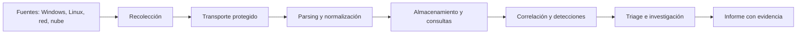
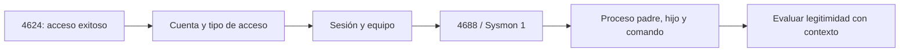
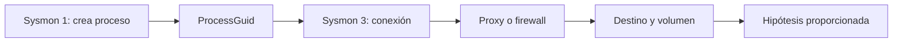
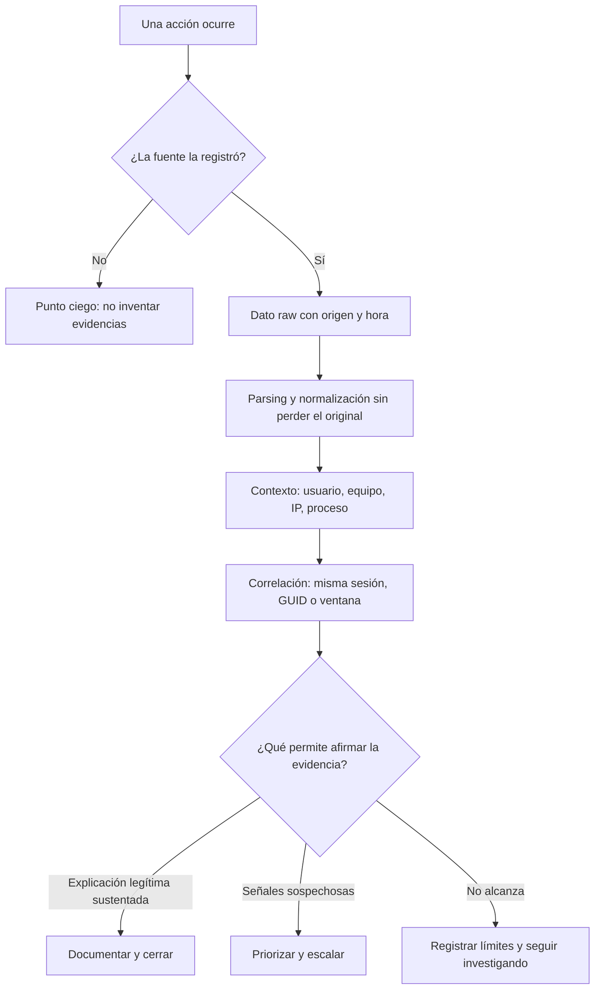

# Unidad 11 — Logs, telemetría y análisis de eventos para Blue Team / SOC L1

> Apuntes personales de estudio · Blue Team, análisis de evidencias y SOC L1
>
> **Estado:** apuntes de estudio completos; los los casos resueltos se basan en registros.
>
> **Seguridad:** usar equipos propios, entornos de práctica o sistemas con autorización. No subir IP privadas reales, tokens, credenciales, nombres de personas o registros sensibles al repositorio público.

## Cómo uso esta guía

La idea de esta unidad es aprender a pasar de «veo un mensaje en un log» a «puedo reconstruir qué pasó, qué no sé todavía y qué haría para comprobarlo». No hay que memorizar treinta eventos de memoria. Hay que aprender a leer campos, hacer una línea de tiempo, unir fuentes, entender los límites de cada registro y escribir una conclusión proporcionada a la evidencia.

**Lo que ya debería conocer:** Windows/Linux básicos, PID y PPID, autenticaciones 4624/4625, Sysmon, permisos, hash SHA-256 y nociones de redes. Todo eso lo vimos en la Unidad 10.

**Al terminar espero poder:** identificar fuentes; extraer logs de forma razonable; distinguir marca horaria de recepción; normalizar un evento; correlacionar por usuario, host, IP, ProcessGuid, LogonId y tiempo; evaluar cobertura; escribir detecciones simples; priorizar un ticket; conservar las evidencias sin alterarlas; y redactar un informe de investigación.

### El criterio que trato de mantener cuando investigo

- **Dato:** lo que efectivamente dice un registro.
- **Observación:** mi lectura descriptiva de uno o varios datos.
- **Hipótesis:** una explicación posible, que todavía tengo que contrastar.
- **Conclusión:** lo que puedo sostener, con su grado de confianza y límites.
- **Acción:** lo que corresponde hacer según procedimiento, criticidad y autorización.

Un evento sospechoso no es igual a un compromiso confirmado. Una ausencia de logs tampoco demuestra que «no pasó nada».

### Temario general

1. Introducción a observabilidad y telemetría.
2. Fuentes y formatos de eventos.
3. Windows Event Log, auditoría y Sysmon.
4. Linux: syslog, journald y auditd.
5. Logs de redes, DNS, proxy, firewall, HTTP, cloud e identidad.
6. Arquitectura de recolección y almacenamiento.
7. Calidad, parsers, normalización, UTC y enriquecimiento.
8. Consultas, filtros, agregación y correlación.
9. Investigación SOC, hipótesis y línea de tiempo.
10. Detecciones, reglas, falsas alarmas y cobertura.
11. Conservación forense y presentación de resultados.
12. Casos de estudio completos, con registros sintéticos y análisis resueltos.
13. Profundización técnica de lectura y correlación.
14. Historia de la gestión de logs y casos públicos.
15. Glosario técnico con advertencias comunes.

## Mapa conceptual de la unidad (aprendi esto nuevo)



**Lectura:** una mala detección puede ser problema de regla; también puede ser problema de fuente, transporte, parser o reloj. Para investigarlo bien hay que pensar todo el recorrido.

---

# Bloque: Fundamentos

En este bloque voy de los conceptos a la práctica. La meta no es repetir definiciones: quiero poder explicarlo con un log adelante y decir qué sé, qué no sé y qué consulta haría después.

## Qué es un log

Un log es un registro de un evento que una fuente decidió emitir. Puede describir una autenticación, una consulta DNS, una creación de proceso o un error de aplicación. No representa la realidad completa: representa la parte que quedó registrada.

**Para entenderlo en un SOC:** Separar mensaje, metadatos, fuente, hora y actor; comprobar si el evento existe por configuración o por defecto.

**Un ejemplo para bajarlo a tierra:** Un servicio falla y deja un mensaje de error: no asumir ataque; consultar causa, frecuencia y cambios recientes.

## Evento, registro y alerta

Evento es una ocurrencia; registro es su representación almacenada; alerta es el resultado de una regla o análisis que decide llamar la atención sobre uno o varios eventos.

**Para entenderlo en un SOC:** Identificar cuál parte es dato crudo y cuál fue producida por el SIEM o la herramienta de detección.

**Un ejemplo para bajarlo a tierra:** Cien 4625 pueden activar una alerta; la alerta no reemplaza los cien eventos originales.

## Telemetría y observabilidad

Telemetría es la información que sistemas y herramientas generan sobre actividad y estado. Observabilidad es nuestra capacidad de explicar un sistema a partir de señales; además de logs puede incluir métricas y trazas.

**Para entenderlo en un SOC:** No confundir métricas agregadas con evidencia de una acción puntual; combinar señales.

**Un ejemplo para bajarlo a tierra:** Un pico de CPU es una métrica: los procesos, servicios y eventos explican posibles causas.

## Visibilidad y puntos ciegos

Si un agente está apagado, un registro rota o una política no captura un campo, la investigación queda incompleta. Lo que no se ve no es necesariamente lo que no sucedió.

**Para entenderlo en un SOC:** Documentar qué cubre cada sensor y qué fecha tiene el último evento recibido.

**Un ejemplo para bajarlo a tierra:** Si falta Sysmon en un host, no afirmar que no hubo procesos sospechosos.

## Eventos como evidencia contextual

Cada dato gana valor al cruzarlo con usuario, host, tipo de sesión, proceso, red y hora. De forma aislada, muchos eventos tienen explicaciones inocentes.

**Para entenderlo en un SOC:** Buscar confirmaciones independientes y contrastar con línea base.

**Un ejemplo para bajarlo a tierra:** Una IP extranjera puede ser VPN corporativa; validar primero el origen real.

## Logs, métricas y trazas distribuidas

Los logs narran hechos, las métricas muestran magnitudes a lo largo del tiempo y las trazas ayudan a seguir una solicitud entre servicios. No son intercambiables.

**Para entenderlo en un SOC:** Unir identificadores de petición y correlacionarlos con spans o errores de aplicaciones.

**Un ejemplo para bajarlo a tierra:** Un error 500 con trace-id puede relacionarse con la llamada a una base de datos.

---

# Bloque: Formato y tiempo

En este bloque voy de los conceptos a la práctica. La meta no es repetir definiciones: quiero poder explicarlo con un log adelante y decir qué sé, qué no sé y qué consulta haría después.

## Campos mínimos de un evento

Me conviene encontrar timestamp, host, proveedor, categoría, nivel, mensaje, usuario, IP y resultado. No todos están presentes; lo tengo que verificar, no inventar.

**Para entenderlo en un SOC:** Identificar event_id, record_id, hostname, channel, provider y raw_message cuando existan.

**Un ejemplo para bajarlo a tierra:** Un JSON con solo message y timestamp sirve, pero limita una correlación precisa.

## JSON y JSON Lines

JSON es un formato estructurado; JSONL usa un objeto JSON por línea. Es muy útil para procesar logs con Python, jq y pipelines.

**Para entenderlo en un SOC:** Distinguir entre JSON array y JSON Lines antes de intentar parsear.

**Un ejemplo para bajarlo a tierra:** Si cada línea es un objeto independiente, json.load del archivo completo puede fallar.

## CSV, delimitadores y comillas

Un CSV puede contener comas dentro de campos, escapado y saltos de línea. Separar a mano por coma suele romper el parseo.

**Para entenderlo en un SOC:** Usar módulo csv en Python y verificar cabeceras, codificación y cantidad de columnas.

**Un ejemplo para bajarlo a tierra:** Una línea de comandos de PowerShell puede contener comas; eso no significa columnas nuevas.

## Syslog conceptual

Syslog transporta y representa mensajes de muchos dispositivos y servicios. Variantes y formatos pueden diferir; nunca presupongo que todas las fuentes tienen idénticos campos.

**Para entenderlo en un SOC:** Reconocer facility, severity, timestamp y hostname según origen; confirmar si usa RFC 3164 o 5424.

**Un ejemplo para bajarlo a tierra:** Un router puede enviar mensajes UDP y perderlos bajo saturación; eso afecta cobertura.

## Timestamps y tiempo del evento

La hora del evento indica cuándo la fuente cree que pasó algo; no siempre coincide con la hora de recolección o indexación. Hay relojes desajustados y buffers.

**Para entenderlo en un SOC:** Guardar event_time, ingestion_time y zona horaria por separado.

**Un ejemplo para bajarlo a tierra:** Una entrada creada a las 08:02 e ingerida a las 08:11 puede cambiar el orden aparente.

## UTC, offset y DST

UTC simplifica correlaciones entre hosts; no debo confundir -03:00 con Z. Los cambios de horario de verano dependen de la región y la fecha.

**Para entenderlo en un SOC:** Normalizar a UTC sin perder timestamp original y offset observado.

**Un ejemplo para bajarlo a tierra:** 2026-10-20T10:00:00-03:00 equivale a 13:00:00Z.

## Latencia de ingestión

El tiempo entre emisión e ingestión sirve para medir salud del pipeline. Si se atrasa puede crear detecciones tardías o falsos huecos.

**Para entenderlo en un SOC:** Medir percentiles de atraso por fuente y alarmar cuando excede lo esperado.

**Un ejemplo para bajarlo a tierra:** Un agente desconectado vuelve y manda eventos históricos todos juntos.

## Duplicados y secuencias

La entrega al menos una vez puede duplicar mensajes. Deduplicar ciegamente por texto puede borrar eventos distintos con igual mensaje.

**Para entenderlo en un SOC:** Combinar host, provider, record_id, timestamp y campos clave, si hay garantía de estabilidad.

**Un ejemplo para bajarlo a tierra:** Dos eventos 4625 idénticos en texto pueden ser dos intentos reales.

## Campos ausentes o nulos

Campo ausente significa que no está; valor null significa que se modeló sin valor; cadena vacía puede tener otro significado.

**Para entenderlo en un SOC:** Consultar esquema de origen antes de asumir equivalencias.

**Un ejemplo para bajarlo a tierra:** Una IP que figura como - no se reemplaza automáticamente por 0.0.0.0.

## Severidad vs criticidad

El nivel ERROR de una aplicación no equivale a una alerta SOC crítica. Severidad técnica y riesgo de negocio se evalúan con criterios distintos.

**Para entenderlo en un SOC:** Priorizar según activo, evidencia, impacto, alcance, confianza y posibilidad de abuso.

**Un ejemplo para bajarlo a tierra:** Un login fallido aislado es menos urgente que el uso inesperado de cuenta privilegiada.

---

# Bloque: Windows y Sysmon

En este bloque voy de los conceptos a la práctica. La meta no es repetir definiciones: quiero poder explicarlo con un log adelante y decir qué sé, qué no sé y qué consulta haría después.(es un tema que pior ahi ya se que es repetitivo y denso pero que se referencia mucho despues)

## Canales de Windows Event Log

Security, System, Application y canales de aplicaciones o proveedores tienen propósitos distintos. Los eventos dependen de versiones, políticas y configuración.

**Para entenderlo en un SOC:** Comprobar fuente, EventID y Channel; no mezclar un ID de Sysmon con uno de Security.

**Un ejemplo para bajarlo a tierra:** EventID 1 de Sysmon es creación de proceso; EventID 1 de otro proveedor puede significar otra cosa.

## 4624: autenticación exitosa

4624 registra autenticación exitosa, no legitimidad humana. Conviene mirar LogonType, cuenta, origen y LogonId.

**Para entenderlo en un SOC:** Correlacionar con 4625, 4672, actividad posterior y dispositivos conocidos.

**Un ejemplo para bajarlo a tierra:** LogonType 3 es red; 10 suele ser remoto interactivo; 5 es servicio.

## 4625: autenticación fallida

4625 ayuda a ver intentos fallidos, sus estados y patrones. Puede faltar IP según el método de autenticación; eso no invalida el evento.

**Para entenderlo en un SOC:** Agrupar por usuario, host origen, IP, tipo de login y ventanas cortas, cuidando NAT.

**Un ejemplo para bajarlo a tierra:** Muchos usuarios con un intento cada uno desde mismo origen pueden sugerir password spraying.

## 4688: creación de proceso

La auditoría de creación de procesos puede producir 4688. La línea de comandos depende de configuración específica; un evento sin command line no prueba evasión.

**Para entenderlo en un SOC:** Leer NewProcessName, NewProcessId, ParentProcessName y CommandLine si está.

**Un ejemplo para bajarlo a tierra:** Una ejecución administrativa nocturna se contrasta con cambio aprobado y usuario.

## 4672 y privilegios especiales

4672 indica asignación de privilegios especiales durante un nuevo logon; no es por sí solo una elevación maliciosa.

**Para entenderlo en un SOC:** Relacionar con LogonId, tipo de sesión, cuenta y actividad posterior.

**Un ejemplo para bajarlo a tierra:** Una cuenta de servicio legítima puede generar eventos 4672 de forma recurrente.

## 1102: limpieza de auditoría

1102 señala limpieza del registro Security. Puede ser autorizada, accidental o maliciosa.

**Para entenderlo en un SOC:** Investigar identidad que lo ejecutó, ticket y brecha de registros previa/posterior.

**Un ejemplo para bajarlo a tierra:** La limpieza tras una sesión sospechosa aumenta prioridad, pero requiere corroboración.

## Sysmon ID 1: creación de proceso

Sysmon registra ProcessGuid, ParentProcessGuid, Image, CommandLine y más según configuración; es telemetría muy útil para árboles de procesos.

**Para entenderlo en un SOC:** Evitar correlacionar solo por PID: pueden reciclarse.

**Un ejemplo para bajarlo a tierra:** WINWORD.EXE que crea powershell.exe exige contexto de documento y comando.

## Sysmon ID 3: conexión de red

Event ID 3 se dedica a conexiones de red y depende de configuración; no todos los sistemas lo tienen habilitado.

**Para entenderlo en un SOC:** Cruzar ProcessGuid, IP, puertos y dirección con proceso y DNS.

**Un ejemplo para bajarlo a tierra:** Un binario firmado puede hacer conexiones atípicas y merece revisión.

## Sysmon ID 7: carga de imagen

Este evento registra image load cuando está activado; su volumen puede ser alto. No todo DLL cargado es sospechoso.

**Para entenderlo en un SOC:** Comparar ruta, firma, módulo y patrón esperado del proceso.

**Un ejemplo para bajarlo a tierra:** Una DLL fuera de carpeta habitual puede justificar investigar search order hijacking.

## Sysmon ID 11: creación de archivo

Event ID 11 informa creación de archivos según configuración. Es útil en secuencias de ejecución y escritura de artefactos.

**Para entenderlo en un SOC:** Correlacionar creación con proceso responsable, ruta y tiempo.

**Un ejemplo para bajarlo a tierra:** Un script crea una tarea o descarga un archivo: buscar el evento de ejecución anterior.

## Sysmon ID 22: DNS

DNS query events brindan asociación entre proceso y dominio cuando la configuración lo permite.

**Para entenderlo en un SOC:** Unir con conexión de red y reputación contextual sin tomarla como prueba absoluta.

**Un ejemplo para bajarlo a tierra:** Un dominio recién observado puede ser actualización legítima o parte de una amenaza.

## PowerShell Logging

Module Logging, Script Block Logging y transcription tienen propósitos, coberturas y riesgos de datos distintos.

**Para entenderlo en un SOC:** Ver qué política está habilitada, proteger registros y evitar exponer secretos en reportes.

**Un ejemplo para bajarlo a tierra:** Un script codificado en command line requiere analizar contenido de forma segura, sin ejecutarlo.

---

# Bloque: Linux

En este bloque voy de los conceptos a la práctica. La meta no es repetir definiciones: quiero poder explicarlo con un log adelante y decir qué sé, qué no sé y qué consulta haría después.

## syslog y archivos tradicionales

Según distribución, rsyslog/syslog-ng pueden escribir /var/log/auth.log, /var/log/secure, messages u otras rutas.

**Para entenderlo en un SOC:** No asumir que una ruta existe siempre: primero identificar distro y configuración.

**Un ejemplo para bajarlo a tierra:** La ausencia de auth.log no significa ausencia de autenticaciones.

## systemd-journald

journald recibe mensajes estructurados del sistema y servicios. Persistencia y retención dependen de configuración.

**Para entenderlo en un SOC:** Usar journalctl sin modificar evidencia y exportar a un formato adecuado.

**Un ejemplo para bajarlo a tierra:** journalctl --since permite ventana temporal; -b selecciona arranque.

## journalctl filtros temporales

--since y --until delimitan tiempo; -b -1 accede al arranque anterior si está retenido; --utc ayuda a comparar.

**Para entenderlo en un SOC:** Fijar zona horaria y ventana explícita en el informe.

**Un ejemplo para bajarlo a tierra:** Un evento parece ocurrir después de otro por zonas horarias distintas.

## journalctl por unidad y prioridad

-u filtra unidad, -p filtra prioridad y -o json presenta estructura. Las opciones de lectura son preferibles durante análisis.

**Para entenderlo en un SOC:** Distinguir journalctl -u ssh de systemctl restart ssh: uno consulta, otro modifica.

**Un ejemplo para bajarlo a tierra:** Una investigación SSH puede empezar por los registros de unidad ssh o sshd según distro.

## auditd y auditctl

Linux Audit permite registrar operaciones según reglas y configuración. auditd transporta/gestiona eventos; auditctl interactúa con el subsistema.

**Para entenderlo en un SOC:** Validar reglas activas, claves y cobertura antes de prometer que un acceso quedó auditado.

**Un ejemplo para bajarlo a tierra:** La ausencia de un evento PATH puede deberse a reglas que no observaban esa ruta.

## ausearch y aureport

ausearch busca registros de audit y aureport ayuda a resumir. El formato de auditoría puede agrupar varios registros en un mismo evento.

**Para entenderlo en un SOC:** Correlacionar por identificador de evento y no contar cada registro como incidente separado.

**Un ejemplo para bajarlo a tierra:** Un evento execve puede tener registros SYSCALL, EXECVE, CWD y PATH relacionados.

## SSH, PAM y sudo

Los mensajes de sshd, PAM y sudo ayudan a detectar accesos y cambios de identidad; necesitan contexto.

**Para entenderlo en un SOC:** Cruzar usuario, TTY, servicio, origen, hora y comandos ejecutados.

**Un ejemplo para bajarlo a tierra:** Muchos fallos SSH pueden ser un escáner habitual y no compromiso.

## cron y unidades systemd

Cron y timers de systemd ejecutan tareas previstas; también pueden ser mecanismos de persistencia.

**Para entenderlo en un SOC:** Comparar cambios con baseline, propietario y autorización.

**Un ejemplo para bajarlo a tierra:** Un timer nuevo que inicia un binario desconocido requiere revisar configuración.

---

# Bloque: Red y aplicación

En este bloque voy de los conceptos a la práctica. La meta no es repetir definiciones: quiero poder explicarlo con un log adelante y decir qué sé, qué no sé y qué consulta haría después.

## Firewall y flujos

Registros de firewall documentan decisiones de política y, a veces, flujos. ACCEPT no prueba que la aplicación respondió ni que el tráfico fue benigno.

**Para entenderlo en un SOC:** Leer origen, destino, puertos, protocolo, regla y acción.

**Un ejemplo para bajarlo a tierra:** Un puerto abierto desde una VPN corporativa puede ser esperado.

## DNS

Logs de resolución ayudan a encontrar consultas y patrones, pero resolver un dominio no prueba comunicación efectiva con el servidor.

**Para entenderlo en un SOC:** Cruzar query, respuesta, TTL, cliente, DNS resolver y conexiones posteriores.

**Un ejemplo para bajarlo a tierra:** Un navegador precarga dominios que nunca termina visitando.

## Proxy y web gateways

Un proxy puede registrar URL o dominio, método, usuario y respuesta según arquitectura. HTTPS limita visibilidad sin inspección autorizada.

**Para entenderlo en un SOC:** Documentar si el campo es dominio, URL completa o SNI y si hay TLS inspection.

**Un ejemplo para bajarlo a tierra:** Un proxy 200 significa respuesta del proxy o destino según implementación.

## HTTP access logs

Método, path, status, IP, user-agent, tiempo, bytes y request-id pueden ayudar. Un 404 aislado no demuestra reconocimiento malicioso.

**Para entenderlo en un SOC:** Agrupar rutas, orígenes, códigos y tasas dentro de ventanas.

**Un ejemplo para bajarlo a tierra:** Un pico de 404 en /admin junto con rutas sensibles justifica revisar.

## IDS/IPS y NDR

IDS genera detecciones basadas en firmas o comportamiento, IPS puede bloquear y NDR analiza actividad de red.

**Para entenderlo en un SOC:** Separar alerta, firma, política de bloqueo y evidencia de paquete.

**Un ejemplo para bajarlo a tierra:** Una firma puede dispararse por tráfico legítimo; evaluar contexto.

## Cloud audit e identidad

Los logs de cloud y proveedores de identidad describen acciones API, configuración e inicios de sesión; los nombres de campos varían.

**Para entenderlo en un SOC:** Anotar proveedor, tenant, identity, operation, result, sourceIP y requestId.

**Un ejemplo para bajarlo a tierra:** Un acceso desde una IP de egress cloud necesita validar identidad y servicio.

---

# Bloque: Pipeline y calidad

En este bloque voy de los conceptos a la práctica. La meta no es repetir definiciones: quiero poder explicarlo con un log adelante y decir qué sé, qué no sé y qué consulta haría después.

## Arquitectura de ingestión

Source -> agente o forwarder -> transporte -> parser -> almacenamiento -> consultas -> detección. Cada salto tiene fallas posibles.

**Para entenderlo en un SOC:** Dibujar flujo real e identificar responsables, colas y puntos de monitoreo.

**Un ejemplo para bajarlo a tierra:** Un agente activo no garantiza que el índice esté recibiendo eventos.

## Agentes y collectors

Un agente en endpoint puede recolectar archivos o APIs; un collector central recibe de varios orígenes. Privilegios y autenticación se limitan.

**Para entenderlo en un SOC:** Verificar identidad de origen, cifrado en tránsito y separación de funciones.

**Un ejemplo para bajarlo a tierra:** Un collector sobredimensionado puede perder mensajes al saturarse.

## Transporte TCP, UDP y TLS

Syslog puede utilizar transportes distintos; UDP no da confirmación de recepción, TCP es más confiable a nivel transporte, TLS protege canal si está bien configurado.

**Para entenderlo en un SOC:** No confundir TLS con validación del contenido original de un registro.

**Un ejemplo para bajarlo a tierra:** Un sensor UDP puede perder eventos y no producir un error visible del lado emisor.

## Parsing

Un parser convierte mensaje raw en campos. Un error de parsing puede desplazar fechas, truncar IP o confundir usuario y host.

**Para entenderlo en un SOC:** Conservar raw y comparar muestra parseada con fuente, incluyendo casos raros.

**Un ejemplo para bajarlo a tierra:** Una coma dentro de comillas rompe split manual de CSV.

## Normalización

Normalizar significa mapear distintos formatos a un modelo comparable sin borrar origen o semántica.

**Para entenderlo en un SOC:** Conservar event.original, source.system y etiquetas raw al construir campos canónicos.

**Un ejemplo para bajarlo a tierra:** src_ip y client.address pueden mapearse, pero no siempre significan lo mismo.

## Enriquecimiento

Agregar contexto de CMDB, criticidad, propietario o reputación ayuda a priorizar; hay que anotar fecha, fuente y confianza.

**Para entenderlo en un SOC:** No tratar datos de reputación como verdad permanente.

**Un ejemplo para bajarlo a tierra:** Una IP pública puede cambiar de asignación y un indicador caducar.

## Pérdida, lag y cobertura

Medir tasa de eventos, atraso, errores de parseo, última señal, cobertura por activo y saturación del almacenamiento.

**Para entenderlo en un SOC:** Crear controles de salud del pipeline además de reglas de ataque.

**Un ejemplo para bajarlo a tierra:** Una detección no sirve si la fuente deja de enviar antes del incidente.

## Retención y minimización

Guardar todo para siempre cuesta dinero y expone privacidad. Definir plazos por riesgo, obligación y utilidad investigativa.

**Para entenderlo en un SOC:** Aplicar controles de acceso, reducción de datos sensibles y políticas de retención explícitas.

**Un ejemplo para bajarlo a tierra:** No pegar tokens o nombres reales de usuarios en un repositorio público.

---

# Bloque: Análisis y SOC

En este bloque voy de los conceptos a la práctica. La meta no es repetir definiciones: quiero poder explicarlo con un log adelante y decir qué sé, qué no sé y qué consulta haría después.

## Búsqueda y filtros

Empezar con hipótesis simple: ¿qué usuario, qué host y qué ventana? Refino gradualmente antes de generalizar.

**Para entenderlo en un SOC:** Usar límites temporales, filtros de host y comprobaciones de campos nulos.

**Un ejemplo para bajarlo a tierra:** Un filtro con event_id como texto puede no coincidir con un campo entero.

## Agregaciones y ventanas

Contar por usuario o IP en intervalos permite detectar incrementos. Es clave definir baseline, duración y condiciones.

**Para entenderlo en un SOC:** Comparar tasas con comportamiento de ese activo y franja horaria.

**Un ejemplo para bajarlo a tierra:** Diez fallos por minuto pueden ser mucho en un host y normal en otro.

## Join y correlación

Relacionar por sesión, ProcessGuid, usuario + host + tiempo o request-id; usar claves robustas, tolerancia temporal y límites.

**Para entenderlo en un SOC:** Anotar qué campos se usaron para unir registros y cuáles son ambiguos.

**Un ejemplo para bajarlo a tierra:** IP de NAT puede agrupar personas distintas; no equivale a identidad.

## Cronología forense

Construir línea temporal con origen y offset, y mantener precisión de los registros. Ordenar en UTC sin inventar causalidad.

**Para entenderlo en un SOC:** Separar time_created, time_observed e ingestion_time.

**Un ejemplo para bajarlo a tierra:** Dos eventos con el mismo segundo no prueban cuál originó al otro.

## Indicadores e hipótesis

IOC describe artefactos observables; TTP describe comportamientos. La detección de comportamiento puede ser más estable que una IP.

**Para entenderlo en un SOC:** Validar indicadores con varias fuentes y fecha de vigencia.

**Un ejemplo para bajarlo a tierra:** Un hash conocido ayuda al triage, pero no reemplaza análisis de ejecución.

## Falsos positivos y negativos

Una regla puede alertar sin ataque o no alertar pese a actividad maliciosa. Optimizar solo cantidad de alertas puede empeorar cobertura.

**Para entenderlo en un SOC:** Registrar precisión, recall aproximado donde haya verdad terreno y causas de falsos positivos.

**Un ejemplo para bajarlo a tierra:** Reducir umbral a cero puede crear alertas inusables.

## Severidad y prioridad

Prioridad combina potencial impacto, activo afectado, evidencia, alcance, confianza y urgencia.

**Para entenderlo en un SOC:** Documentar qué criterio determina P1/P2/P3 local, no inventar SLA de una empresa.

**Un ejemplo para bajarlo a tierra:** Una cuenta admin en servidor de pagos merece atención distinta a equipo de laboratorio.

## Triage reproducible

Un buen triage: leer alerta, validar fuente, delimitar tiempo y activos, consultar evidencia, contrastar con cambios, formular hipótesis y escalar.

**Para entenderlo en un SOC:** Registrar consultas exactas y evidencias, además de qué no se pudo comprobar.

**Un ejemplo para bajarlo a tierra:** No declarar «exfiltración confirmada» solo por una conexión HTTPS saliente.

## Reglas Sigma

Sigma propone un formato YAML para detecciones basadas en logs. Una regla expresa lógica, pero requiere mapeo de campos y backend adecuados.

**Para entenderlo en un SOC:** Probar contra dataset positivo, negativo y casos límite; revisar estado de la regla.

**Un ejemplo para bajarlo a tierra:** selection + condition no garantiza ejecución idéntica en todos los SIEM.

## KQL, SPL y consultas genéricas

Diferentes SIEM tienen lenguajes propios. Conviene aprender primero intención: filtrar, proyectar, agregar, ordenar y combinar.

**Para entenderlo en un SOC:** Verificar nombres reales de tablas y tipos antes de copiar una consulta.

**Un ejemplo para bajarlo a tierra:** Un ejemplo KQL para SecurityEvent no corre si el workspace usa otra tabla.

## MITRE ATT&CK como mapa

ATT&CK es una base de conocimientos de comportamientos adversarios, no una prueba de atribución.

**Para entenderlo en un SOC:** Mapear hipótesis a técnicas con justificación concreta de datos.

**Un ejemplo para bajarlo a tierra:** Un evento de tareas programadas no implica necesariamente T1053 malicioso.

## Privacidad y seguridad de logs

Los logs pueden contener sesiones, datos personales, rutas privadas y a veces secretos volcados por error.

**Para entenderlo en un SOC:** Usar acceso mínimo, control de exportación, retención y sanitización antes de compartir.

**Un ejemplo para bajarlo a tierra:** En GitHub publicar datasets sintéticos, nunca eventos internos crudos.

## Reporte de incidente SOC

El informe debe incluir resumen, alcance, evidencia, cronología, hipótesis, incertidumbre, impacto conocido y recomendaciones.

**Para entenderlo en un SOC:** Separar citas de eventos de inferencias y detallar zona horaria y limitaciones.

**Un ejemplo para bajarlo a tierra:** Un informe honesto puede terminar en «actividad sospechosa pendiente de validación».

---

# Profundización técnica: cómo pensar los logs sin quedarse solo con la definición

Hasta acá tengo un mapa de los temas. En esta parte bajo todo a tierra: qué pasa cuando los datos son imperfectos, cómo los leo sin inventarme conclusiones y qué controles concretos me sirven para defender un entorno.

## 1. No todo lo que pasó quedó registrado

Esto parece obvio, pero me parece una de las ideas más importantes de toda la unidad.

Un log existe porque alguien decidió instrumentar una actividad: el sistema operativo, una aplicación, un agente, un firewall o la plataforma de nube.

Esa decisión depende de configuraciones, licencias, permisos, versión de producto y capacidad de almacenamiento.

Por ejemplo, si no está habilitada la auditoría de creación de procesos, probablemente no encuentre eventos 4688 aunque los procesos hayan existido.

Y si Sysmon no está instalado o su configuración filtra ciertos eventos, tampoco puedo asumir que una búsqueda vacía descarte esa actividad.

Por este lado, tengo que separar dos preguntas distintas:

1. ¿Encontré evidencia positiva de que ocurrió el comportamiento?
2. ¿Tengo cobertura suficiente como para afirmar que no ocurrió?

No son equivalentes.

Una consulta que devuelve cero filas me dice que no encontré coincidencias en **ese dataset, ese rango y bajo ese criterio**.

No me dice que la actividad jamás existió.

### Ejemplo: buscar una ejecución que nadie registró

Supongamos que me piden investigar si `powershell.exe` se ejecutó ayer a las 18:00.

Busco en Security 4688 y el SIEM no devuelve nada.

Antes de descartar el caso, verifico la política de auditoría, si el canal fue recolectado y si hubo retrasos en el agente.

También reviso Sysmon 1, si existe, y otros sensores EDR que registren procesos.

A veces la fuente existe pero no se está enviando. Otras veces se envía, pero el parser lo descartó.

Una búsqueda sin resultados no reemplaza esa revisión.

### Cobertura que me gustaría tener documentada

| Fuente | Pregunta que responde | Dependencia importante | Limitación frecuente |
| --- | --- | --- | --- |
| Windows Security | ¿Hubo un acceso o cambio auditado? | Políticas de auditoría | No todos los campos aparecen siempre |
| Sysmon | ¿Qué procesos y comportamientos observó el sensor? | Instalación y configuración | Filtrado, volumen y retención |
| Linux journal | ¿Qué registraron servicios y sistema? | Journald y retención | Journal volátil o rotado |
| auditd | ¿Qué operaciones auditó el kernel? | Reglas y estado del daemon | Alto volumen si se configura mal |
| DNS | ¿Qué nombre se consultó? | Resolver observado | No prueba visita o conexión exitosa |
| Firewall | ¿Qué flujo se permitió o bloqueó? | Reglas y política de logging | No suele describir contenido de aplicación |
| Proxy | ¿Qué petición web observó el intermediario? | Tráfico que pasa por él | Bypass, túneles y cifrado |

## 2. Una línea temporal puede mentir si mezclo relojes

Cuando tengo un evento de Windows, otro de Linux y otro de un firewall, el problema no suele ser ordenar los números: es saber qué significan esos números.

Un timestamp puede registrar cuándo ocurrió la acción, cuándo el software generó la línea o cuándo un colector la recibió.

En un entorno con retrasos, esos tres momentos pueden ser distintos.

Y si encima un equipo tiene el reloj adelantado, la correlación se complica todavía más.

### Ejemplo con dos eventos

```text
2026-10-20T21:01:30-03:00 host-a AUTH_SUCCESS user=ana
2026-10-21T00:01:34Z      proxy-1 HTTP_REQUEST user=ana
```

No pasaron tres horas entre esos registros: después de convertir a UTC, aparecen separados por cuatro segundos.

La primera línea corresponde a las 00:01:30Z del día siguiente.

Acá conviene guardar dos datos: la marca horaria original y la versión normalizada que uso para ordenar.

Nunca me parece buena idea sobrescribir el original sin dejar un campo que explique la conversión.

### Cuándo revisaría sincronización de tiempo

- Si una acción aparece antes que el inicio de sesión que la habilitó.
- Si los logs llegan con una latencia inesperada.
- Si las alertas de distintos equipos nunca coinciden en la misma ventana.
- Si una máquina se restauró desde una snapshot antigua.
- Si hay un cambio de zona horaria o una conversión incorrecta de horario de verano.

## 3. La correlación no se hace solo por IP

Una IP puede representar un dispositivo, varios usuarios detrás de NAT, un proxy compartido o la salida de una VPN.

Por eso, cuando correlaciono solamente por dirección de origen, corro el riesgo de unir actividades que no pertenecen a la misma persona.

Tampoco me alcanza con un nombre de usuario: una cuenta de servicio puede ejecutar muchas acciones automáticas.

Para mejorar la relación entre eventos busco llaves más específicas.

### Ejemplo de llaves de correlación

| Campo | Dónde suele aparecer | Precaución |
| --- | --- | --- |
| `ProcessGuid` | Sysmon | Útil para una instancia de proceso dentro de su contexto |
| `LogonId` | Windows Security | Interpretarlo con host y sesión; su alcance no es global |
| PID | Windows/Linux | Se reutiliza con el tiempo; sumar hora y equipo |
| Session ID | Aplicaciones y web | Protegerlo porque puede identificar una sesión activa |
| `user.name` | Varias fuentes normalizadas | Cuentas duplicadas y formatos de dominio diferentes |
| IP origen | Red, proxy, identidad | NAT, VPN y direcciones compartidas |
| `host.name` | Endpoint y colectores | Cambios de nombre y errores de inventario |

Una correlación es mejor cuando puedo justificar por qué dos registros describen la misma actividad.

No se trata de encontrar dos líneas que tengan algo parecido.

## 4. Parsing: la etapa donde se pueden romper los datos

Muchos registros se ven prolijos en la interfaz del SIEM, pero antes tuvieron que atravesar un parser.

El parser lee un formato e intenta separar información en campos útiles.

Si el formato cambia, puede desplazar una columna, interpretar mal una fecha o confundir un delimitador que formaba parte de un mensaje.

En CSV, por ejemplo, una coma dentro de comillas no debería convertirse en una columna nueva.

En JSON, un campo ausente es distinto de un campo presente con valor `null`.

Y una cadena vacía tampoco significa automáticamente que el usuario fue anónimo.

### Ejemplo seguro con Python y JSONL

```python
import json
from pathlib import Path

ruta = Path('eventos.jsonl')
for numero, linea in enumerate(ruta.read_text(encoding='utf-8').splitlines(), 1):
    if not linea.strip():
        continue
    try:
        evento = json.loads(linea)
    except json.JSONDecodeError as error:
        print(f'Línea {numero}: JSON inválido: {error}')
        continue
    print(numero, evento.get('timestamp'), evento.get('event_id'))
```

Este ejemplo no ejecuta comandos de sistema, solo procesa un archivo local.

Algo que me gusta del enfoque es que informa qué línea no pudo interpretar, en lugar de descartarla en silencio.

Si ignoro líneas inválidas sin contarlas, después puedo terminar creyendo que no hubo actividad en una ventana donde sí la hubo.

## 5. Normalizar no significa borrar el dato original

Una vez que tengo eventos de varias fuentes, quiero consultarlos con nombres de campo coherentes.

Una plataforma puede hablar de `src_ip`, otra de `client.address` y otra de `source.ip`.

El objetivo de la normalización es poder comparar sin aprender de memoria todas las variantes.

Pero si transformo algo, me conviene conservar el valor bruto para poder auditar el parser.

Un evento enriquecido puede incluir geolocalización de IP o reputación de un dominio.

Eso es **contexto agregado**, no lo que necesariamente observó el sensor en el momento original.

Si una reputación cambió después, no debo presentarla como un hecho histórico registrado por la fuente.

### Ejemplo de evento normalizado

```json
{
  "@timestamp": "2026-10-20T23:15:07Z",
  "event.category": ["authentication"],
  "event.outcome": "failure",
  "source.ip": "192.0.2.25",
  "user.name": "usuario_prueba",
  "host.name": "lab-windows",
  "event.code": "4625",
  "raw_time": "2026-10-20 20:15:07 -0300",
  "lab.synthetic": true
}
```

La IP del rango `192.0.2.0/24` se usa para documentación; no representa un actor real.

## 6. Alertas, detecciones y la pregunta que realmente quiero responder

Una alerta es un llamado de atención, no una sentencia.

Un detector por umbral puede señalar quince fallos de autenticación en cinco minutos.

Eso puede significar un ataque automatizado, una aplicación con una contraseña vieja, un cambio de credenciales incompleto o una prueba de seguridad aprobada.

Por eso me gusta escribir cada detección como una hipótesis comprobable.

**Hipótesis:** una identidad está recibiendo intentos anormales desde múltiples orígenes.

**Fuente:** eventos de autenticación, identidad y red disponibles.

**Condiciones:** volumen, ventana temporal, diversidad de origen y comportamiento habitual.

**Validación:** mirar usuarios afectados, cuentas de servicio, horarios y tareas programadas.

**Límite:** múltiples errores no demuestran acceso exitoso ni compromiso.

### Falso positivo y falso negativo

Un falso positivo ocurre cuando la regla alerta sobre algo que no representa la amenaza buscada.

Un falso negativo ocurre cuando la actividad que quería detectar pasa sin disparar la alerta.

Reducir falsos positivos puede ser útil para la carga de trabajo, pero no debería hacerse borrando condiciones necesarias o excluyendo cuentas enteras sin fundamento.

La detección tiene que evaluarse con casos positivos y negativos, idealmente representativos del entorno.

## 7. Interpretar autenticaciones sin caer en conclusiones rápidas

En Windows, `4624` representa una autenticación exitosa, y `4625` una fallida.

El código por sí solo no me dice si la persona era la autorizada.

Un usuario legítimo puede equivocarse de contraseña, y un atacante con credenciales válidas puede generar un éxito.

También tengo que mirar el tipo de inicio de sesión, la cuenta, el equipo, la IP y lo que pasó después.

El `Logon Type 3` representa un inicio de sesión de red; no equivale a una sesión interactiva RDP.

En investigaciones de dominio, puedo complementar con otros registros, según la arquitectura y políticas habilitadas.

### Preguntas útiles al ver un 4624

- ¿La cuenta debería iniciar sesión en ese equipo?
- ¿La hora tiene sentido para esa operación?
- ¿Hubo fallos anteriores relacionados?
- ¿El origen es conocido y está documentado?
- ¿Qué procesos o recursos se utilizaron a continuación?
- ¿Hay algún cambio de servicio, tarea o privilegio relacionado?

## 8. Sysmon: un sensor, no un veredicto

Sysmon registra distintos comportamientos según su configuración.

El ID 1 se usa para creación de proceso, el 3 para conexiones de red si están habilitadas, y el 22 para consultas DNS según la versión y configuración.

Un evento Sysmon y un evento Security con el mismo número no significan necesariamente lo mismo.

El canal y el proveedor forman parte de la identidad del evento.

### Una relación de procesos para investigar

```text
EXPLORER.EXE
  └── WINWORD.EXE
        └── powershell.exe
              └── programa.exe
```

Esa cadena puede justificar análisis, pero no confirma malware por sí sola.

Me interesa revisar línea de comandos, archivo abierto, firma, hash, usuario y actividad de red del proceso final.

Además, no todos los sensores capturan todos los procesos; un filtro mal ajustado puede dejar puntos ciegos.

## 9. En Linux, no depender de una sola ruta

Hay distribuciones donde veo intentos SSH en `/var/log/auth.log`, otras donde el archivo equivalente es `/var/log/secure`, y entornos que dependen principalmente del journal.

Por eso `journalctl` suele ser una buena herramienta, pero tengo que comprobar si el servicio se llama `ssh` o `sshd`.

También debo verificar qué arranques conserva y qué retención tiene configurada.

### Algunas consultas de lectura

```bash
journalctl --list-boots
journalctl -b -1 --no-pager
journalctl -u ssh --since '2 hours ago' --no-pager
journalctl -u sshd --since '2 hours ago' --no-pager
journalctl -p warning --since today --no-pager
journalctl --utc -o short-iso-precise --since yesterday --no-pager
```

Si no encuentro resultados, no reinicio el servicio para «hacerlo aparecer».

Primero confirmo el nombre de la unidad, la configuración y si existieron registros para ese período.

## 10. auditd: registrar algo no es lo mismo que explicar por qué ocurrió

En Linux, el subsistema de auditoría puede registrar determinadas operaciones según reglas.

Pero ver un acceso a un archivo no demuestra por sí solo que el acceso haya sido ilegítimo.

Tengo que analizar identidad, proceso ejecutor, resultado, contexto y autorización.

Si una regla genera miles de eventos por segundo, también puede afectar el volumen y dificultar una investigación.

Por ese motivo las políticas se diseñan para cubrir riesgos concretos y con pruebas previas.

### Ejemplos de consulta, si auditd está disponible

```bash
sudo auditctl -s
sudo ausearch -m USER_LOGIN --start today
sudo aureport --login --summary
```

Son consultas de estado o lectura de eventos existentes; no crean reglas nuevas.

Los formatos, categorías y resultados dependen del sistema y de la configuración real.

## 11. Red: una IP de destino no prueba exfiltración

Una conexión saliente puede ser actualización de software, sincronización, navegación, telemetría legítima o actividad no autorizada.

Para hablar de exfiltración necesito mucho más que «habló con un destino externo».

Busco volumen de bytes, dirección del flujo, protocolo, identidad del proceso, destino, contenido disponible y línea base.

Si el tráfico está cifrado, un firewall puede registrar metadatos sin conocer lo que viajó en la sesión.

También debo considerar DNS caching, proxies, túneles y conexiones reutilizadas.

**Una observación cuidadosa:** «se detectó una conexión no habitual desde el proceso X hacia la IP Y».

**Una conclusión que no puedo afirmar todavía:** «el proceso X robó información».

## 12. Retención y protección: los logs también son información sensible

Un registro puede incluir nombres de usuario, direcciones IP internas, nombres de documentos, rutas de archivos e identificadores de sesión.

Por eso un SIEM no debería convertirse en una base pública de datos personales.

Necesito control de acceso, retención adecuada, transporte protegido y políticas de minimización.

Nunca subiría a GitHub un log real sin revisar si contiene secretos o información de personas.

En mi portfolio voy a usar datos sintéticos o anonimizados de forma robusta y voy a aclarar expresamente su origen.

## 13. Cómo escribiría un informe con una conclusión inconclusa

No necesito forzar que todos los casos terminen en «ataque confirmado».

Un informe honesto puede terminar diciendo que la evidencia disponible no permite confirmarlo ni descartarlo.

Lo importante es que otra persona entienda las fuentes revisadas, la ventana temporal, el método y lo que faltaría comprobar.

Ejemplo:

> Se observaron seis fallos de autenticación para una cuenta administrativa, seguidos por un acceso exitoso desde el mismo equipo de origen. No se dispone de registros del endpoint que permitan determinar qué acciones se realizaron después. El caso queda como actividad sospechosa pendiente de validación. Se recomienda confirmar la operación con el responsable de la cuenta y recuperar telemetría adicional conforme al procedimiento.

No estoy inventando nada que no haya visto. Estoy explicando qué parte es un dato, qué parte es interpretación y qué falta.

---

# Historia y casos reales: para entender por qué registrar bien importa

Los ejemplos siguientes son casos públicos documentados. Los uso para aprender principios de observabilidad y respuesta; no son laboratorios que yo haya ejecutado.

## 2006: NIST publica una guía de gestión de logs

En septiembre de 2006, NIST publicó la guía SP 800-92 sobre gestión de registros de seguridad informática.

La idea de que registrar, almacenar, revisar y mantener logs requiere procesos organizacionales ya estaba bien establecida antes de que hablar de SIEM fuera algo cotidiano.

El texto aborda arquitectura, procesos y responsabilidades, no solamente comandos.

A mí me sirve para recordar que una herramienta que junta eventos no soluciona por sí sola el problema de gestión.

Fuente: <https://csrc.nist.gov/pubs/sp/800/92/final>

## 2021: Log4Shell y la importancia de conservar evidencias de aplicación

En diciembre de 2021 se divulgó CVE-2021-44228, conocida como Log4Shell, vinculada a Apache Log4j.

Hubo actividad de escaneo e intentos de explotación que llevó a CISA y agencias asociadas a publicar recomendaciones urgentes.

Para un equipo SOC, la lección no es mirar solo alertas de red: también hay que conocer qué aplicaciones utilizan la biblioteca afectada, revisar versiones y preservar registros relevantes.

Una solicitud web sospechosa no demuestra automáticamente que la explotación haya funcionado.

Por eso conviene correlacionar la petición, los procesos del servidor, comunicaciones posteriores y cambios en el entorno.

Fuentes: <https://www.cisa.gov/news-events/alerts/2021/12/22/mitigating-log4shell-and-other-log4j-related-vulnerabilities> y <https://sec.cloudapps.cisco.com/security/center/resources/prod_svc_info_log4j.html>

## 2023: NIST plantea actualizar la planificación de gestión de logs

NIST difundió en octubre de 2023 un borrador de la revisión 1 de SP 800-92.

El enfoque del borrador apunta más a planificar la gestión de logs en una organización y menos a explicar cada herramienta particular.

La distinción es importante: una organización puede tener muchas herramientas pero no una estrategia de cobertura, retención o calidad.

Al momento de escribir estos apuntes, esa revisión figura como borrador; no debería citarla como una publicación final.

Fuente: <https://csrc.nist.gov/pubs/sp/800/92/r1/ipd>

## 2024: agencias internacionales publican buenas prácticas de logging y detección

En agosto de 2024, el Australian Cyber Security Centre, CISA, FBI, NSA y otros socios difundieron recomendaciones conjuntas.

El documento remarca la relevancia de registrar eventos útiles, centralizarlos, conservar calidad y permitir investigación de técnicas de living off the land.

Este tipo de técnicas aprovecha herramientas disponibles en el sistema, por lo que el nombre de un proceso legítimo no alcanza para considerarlo inocuo.

Acá se ve muy claro por qué Sysmon, eventos de Windows, logs de identidad y un buen contexto tienen más valor juntos que aislados.

Fuente: <https://www.cyber.gov.au/publication/best-practices-for-event-logging-and-threat-detection>

## Una perspectiva histórica: de revisar archivos a correlacionar ambientes

En un servidor aislado, revisar un archivo de texto podía alcanzar para explicar muchos errores operativos.

Con aplicaciones distribuidas, servicios de nube, accesos remotos y múltiples identidades, un mismo incidente puede dejar rastros en muchas plataformas.

Por eso apareció la necesidad de normalizar campos y consultar eventos de forma conjunta.

Pero el cambio tecnológico no elimina las preguntas básicas: ¿quién generó el registro?, ¿qué capturó realmente?, ¿cuándo ocurrió?, ¿qué pudo quedar afuera?

### Mi conclusión de estos casos

La historia sirve para entender que la telemetría es una capacidad de defensa que se diseña y mantiene.

Un SOC necesita herramientas, sí, pero también criterios para decidir qué registrar, cómo interpretarlo y qué no se puede afirmar.

---

# Glosario técnico comentado

| Término | Cómo lo entiendo | Ojo con esto |
| --- | --- | --- |
| Evento | Algo que ocurrió o fue observado | No todo evento genera un registro |
| Log | Representación almacenada de un evento | Puede ser incompleta |
| Alerta | Señal generada por una regla o análisis | No equivale a incidente confirmado |
| Fuente | Sistema que produjo el dato | El colector no siempre es el origen |
| Parser | Componente que extrae campos | Puede perder información si falla |
| Normalización | Homogeneizar nombres y formatos | Conservar valor bruto |
| Enriquecimiento | Agregar contexto externo | Puede cambiar con el tiempo |
| Ingestión | Entrada de eventos a una plataforma | Puede retrasarse |
| Retención | Tiempo y condiciones de conservación | Depende de políticas y costos |
| Deduplicación | Reducir registros duplicados | No borrar eventos legítimos parecidos |
| Correlación | Relacionar evidencias entre fuentes | Coincidencia no significa causalidad |
| IOC | Indicador observable asociado a actividad de interés | Un IOC puede tener usos legítimos |
| TTP | Tácticas, técnicas y procedimientos | Sirven para razonar comportamientos |
| Baseline | Comportamiento habitual documentado | Cambia según entorno |
| FP | Falso positivo | Señal que no corresponde a amenaza buscada |
| FN | Falso negativo | Actividad que pasó sin ser detectada |
| Triage | Evaluación inicial y priorización | No implica cerrar toda la investigación |
| Chain of custody | Trazabilidad de la evidencia | Requiere registro de quién y cuándo |
| SHA-256 | Función hash del contenido | No certifica legitimidad del archivo |

---

# Catálogo de comandos seguros de consulta

> Los ejemplos de lectura no ejecutan ataques ni alteran servicios. Ajustar nombres de unidad, permisos y rutas. En sistemas productivos seguir el procedimiento autorizado.

## Windows Event Logs (PowerShell)

```powershell
# Ver canales relevantes
Get-WinEvent -ListLog Security, System, Application

# Últimos 4624 y 4625, si hay permisos de lectura
Get-WinEvent -FilterHashtable @{LogName='Security'; Id=4624,4625; StartTime=(Get-Date).AddHours(-4)} |
  Select-Object TimeCreated, Id, ProviderName, Message -First 50

# Eventos 4688, si la auditoría está habilitada
Get-WinEvent -FilterHashtable @{LogName='Security'; Id=4688} -MaxEvents 30 |
  Select-Object TimeCreated, Id, Message

# Sysmon, si está instalado y habilitado
Get-WinEvent -ListLog 'Microsoft-Windows-Sysmon/Operational'
Get-WinEvent -FilterHashtable @{LogName='Microsoft-Windows-Sysmon/Operational'; Id=1,3,11,22} -MaxEvents 40 |
  Select-Object TimeCreated, Id, Message
```

**Ojo:** filtrar eventos no habilita auditoría. Si el canal no existe o está vacío, primero verifico instalación, política, permisos y rango de retención.

## Linux (lectura)

```bash
# Identificar sistema y hora
cat /etc/os-release
date -Is
date -u -Is

# Ventana temporal del journal
journalctl --since '2026-10-20 12:00:00' --until '2026-10-20 13:00:00' --utc

# Ver arranques retenidos
journalctl --list-boots
journalctl -b -1 -n 50

# Consultar servicios (puede llamarse ssh o sshd)
journalctl -u ssh --since '1 hour ago'
journalctl -u sshd --since '1 hour ago'

# Salida JSON Lines para analizar con un parser
journalctl -u ssh --since '1 hour ago' -o json --no-pager

# Examinar archivos tradicionales si existen
ls -l /var/log
sudo grep -Ei 'failed|accepted|invalid' /var/log/auth.log 2>/dev/null | tail -50

# Buscar eventos de Audit (si la herramienta está instalada)
sudo ausearch -ts today 2>/dev/null | head -80
```

## Comandos que NO usaría por accidente mientras investigo

```text
systemctl restart ...        # cambia estado del servicio
systemctl disable ...        # cambia estado de habilitación
journalctl --vacuum-time=... # modifica retención del journal
chmod ...                    # cambia metadatos
rm ...                       # destruye archivos
wevtutil cl Security         # limpia el log Security de Windows
```

No significa que nunca se puedan usar: significa que son cambios operativos y requieren justificación, autorización y cuidado con las evidencias.

# Tabla razonada de eventos Windows

El mismo número puede significar otra cosa en otros proveedores. Las explicaciones de abajo corresponden a los canales/proveedores que se mencionan, no son universales.

### Security Event ID 4624 — Inicio de sesión exitoso

- **Qué representa:** inicio de sesión exitoso dentro del sistema de auditoría de seguridad de Windows, cuando se genera el evento correspondiente.
- **Qué campos revisaría primero:** LogonType, cuenta, IP, LogonId.
- **Qué evitaría afirmar:** Un login puede ser legítimo o abuso de credenciales.
- **Cómo lo enlazo con otros datos:** busco host, usuario, hora, LogonId o identificador relacionado; después reviso creación de procesos, servicios y cambios de cuentas si tienen sentido para la hipótesis.
- **Ejemplo de razonamiento:** observo el registro, verifico que el campo existe, comparo con el comportamiento habitual y redacto una conclusión provisional. Si falta el evento anterior, no doy por hecho que nunca existió.
- **Registro que me sirve en GitHub:** una muestra sintética con los campos reales del esquema, un análisis del contexto y una conclusión que indique el nivel de confianza.

**Pregunta de repaso:** ¿qué señal me haría priorizar este evento y qué evidencia alternativa podría ofrecer una explicación legítima?

### Security Event ID 4625 — Inicio de sesión fallido

- **Qué representa:** inicio de sesión fallido dentro del sistema de auditoría de seguridad de Windows, cuando se genera el evento correspondiente.
- **Qué campos revisaría primero:** TargetUserName, Status/SubStatus, IP.
- **Qué evitaría afirmar:** No todos los fallos son ataques.
- **Cómo lo enlazo con otros datos:** busco host, usuario, hora, LogonId o identificador relacionado; después reviso creación de procesos, servicios y cambios de cuentas si tienen sentido para la hipótesis.
- **Ejemplo de razonamiento:** observo el registro, verifico que el campo existe, comparo con el comportamiento habitual y redacto una conclusión provisional. Si falta el evento anterior, no doy por hecho que nunca existió.
- **Registro que me sirve en GitHub:** una muestra sintética con los campos reales del esquema, un análisis del contexto y una conclusión que indique el nivel de confianza.

**Pregunta de repaso:** ¿qué señal me haría priorizar este evento y qué evidencia alternativa podría ofrecer una explicación legítima?

### Security Event ID 4634 — Cierre de sesión

- **Qué representa:** cierre de sesión dentro del sistema de auditoría de seguridad de Windows, cuando se genera el evento correspondiente.
- **Qué campos revisaría primero:** LogonId y cuenta.
- **Qué evitaría afirmar:** No siempre significa desconexión de red.
- **Cómo lo enlazo con otros datos:** busco host, usuario, hora, LogonId o identificador relacionado; después reviso creación de procesos, servicios y cambios de cuentas si tienen sentido para la hipótesis.
- **Ejemplo de razonamiento:** observo el registro, verifico que el campo existe, comparo con el comportamiento habitual y redacto una conclusión provisional. Si falta el evento anterior, no doy por hecho que nunca existió.
- **Registro que me sirve en GitHub:** una muestra sintética con los campos reales del esquema, un análisis del contexto y una conclusión que indique el nivel de confianza.

**Pregunta de repaso:** ¿qué señal me haría priorizar este evento y qué evidencia alternativa podría ofrecer una explicación legítima?

### Security Event ID 4648 — Credenciales explícitas

- **Qué representa:** credenciales explícitas dentro del sistema de auditoría de seguridad de Windows, cuando se genera el evento correspondiente.
- **Qué campos revisaría primero:** Cuenta, proceso, destino.
- **Qué evitaría afirmar:** Puede ser RunAs legítimo.
- **Cómo lo enlazo con otros datos:** busco host, usuario, hora, LogonId o identificador relacionado; después reviso creación de procesos, servicios y cambios de cuentas si tienen sentido para la hipótesis.
- **Ejemplo de razonamiento:** observo el registro, verifico que el campo existe, comparo con el comportamiento habitual y redacto una conclusión provisional. Si falta el evento anterior, no doy por hecho que nunca existió.
- **Registro que me sirve en GitHub:** una muestra sintética con los campos reales del esquema, un análisis del contexto y una conclusión que indique el nivel de confianza.

**Pregunta de repaso:** ¿qué señal me haría priorizar este evento y qué evidencia alternativa podría ofrecer una explicación legítima?

### Security Event ID 4672 — Privilegios especiales

- **Qué representa:** privilegios especiales dentro del sistema de auditoría de seguridad de Windows, cuando se genera el evento correspondiente.
- **Qué campos revisaría primero:** Cuenta, LogonId.
- **Qué evitaría afirmar:** Común para algunas cuentas administrativas.
- **Cómo lo enlazo con otros datos:** busco host, usuario, hora, LogonId o identificador relacionado; después reviso creación de procesos, servicios y cambios de cuentas si tienen sentido para la hipótesis.
- **Ejemplo de razonamiento:** observo el registro, verifico que el campo existe, comparo con el comportamiento habitual y redacto una conclusión provisional. Si falta el evento anterior, no doy por hecho que nunca existió.
- **Registro que me sirve en GitHub:** una muestra sintética con los campos reales del esquema, un análisis del contexto y una conclusión que indique el nivel de confianza.

**Pregunta de repaso:** ¿qué señal me haría priorizar este evento y qué evidencia alternativa podría ofrecer una explicación legítima?

### Security Event ID 4688 — Proceso creado

- **Qué representa:** proceso creado dentro del sistema de auditoría de seguridad de Windows, cuando se genera el evento correspondiente.
- **Qué campos revisaría primero:** NewProcessName, ProcessId, CommandLine.
- **Qué evitaría afirmar:** El detalle depende de auditoría.
- **Cómo lo enlazo con otros datos:** busco host, usuario, hora, LogonId o identificador relacionado; después reviso creación de procesos, servicios y cambios de cuentas si tienen sentido para la hipótesis.
- **Ejemplo de razonamiento:** observo el registro, verifico que el campo existe, comparo con el comportamiento habitual y redacto una conclusión provisional. Si falta el evento anterior, no doy por hecho que nunca existió.
- **Registro que me sirve en GitHub:** una muestra sintética con los campos reales del esquema, un análisis del contexto y una conclusión que indique el nivel de confianza.

**Pregunta de repaso:** ¿qué señal me haría priorizar este evento y qué evidencia alternativa podría ofrecer una explicación legítima?

### Security Event ID 4697 — Servicio instalado (Security)

- **Qué representa:** servicio instalado (security) dentro del sistema de auditoría de seguridad de Windows, cuando se genera el evento correspondiente.
- **Qué campos revisaría primero:** Servicio, cuenta, contexto.
- **Qué evitaría afirmar:** Requiere políticas adecuadas.
- **Cómo lo enlazo con otros datos:** busco host, usuario, hora, LogonId o identificador relacionado; después reviso creación de procesos, servicios y cambios de cuentas si tienen sentido para la hipótesis.
- **Ejemplo de razonamiento:** observo el registro, verifico que el campo existe, comparo con el comportamiento habitual y redacto una conclusión provisional. Si falta el evento anterior, no doy por hecho que nunca existió.
- **Registro que me sirve en GitHub:** una muestra sintética con los campos reales del esquema, un análisis del contexto y una conclusión que indique el nivel de confianza.

**Pregunta de repaso:** ¿qué señal me haría priorizar este evento y qué evidencia alternativa podría ofrecer una explicación legítima?

### Security Event ID 4698 — Tarea programada creada

- **Qué representa:** tarea programada creada dentro del sistema de auditoría de seguridad de Windows, cuando se genera el evento correspondiente.
- **Qué campos revisaría primero:** Nombre de tarea, autor.
- **Qué evitaría afirmar:** No implica persistencia maliciosa por sí sola.
- **Cómo lo enlazo con otros datos:** busco host, usuario, hora, LogonId o identificador relacionado; después reviso creación de procesos, servicios y cambios de cuentas si tienen sentido para la hipótesis.
- **Ejemplo de razonamiento:** observo el registro, verifico que el campo existe, comparo con el comportamiento habitual y redacto una conclusión provisional. Si falta el evento anterior, no doy por hecho que nunca existió.
- **Registro que me sirve en GitHub:** una muestra sintética con los campos reales del esquema, un análisis del contexto y una conclusión que indique el nivel de confianza.

**Pregunta de repaso:** ¿qué señal me haría priorizar este evento y qué evidencia alternativa podría ofrecer una explicación legítima?

### Security Event ID 4702 — Tarea programada actualizada

- **Qué representa:** tarea programada actualizada dentro del sistema de auditoría de seguridad de Windows, cuando se genera el evento correspondiente.
- **Qué campos revisaría primero:** Nombre y cambios.
- **Qué evitaría afirmar:** Contrastar con mantenimiento.
- **Cómo lo enlazo con otros datos:** busco host, usuario, hora, LogonId o identificador relacionado; después reviso creación de procesos, servicios y cambios de cuentas si tienen sentido para la hipótesis.
- **Ejemplo de razonamiento:** observo el registro, verifico que el campo existe, comparo con el comportamiento habitual y redacto una conclusión provisional. Si falta el evento anterior, no doy por hecho que nunca existió.
- **Registro que me sirve en GitHub:** una muestra sintética con los campos reales del esquema, un análisis del contexto y una conclusión que indique el nivel de confianza.

**Pregunta de repaso:** ¿qué señal me haría priorizar este evento y qué evidencia alternativa podría ofrecer una explicación legítima?

### Security Event ID 4719 — Cambio en política de auditoría

- **Qué representa:** cambio en política de auditoría dentro del sistema de auditoría de seguridad de Windows, cuando se genera el evento correspondiente.
- **Qué campos revisaría primero:** Cuenta, operación.
- **Qué evitaría afirmar:** Puede explicar pérdida de cobertura.
- **Cómo lo enlazo con otros datos:** busco host, usuario, hora, LogonId o identificador relacionado; después reviso creación de procesos, servicios y cambios de cuentas si tienen sentido para la hipótesis.
- **Ejemplo de razonamiento:** observo el registro, verifico que el campo existe, comparo con el comportamiento habitual y redacto una conclusión provisional. Si falta el evento anterior, no doy por hecho que nunca existió.
- **Registro que me sirve en GitHub:** una muestra sintética con los campos reales del esquema, un análisis del contexto y una conclusión que indique el nivel de confianza.

**Pregunta de repaso:** ¿qué señal me haría priorizar este evento y qué evidencia alternativa podría ofrecer una explicación legítima?

### Security Event ID 4720 — Cuenta creada

- **Qué representa:** cuenta creada dentro del sistema de auditoría de seguridad de Windows, cuando se genera el evento correspondiente.
- **Qué campos revisaría primero:** Cuenta y actor.
- **Qué evitaría afirmar:** Contrastar con altas de personal.
- **Cómo lo enlazo con otros datos:** busco host, usuario, hora, LogonId o identificador relacionado; después reviso creación de procesos, servicios y cambios de cuentas si tienen sentido para la hipótesis.
- **Ejemplo de razonamiento:** observo el registro, verifico que el campo existe, comparo con el comportamiento habitual y redacto una conclusión provisional. Si falta el evento anterior, no doy por hecho que nunca existió.
- **Registro que me sirve en GitHub:** una muestra sintética con los campos reales del esquema, un análisis del contexto y una conclusión que indique el nivel de confianza.

**Pregunta de repaso:** ¿qué señal me haría priorizar este evento y qué evidencia alternativa podría ofrecer una explicación legítima?

### Security Event ID 4728 — Miembro agregado a grupo global

- **Qué representa:** miembro agregado a grupo global dentro del sistema de auditoría de seguridad de Windows, cuando se genera el evento correspondiente.
- **Qué campos revisaría primero:** Grupo y miembro.
- **Qué evitaría afirmar:** Validar autorización.
- **Cómo lo enlazo con otros datos:** busco host, usuario, hora, LogonId o identificador relacionado; después reviso creación de procesos, servicios y cambios de cuentas si tienen sentido para la hipótesis.
- **Ejemplo de razonamiento:** observo el registro, verifico que el campo existe, comparo con el comportamiento habitual y redacto una conclusión provisional. Si falta el evento anterior, no doy por hecho que nunca existió.
- **Registro que me sirve en GitHub:** una muestra sintética con los campos reales del esquema, un análisis del contexto y una conclusión que indique el nivel de confianza.

**Pregunta de repaso:** ¿qué señal me haría priorizar este evento y qué evidencia alternativa podría ofrecer una explicación legítima?

### Security Event ID 4732 — Miembro agregado a grupo local

- **Qué representa:** miembro agregado a grupo local dentro del sistema de auditoría de seguridad de Windows, cuando se genera el evento correspondiente.
- **Qué campos revisaría primero:** Grupo y miembro.
- **Qué evitaría afirmar:** Validar privilegios.
- **Cómo lo enlazo con otros datos:** busco host, usuario, hora, LogonId o identificador relacionado; después reviso creación de procesos, servicios y cambios de cuentas si tienen sentido para la hipótesis.
- **Ejemplo de razonamiento:** observo el registro, verifico que el campo existe, comparo con el comportamiento habitual y redacto una conclusión provisional. Si falta el evento anterior, no doy por hecho que nunca existió.
- **Registro que me sirve en GitHub:** una muestra sintética con los campos reales del esquema, un análisis del contexto y una conclusión que indique el nivel de confianza.

**Pregunta de repaso:** ¿qué señal me haría priorizar este evento y qué evidencia alternativa podría ofrecer una explicación legítima?

### Security Event ID 4740 — Cuenta bloqueada

- **Qué representa:** cuenta bloqueada dentro del sistema de auditoría de seguridad de Windows, cuando se genera el evento correspondiente.
- **Qué campos revisaría primero:** Cuenta, host origen cuando esté.
- **Qué evitaría afirmar:** Puede ser error o intento de fuerza bruta.
- **Cómo lo enlazo con otros datos:** busco host, usuario, hora, LogonId o identificador relacionado; después reviso creación de procesos, servicios y cambios de cuentas si tienen sentido para la hipótesis.
- **Ejemplo de razonamiento:** observo el registro, verifico que el campo existe, comparo con el comportamiento habitual y redacto una conclusión provisional. Si falta el evento anterior, no doy por hecho que nunca existió.
- **Registro que me sirve en GitHub:** una muestra sintética con los campos reales del esquema, un análisis del contexto y una conclusión que indique el nivel de confianza.

**Pregunta de repaso:** ¿qué señal me haría priorizar este evento y qué evidencia alternativa podría ofrecer una explicación legítima?

### Security Event ID 4768 — Solicitud de TGT Kerberos

- **Qué representa:** solicitud de tgt kerberos dentro del sistema de auditoría de seguridad de Windows, cuando se genera el evento correspondiente.
- **Qué campos revisaría primero:** Cuenta y origen.
- **Qué evitaría afirmar:** Validar dominio e infraestructura.
- **Cómo lo enlazo con otros datos:** busco host, usuario, hora, LogonId o identificador relacionado; después reviso creación de procesos, servicios y cambios de cuentas si tienen sentido para la hipótesis.
- **Ejemplo de razonamiento:** observo el registro, verifico que el campo existe, comparo con el comportamiento habitual y redacto una conclusión provisional. Si falta el evento anterior, no doy por hecho que nunca existió.
- **Registro que me sirve en GitHub:** una muestra sintética con los campos reales del esquema, un análisis del contexto y una conclusión que indique el nivel de confianza.

**Pregunta de repaso:** ¿qué señal me haría priorizar este evento y qué evidencia alternativa podría ofrecer una explicación legítima?

### Security Event ID 4769 — Solicitud de ticket de servicio

- **Qué representa:** solicitud de ticket de servicio dentro del sistema de auditoría de seguridad de Windows, cuando se genera el evento correspondiente.
- **Qué campos revisaría primero:** Cuenta, servicio, cifrado.
- **Qué evitaría afirmar:** No confirma Kerberoasting.
- **Cómo lo enlazo con otros datos:** busco host, usuario, hora, LogonId o identificador relacionado; después reviso creación de procesos, servicios y cambios de cuentas si tienen sentido para la hipótesis.
- **Ejemplo de razonamiento:** observo el registro, verifico que el campo existe, comparo con el comportamiento habitual y redacto una conclusión provisional. Si falta el evento anterior, no doy por hecho que nunca existió.
- **Registro que me sirve en GitHub:** una muestra sintética con los campos reales del esquema, un análisis del contexto y una conclusión que indique el nivel de confianza.

**Pregunta de repaso:** ¿qué señal me haría priorizar este evento y qué evidencia alternativa podría ofrecer una explicación legítima?

### Security Event ID 4771 — Preautenticación Kerberos fallida

- **Qué representa:** preautenticación kerberos fallida dentro del sistema de auditoría de seguridad de Windows, cuando se genera el evento correspondiente.
- **Qué campos revisaría primero:** Failure Code, usuario.
- **Qué evitaría afirmar:** Depende del origen.
- **Cómo lo enlazo con otros datos:** busco host, usuario, hora, LogonId o identificador relacionado; después reviso creación de procesos, servicios y cambios de cuentas si tienen sentido para la hipótesis.
- **Ejemplo de razonamiento:** observo el registro, verifico que el campo existe, comparo con el comportamiento habitual y redacto una conclusión provisional. Si falta el evento anterior, no doy por hecho que nunca existió.
- **Registro que me sirve en GitHub:** una muestra sintética con los campos reales del esquema, un análisis del contexto y una conclusión que indique el nivel de confianza.

**Pregunta de repaso:** ¿qué señal me haría priorizar este evento y qué evidencia alternativa podría ofrecer una explicación legítima?

### Security Event ID 1102 — Registro Security limpiado

- **Qué representa:** registro security limpiado dentro del sistema de auditoría de seguridad de Windows, cuando se genera el evento correspondiente.
- **Qué campos revisaría primero:** Actor y hora.
- **Qué evitaría afirmar:** Investigar si fue cambio autorizado.
- **Cómo lo enlazo con otros datos:** busco host, usuario, hora, LogonId o identificador relacionado; después reviso creación de procesos, servicios y cambios de cuentas si tienen sentido para la hipótesis.
- **Ejemplo de razonamiento:** observo el registro, verifico que el campo existe, comparo con el comportamiento habitual y redacto una conclusión provisional. Si falta el evento anterior, no doy por hecho que nunca existió.
- **Registro que me sirve en GitHub:** una muestra sintética con los campos reales del esquema, un análisis del contexto y una conclusión que indique el nivel de confianza.

**Pregunta de repaso:** ¿qué señal me haría priorizar este evento y qué evidencia alternativa podría ofrecer una explicación legítima?

# Catálogo práctico de Sysmon

Sysmon solo registra los eventos configurados y aplicables a la versión instalada. Revisar configuración real y no asumir que la falta de un evento demuestra ausencia de actividad.

### Sysmon Event ID 1 — Process Create

- **Qué miro:** Image, CommandLine, ProcessGuid, ParentProcessGuid.
- **Valor para el SOC:** suma contexto de endpoint a una línea temporal; primero confirmo si esta categoría está habilitada.
- **Qué correlación haría:** ProcessGuid, host, hora, usuario, ruta y conexiones con otros eventos.
- **Qué cuidado tendría:** la interpretación aislada puede dar falsos positivos. Comparo con procesos y operaciones legítimas.
- **Consulta de ejemplo:** filtrar en `Microsoft-Windows-Sysmon/Operational` por ID 1 y por ventana horaria, si tengo permisos.
- **Pregunta de análisis:** ¿qué otro evento o cambio autorizado podría confirmar o descartar la hipótesis?

```powershell
# Solo lectura: ajustar ventana y privilegios
Get-WinEvent -FilterHashtable @{LogName='Microsoft-Windows-Sysmon/Operational'; Id=1} -MaxEvents 15 |
  Select-Object TimeCreated, Id, Message
```

### Sysmon Event ID 2 — File creation time changed

- **Qué miro:** ruta y proceso.
- **Valor para el SOC:** suma contexto de endpoint a una línea temporal; primero confirmo si esta categoría está habilitada.
- **Qué correlación haría:** ProcessGuid, host, hora, usuario, ruta y conexiones con otros eventos.
- **Qué cuidado tendría:** la interpretación aislada puede dar falsos positivos. Comparo con procesos y operaciones legítimas.
- **Consulta de ejemplo:** filtrar en `Microsoft-Windows-Sysmon/Operational` por ID 2 y por ventana horaria, si tengo permisos.
- **Pregunta de análisis:** ¿qué otro evento o cambio autorizado podría confirmar o descartar la hipótesis?

```powershell
# Solo lectura: ajustar ventana y privilegios
Get-WinEvent -FilterHashtable @{LogName='Microsoft-Windows-Sysmon/Operational'; Id=2} -MaxEvents 15 |
  Select-Object TimeCreated, Id, Message
```

### Sysmon Event ID 3 — Network Connection

- **Qué miro:** IP, puerto, protocolo, ProcessGuid.
- **Valor para el SOC:** suma contexto de endpoint a una línea temporal; primero confirmo si esta categoría está habilitada.
- **Qué correlación haría:** ProcessGuid, host, hora, usuario, ruta y conexiones con otros eventos.
- **Qué cuidado tendría:** la interpretación aislada puede dar falsos positivos. Comparo con procesos y operaciones legítimas.
- **Consulta de ejemplo:** filtrar en `Microsoft-Windows-Sysmon/Operational` por ID 3 y por ventana horaria, si tengo permisos.
- **Pregunta de análisis:** ¿qué otro evento o cambio autorizado podría confirmar o descartar la hipótesis?

```powershell
# Solo lectura: ajustar ventana y privilegios
Get-WinEvent -FilterHashtable @{LogName='Microsoft-Windows-Sysmon/Operational'; Id=3} -MaxEvents 15 |
  Select-Object TimeCreated, Id, Message
```

### Sysmon Event ID 5 — Process Terminate

- **Qué miro:** ProcessGuid y fecha.
- **Valor para el SOC:** suma contexto de endpoint a una línea temporal; primero confirmo si esta categoría está habilitada.
- **Qué correlación haría:** ProcessGuid, host, hora, usuario, ruta y conexiones con otros eventos.
- **Qué cuidado tendría:** la interpretación aislada puede dar falsos positivos. Comparo con procesos y operaciones legítimas.
- **Consulta de ejemplo:** filtrar en `Microsoft-Windows-Sysmon/Operational` por ID 5 y por ventana horaria, si tengo permisos.
- **Pregunta de análisis:** ¿qué otro evento o cambio autorizado podría confirmar o descartar la hipótesis?

```powershell
# Solo lectura: ajustar ventana y privilegios
Get-WinEvent -FilterHashtable @{LogName='Microsoft-Windows-Sysmon/Operational'; Id=5} -MaxEvents 15 |
  Select-Object TimeCreated, Id, Message
```

### Sysmon Event ID 6 — Driver Loaded

- **Qué miro:** ruta, firma, hash.
- **Valor para el SOC:** suma contexto de endpoint a una línea temporal; primero confirmo si esta categoría está habilitada.
- **Qué correlación haría:** ProcessGuid, host, hora, usuario, ruta y conexiones con otros eventos.
- **Qué cuidado tendría:** la interpretación aislada puede dar falsos positivos. Comparo con procesos y operaciones legítimas.
- **Consulta de ejemplo:** filtrar en `Microsoft-Windows-Sysmon/Operational` por ID 6 y por ventana horaria, si tengo permisos.
- **Pregunta de análisis:** ¿qué otro evento o cambio autorizado podría confirmar o descartar la hipótesis?

```powershell
# Solo lectura: ajustar ventana y privilegios
Get-WinEvent -FilterHashtable @{LogName='Microsoft-Windows-Sysmon/Operational'; Id=6} -MaxEvents 15 |
  Select-Object TimeCreated, Id, Message
```

### Sysmon Event ID 7 — Image Load

- **Qué miro:** módulo, proceso y firma.
- **Valor para el SOC:** suma contexto de endpoint a una línea temporal; primero confirmo si esta categoría está habilitada.
- **Qué correlación haría:** ProcessGuid, host, hora, usuario, ruta y conexiones con otros eventos.
- **Qué cuidado tendría:** la interpretación aislada puede dar falsos positivos. Comparo con procesos y operaciones legítimas.
- **Consulta de ejemplo:** filtrar en `Microsoft-Windows-Sysmon/Operational` por ID 7 y por ventana horaria, si tengo permisos.
- **Pregunta de análisis:** ¿qué otro evento o cambio autorizado podría confirmar o descartar la hipótesis?

```powershell
# Solo lectura: ajustar ventana y privilegios
Get-WinEvent -FilterHashtable @{LogName='Microsoft-Windows-Sysmon/Operational'; Id=7} -MaxEvents 15 |
  Select-Object TimeCreated, Id, Message
```

### Sysmon Event ID 8 — CreateRemoteThread

- **Qué miro:** origen y destino.
- **Valor para el SOC:** suma contexto de endpoint a una línea temporal; primero confirmo si esta categoría está habilitada.
- **Qué correlación haría:** ProcessGuid, host, hora, usuario, ruta y conexiones con otros eventos.
- **Qué cuidado tendría:** la interpretación aislada puede dar falsos positivos. Comparo con procesos y operaciones legítimas.
- **Consulta de ejemplo:** filtrar en `Microsoft-Windows-Sysmon/Operational` por ID 8 y por ventana horaria, si tengo permisos.
- **Pregunta de análisis:** ¿qué otro evento o cambio autorizado podría confirmar o descartar la hipótesis?

```powershell
# Solo lectura: ajustar ventana y privilegios
Get-WinEvent -FilterHashtable @{LogName='Microsoft-Windows-Sysmon/Operational'; Id=8} -MaxEvents 15 |
  Select-Object TimeCreated, Id, Message
```

### Sysmon Event ID 10 — Process Access

- **Qué miro:** proceso origen y destino, GrantedAccess.
- **Valor para el SOC:** suma contexto de endpoint a una línea temporal; primero confirmo si esta categoría está habilitada.
- **Qué correlación haría:** ProcessGuid, host, hora, usuario, ruta y conexiones con otros eventos.
- **Qué cuidado tendría:** la interpretación aislada puede dar falsos positivos. Comparo con procesos y operaciones legítimas.
- **Consulta de ejemplo:** filtrar en `Microsoft-Windows-Sysmon/Operational` por ID 10 y por ventana horaria, si tengo permisos.
- **Pregunta de análisis:** ¿qué otro evento o cambio autorizado podría confirmar o descartar la hipótesis?

```powershell
# Solo lectura: ajustar ventana y privilegios
Get-WinEvent -FilterHashtable @{LogName='Microsoft-Windows-Sysmon/Operational'; Id=10} -MaxEvents 15 |
  Select-Object TimeCreated, Id, Message
```

### Sysmon Event ID 11 — File Create

- **Qué miro:** ruta, ProcessGuid.
- **Valor para el SOC:** suma contexto de endpoint a una línea temporal; primero confirmo si esta categoría está habilitada.
- **Qué correlación haría:** ProcessGuid, host, hora, usuario, ruta y conexiones con otros eventos.
- **Qué cuidado tendría:** la interpretación aislada puede dar falsos positivos. Comparo con procesos y operaciones legítimas.
- **Consulta de ejemplo:** filtrar en `Microsoft-Windows-Sysmon/Operational` por ID 11 y por ventana horaria, si tengo permisos.
- **Pregunta de análisis:** ¿qué otro evento o cambio autorizado podría confirmar o descartar la hipótesis?

```powershell
# Solo lectura: ajustar ventana y privilegios
Get-WinEvent -FilterHashtable @{LogName='Microsoft-Windows-Sysmon/Operational'; Id=11} -MaxEvents 15 |
  Select-Object TimeCreated, Id, Message
```

### Sysmon Event ID 12 — Registry object create/delete

- **Qué miro:** objeto, proceso.
- **Valor para el SOC:** suma contexto de endpoint a una línea temporal; primero confirmo si esta categoría está habilitada.
- **Qué correlación haría:** ProcessGuid, host, hora, usuario, ruta y conexiones con otros eventos.
- **Qué cuidado tendría:** la interpretación aislada puede dar falsos positivos. Comparo con procesos y operaciones legítimas.
- **Consulta de ejemplo:** filtrar en `Microsoft-Windows-Sysmon/Operational` por ID 12 y por ventana horaria, si tengo permisos.
- **Pregunta de análisis:** ¿qué otro evento o cambio autorizado podría confirmar o descartar la hipótesis?

```powershell
# Solo lectura: ajustar ventana y privilegios
Get-WinEvent -FilterHashtable @{LogName='Microsoft-Windows-Sysmon/Operational'; Id=12} -MaxEvents 15 |
  Select-Object TimeCreated, Id, Message
```

### Sysmon Event ID 13 — Registry value set

- **Qué miro:** objeto y valor.
- **Valor para el SOC:** suma contexto de endpoint a una línea temporal; primero confirmo si esta categoría está habilitada.
- **Qué correlación haría:** ProcessGuid, host, hora, usuario, ruta y conexiones con otros eventos.
- **Qué cuidado tendría:** la interpretación aislada puede dar falsos positivos. Comparo con procesos y operaciones legítimas.
- **Consulta de ejemplo:** filtrar en `Microsoft-Windows-Sysmon/Operational` por ID 13 y por ventana horaria, si tengo permisos.
- **Pregunta de análisis:** ¿qué otro evento o cambio autorizado podría confirmar o descartar la hipótesis?

```powershell
# Solo lectura: ajustar ventana y privilegios
Get-WinEvent -FilterHashtable @{LogName='Microsoft-Windows-Sysmon/Operational'; Id=13} -MaxEvents 15 |
  Select-Object TimeCreated, Id, Message
```

### Sysmon Event ID 14 — Registry rename

- **Qué miro:** objeto y proceso.
- **Valor para el SOC:** suma contexto de endpoint a una línea temporal; primero confirmo si esta categoría está habilitada.
- **Qué correlación haría:** ProcessGuid, host, hora, usuario, ruta y conexiones con otros eventos.
- **Qué cuidado tendría:** la interpretación aislada puede dar falsos positivos. Comparo con procesos y operaciones legítimas.
- **Consulta de ejemplo:** filtrar en `Microsoft-Windows-Sysmon/Operational` por ID 14 y por ventana horaria, si tengo permisos.
- **Pregunta de análisis:** ¿qué otro evento o cambio autorizado podría confirmar o descartar la hipótesis?

```powershell
# Solo lectura: ajustar ventana y privilegios
Get-WinEvent -FilterHashtable @{LogName='Microsoft-Windows-Sysmon/Operational'; Id=14} -MaxEvents 15 |
  Select-Object TimeCreated, Id, Message
```

### Sysmon Event ID 15 — FileCreateStreamHash

- **Qué miro:** rutas y hashes.
- **Valor para el SOC:** suma contexto de endpoint a una línea temporal; primero confirmo si esta categoría está habilitada.
- **Qué correlación haría:** ProcessGuid, host, hora, usuario, ruta y conexiones con otros eventos.
- **Qué cuidado tendría:** la interpretación aislada puede dar falsos positivos. Comparo con procesos y operaciones legítimas.
- **Consulta de ejemplo:** filtrar en `Microsoft-Windows-Sysmon/Operational` por ID 15 y por ventana horaria, si tengo permisos.
- **Pregunta de análisis:** ¿qué otro evento o cambio autorizado podría confirmar o descartar la hipótesis?

```powershell
# Solo lectura: ajustar ventana y privilegios
Get-WinEvent -FilterHashtable @{LogName='Microsoft-Windows-Sysmon/Operational'; Id=15} -MaxEvents 15 |
  Select-Object TimeCreated, Id, Message
```

### Sysmon Event ID 22 — DNS Query

- **Qué miro:** QueryName, QueryResults, ProcessGuid.
- **Valor para el SOC:** suma contexto de endpoint a una línea temporal; primero confirmo si esta categoría está habilitada.
- **Qué correlación haría:** ProcessGuid, host, hora, usuario, ruta y conexiones con otros eventos.
- **Qué cuidado tendría:** la interpretación aislada puede dar falsos positivos. Comparo con procesos y operaciones legítimas.
- **Consulta de ejemplo:** filtrar en `Microsoft-Windows-Sysmon/Operational` por ID 22 y por ventana horaria, si tengo permisos.
- **Pregunta de análisis:** ¿qué otro evento o cambio autorizado podría confirmar o descartar la hipótesis?

```powershell
# Solo lectura: ajustar ventana y privilegios
Get-WinEvent -FilterHashtable @{LogName='Microsoft-Windows-Sysmon/Operational'; Id=22} -MaxEvents 15 |
  Select-Object TimeCreated, Id, Message
```

### Sysmon Event ID 23 — File Delete archived

- **Qué miro:** ruta, hash y archivo.
- **Valor para el SOC:** suma contexto de endpoint a una línea temporal; primero confirmo si esta categoría está habilitada.
- **Qué correlación haría:** ProcessGuid, host, hora, usuario, ruta y conexiones con otros eventos.
- **Qué cuidado tendría:** la interpretación aislada puede dar falsos positivos. Comparo con procesos y operaciones legítimas.
- **Consulta de ejemplo:** filtrar en `Microsoft-Windows-Sysmon/Operational` por ID 23 y por ventana horaria, si tengo permisos.
- **Pregunta de análisis:** ¿qué otro evento o cambio autorizado podría confirmar o descartar la hipótesis?

```powershell
# Solo lectura: ajustar ventana y privilegios
Get-WinEvent -FilterHashtable @{LogName='Microsoft-Windows-Sysmon/Operational'; Id=23} -MaxEvents 15 |
  Select-Object TimeCreated, Id, Message
```

### Sysmon Event ID 25 — Process Tampering

- **Qué miro:** tipo y proceso.
- **Valor para el SOC:** suma contexto de endpoint a una línea temporal; primero confirmo si esta categoría está habilitada.
- **Qué correlación haría:** ProcessGuid, host, hora, usuario, ruta y conexiones con otros eventos.
- **Qué cuidado tendría:** la interpretación aislada puede dar falsos positivos. Comparo con procesos y operaciones legítimas.
- **Consulta de ejemplo:** filtrar en `Microsoft-Windows-Sysmon/Operational` por ID 25 y por ventana horaria, si tengo permisos.
- **Pregunta de análisis:** ¿qué otro evento o cambio autorizado podría confirmar o descartar la hipótesis?

```powershell
# Solo lectura: ajustar ventana y privilegios
Get-WinEvent -FilterHashtable @{LogName='Microsoft-Windows-Sysmon/Operational'; Id=25} -MaxEvents 15 |
  Select-Object TimeCreated, Id, Message
```

### Sysmon Event ID 26 — File Delete logged

- **Qué miro:** ruta, proceso.
- **Valor para el SOC:** suma contexto de endpoint a una línea temporal; primero confirmo si esta categoría está habilitada.
- **Qué correlación haría:** ProcessGuid, host, hora, usuario, ruta y conexiones con otros eventos.
- **Qué cuidado tendría:** la interpretación aislada puede dar falsos positivos. Comparo con procesos y operaciones legítimas.
- **Consulta de ejemplo:** filtrar en `Microsoft-Windows-Sysmon/Operational` por ID 26 y por ventana horaria, si tengo permisos.
- **Pregunta de análisis:** ¿qué otro evento o cambio autorizado podría confirmar o descartar la hipótesis?

```powershell
# Solo lectura: ajustar ventana y privilegios
Get-WinEvent -FilterHashtable @{LogName='Microsoft-Windows-Sysmon/Operational'; Id=26} -MaxEvents 15 |
  Select-Object TimeCreated, Id, Message
```

---

# Guía de correlación: de un log a una historia verificable

Una correlación no significa pegar registros uno al lado del otro: tiene que haber un criterio de enlace. Si mezclo eventos solo porque sucedieron cerca, puedo crear una historia que nunca pasó.

## Reglas de enlace útiles

| Campo | Sirve para | Limitación |
| --- | --- | --- |
| ProcessGuid | Unir actividad de la misma instancia de proceso | Depende de Sysmon y su configuración |
| PID | Relacionar proceso y actividad inmediata | Se reutiliza; combinar con host y tiempo |
| LogonId | Asociar eventos de una sesión Windows | Alcance local al host y reinicios |
| CorrelationId / request-id | Seguir solicitudes de servicios | No todas las aplicaciones lo generan |
| IP | Agrupar comunicaciones | NAT, proxy, VPN y DHCP cambian significado |
| Usuario | Seguir actividad de cuenta | Cuentas compartidas y servicios dificultan atribución |
| Hostname | Identificar equipo | Renombrados, duplicados o errores de inventario |
| EventRecordID | Ordenar eventos dentro de un canal | No es reloj universal entre canales |

## Preguntas que quiero contestar

1. ¿Qué pasó primero según el reloj de cada fuente?
2. ¿Los relojes estaban sincronizados?
3. ¿Los IDs que unen eventos son realmente comparables entre fuentes?
4. ¿La actividad posterior es del mismo proceso, usuario o equipo?
5. ¿Hay otra explicación compatible con los mismos eventos?
6. ¿Qué no pude observar por limitaciones de retención, auditoría o sensores?
7. ¿Qué acción sería proporcionada al riesgo sin destruir evidencia?

## Línea temporal recomendada

| Hora UTC | Fuente | Host | Cuenta/proceso | Hecho observado | Evidencia | Confianza |
| --- | --- | --- | --- | --- | --- | --- |
| 13:01:02Z | Windows Security | PC-LAB | cuenta-lab | Falló autenticación | evento sintético 4625 | Alta en el hecho |
| 13:02:17Z | Windows Security | PC-LAB | cuenta-lab | Autenticación exitosa | evento sintético 4624 | Alta en el hecho |
| 13:03:41Z | Sysmon | PC-LAB | powershell.exe | Creación de proceso | evento sintético ID 1 | Alta en el hecho |
| 13:04:05Z | Sysmon | PC-LAB | powershell.exe | Conexión de red | evento sintético ID 3 | Media en la relación |

**Importante:** los datos de esta tabla son **inventados para estudiar**, no provienen de una computadora real.

# Casos resueltos: veinte situaciones distintas, sin formularios repetidos

En esta sección los ejemplos están **resueltos**, no esperando que complete una ficha. Todos los eventos son **sintéticos**: los dominios `example.test` y las IP de rangos reservados son de demostración. Algunos campos son esquemáticos para facilitar la lectura y no sustituyen el formato original de cada proveedor.

La idea es aprender a sacar conclusiones proporcionadas: qué muestran los datos y, muy especialmente, qué **no** permiten asegurar.

## Caso 01 — Un origen prueba muchas cuentas

*Tema:* Autenticación / password spraying.

### Los registros

```text
2026-10-21T13:00:01Z id=4625 src=203.0.113.18 user=lucia status=0xC000006A
2026-10-21T13:00:04Z id=4625 src=203.0.113.18 user=matias status=0xC000006A
2026-10-21T13:00:07Z id=4625 src=203.0.113.18 user=sofia status=0xC000006A
2026-10-21T13:00:10Z id=4625 src=203.0.113.18 user=admin status=0xC000006A
```

### Mi lectura

Una sola IP aparece con cuatro usuarios distintos, un intento por cuenta y muy poco tiempo entre uno y otro. Esto encaja más con un patrón de *password spraying* que con fuerza bruta sobre una única cuenta. El estado indica contraseña incorrecta en este ejemplo.

**Qué resuelvo:** Clasificaría la secuencia como intento de acceso sospechoso. No hay inicio exitoso en la muestra, por lo que no afirmaría compromiso. Revisaría la continuidad del patrón en un período mayor y las políticas de bloqueo.

## Caso 02 — Una sola cuenta recibe muchos intentos

*Tema:* Autenticación / concentración.

Primero miro los datos y después trato de armar una explicación, no al revés.

```text
2026-10-21T14:20:00Z id=4625 src=198.51.100.40 user=backup_srv
2026-10-21T14:20:01Z id=4625 src=198.51.100.40 user=backup_srv
2026-10-21T14:20:02Z id=4625 src=198.51.100.40 user=backup_srv
2026-10-21T14:20:03Z id=4625 src=198.51.100.40 user=backup_srv
2026-10-21T14:20:04Z id=4624 src=198.51.100.40 user=backup_srv logon_type=3
```

Acá cambia la historia: muchos intentos sobre una cuenta y después un acceso de red exitoso. También podría ser un servicio con una contraseña vieja que finalmente se actualizó. La secuencia aislada no identifica al actor.

> **Resultado del caso:** Lo marcaría para revisión prioritaria por tratarse de una cuenta de servicio y por el éxito posterior. Haría correlación con cambios de credenciales y conexiones de la cuenta antes de decidir si hubo abuso.

## Caso 03 — Cuenta de servicio fuera del horario habitual

*Tema:* Identidad / línea de base.

### Evidencia de ejemplo

```text
2026-10-22T02:17:00Z id=4624 user=svc_etl logon_type=5 host=APP-02
2026-10-22T02:19:00Z system_job=etl-nightly ticket=CHG-2407 host=APP-02
2026-10-22T02:20:00Z sysmon_id=1 image=C:\ETL\worker.exe user=svc_etl
```

**Qué significa en este contexto.** La cuenta se usó de madrugada, pero el logon type de servicio, la tarea nocturna documentada y la ejecución esperada apuntan a una operación normal. Que pase fuera de horario no alcanza para marcarlo como ataque.

**Decisión fundamentada.** Cerraría la alerta como actividad explicada por automatización aprobada en este conjunto sintético. Conservaría el vínculo al cambio y propondría ajustar la excepción de la regla, sin desactivar la auditoría.

## Caso 04 — Word inicia PowerShell

*Tema:* Endpoint / procesos padre e hijo.

```text
2026-10-22T09:30:00Z sysmon_id=1 guid={P1} image=C:\Program Files\Microsoft Office\WINWORD.EXE
2026-10-22T09:30:03Z sysmon_id=1 guid={P2} parent_guid={P1} image=C:\Windows\System32\WindowsPowerShell\v1.0\powershell.exe commandline="powershell.exe -NoProfile -EncodedCommand <BASE64_SIMULADO>"
2026-10-22T09:30:06Z sysmon_id=3 process_guid={P2} dest_ip=192.0.2.77 dest_port=443
```

La relación Word → PowerShell no es suficiente para confirmar malware, pero es inusual y merece análisis. El GUID une la creación del proceso con la conexión, lo que resulta más sólido que atribuir actividad solo porque dos eventos tienen horas cercanas.

### Hasta dónde puedo concluir

Escalaría como ejecución anómala que necesita decodificación *sin ejecutar* el contenido, revisión del documento y validación de la conexión. No daría por confirmada la descarga ni la ejecución de un payload desconocido.

## Caso 05 — Servicio firmado con conexión fuera de perfil

*Tema:* Endpoint y red / contexto.

### Los registros

```text
2026-10-22T11:00:00Z sysmon_id=1 guid={S1} image=C:\Program Files\Vendor\sync.exe signed=true
2026-10-22T11:03:14Z sysmon_id=3 process_guid={S1} dest_ip=198.51.100.21 dest_port=8443
2026-10-22T11:03:20Z proxy action=ALLOW src_host=PC-31 dest_ip=198.51.100.21 bytes_out=7500
```

### Mi lectura

La firma ayuda a identificar al editor, no garantiza que la ejecución sea legítima. El destino por puerto 8443 y 7.500 bytes salientes son observaciones, no prueba de robo de datos.

**Qué resuelvo:** Mantendría un estado de actividad inusual sin exfiltración confirmada. Primero consultaría inventario del software, tareas de sincronización y destino esperado; después ampliaría red y acceso a archivos si no hubiera explicación.

## Caso 06 — Tarea programada incorporada durante una actualización

*Tema:* Windows / persistencia versus cambios aprobados.

Primero miro los datos y después trato de armar una explicación, no al revés.

```text
2026-10-22T15:10:00Z win_id=4698 task=\Vendor\Updater command=C:\Program Files\Vendor\update.exe
2026-10-22T15:09:00Z change=CHG-531 start=15:00 end=16:00
2026-10-22T15:11:00Z sysmon_id=1 image=C:\Program Files\Vendor\update.exe
```

La tarea es un mecanismo que *podría* dar persistencia, pero acá también hay una actualización registrada que coincide en nombre y ventana. Un atacante también puede operar durante un cambio: por eso hay que comparar la ruta y el firmante del binario.

> **Resultado del caso:** Con los datos disponibles, la hipótesis más fuerte es cambio esperado. Validaría que el ticket incluya esa tarea antes de cerrarlo, y evitaría eliminarla solo porque apareció recientemente.

## Caso 07 — Una unidad systemd aparece en el servidor

*Tema:* Linux / arranque y servicios.

### Evidencia de ejemplo

```text
2026-10-22T16:00:00Z sudo user=deploy command="install /tmp/collector.service /etc/systemd/system/"
2026-10-22T16:01:00Z systemd unit=collector.service result=started
2026-10-22T16:01:10Z process=collector pid=3480 user=collector
```

**Qué significa en este contexto.** La instalación de una unidad es un cambio sensible porque permite iniciar procesos. En el dataset figura una cuenta de despliegue que copió la unidad desde /tmp; esa ruta temporal llama la atención, aunque no basta para atribuir ataque.

**Decisión fundamentada.** Abriría revisión de cambio: contenido de la unidad, hash del binario, paquete de despliegue y autorización. No concluiría persistencia maliciosa sin esos datos.

## Caso 08 — Un grupo privilegiado cambia de miembros

*Tema:* Identidad / cambios de grupos.

```text
2026-10-22T17:35:00Z event_id=4732 target_group=Administrators member=auditor_temp actor=it_admin host=DC-01
2026-10-22T17:34:00Z ticket=CHG-550 description="Soporte de auditoría temporal"
```

El 4732 registra incorporación a un grupo local de seguridad en este caso. Es relevante porque modifica privilegios, pero el ticket proporciona una explicación plausible.

### Hasta dónde puedo concluir

Confirmaría el alcance del grupo, duración aprobada y posterior retiro del acceso. Si no existe plazo de revocación, generaría una observación de control de privilegios aunque el cambio inicial sea legítimo.

## Caso 09 — El registro de eventos deja de llegar

*Tema:* Pipeline / visibilidad.

### Los registros

```text
2026-10-22T18:00:00Z ingest host=SRV-07 last_event=17:59:58Z
2026-10-22T18:04:00Z collector host=SRV-07 status=disconnected
2026-10-22T18:20:00Z collector host=SRV-07 status=reconnected backlog=900
```

### Mi lectura

La pérdida temporal de ingesta no demuestra que hayan borrado logs. La reconexión y el backlog indican que el agente pudo conservar registros localmente y enviarlos después.

**Qué resuelvo:** Calificaría la ventana como pérdida temporal de visibilidad en tiempo real y comprobaría si los 900 eventos cubren completamente el lapso. Si hay huecos permanentes, documentaría qué preguntas ya no se pueden responder.

## Caso 10 — Muchos 404 en un servidor web

*Tema:* Web / escaneo.

Primero miro los datos y después trato de armar una explicación, no al revés.

```text
2026-10-22T19:00:01Z ip=192.0.2.15 method=GET path=/wp-admin status=404
2026-10-22T19:00:02Z ip=192.0.2.15 method=GET path=/.env status=404
2026-10-22T19:00:03Z ip=192.0.2.15 method=GET path=/admin status=404
2026-10-22T19:00:04Z ip=192.0.2.15 method=GET path=/backup.zip status=404
```

Las rutas apuntan a recursos sensibles conocidos y aparecen a intervalos regulares. Es compatible con un reconocimiento automatizado. Los códigos 404 muestran que esos recursos no se encontraron en estas solicitudes, no que todo el servidor esté protegido.

> **Resultado del caso:** Lo clasificaría como escaneo probable sin explotación evidenciada en la muestra. Buscaría rutas con respuesta 200, 301, 403 o 500 en el resto de la ventana y propondría controles de tasa si fuera recurrente.

## Caso 11 — DNS con nombres largos y repetitivos

*Tema:* DNS / anomalías de consulta.

### Evidencia de ejemplo

```text
2026-10-22T20:05:00Z host=PC-17 query=a81bb2cc3dd4e5.example.test type=TXT
2026-10-22T20:05:01Z host=PC-17 query=bb91cc28ab7742.example.test type=TXT
2026-10-22T20:05:02Z host=PC-17 query=883abac934bc41.example.test type=TXT
```

**Qué significa en este contexto.** El patrón de etiquetas largas y consultas TXT regulares puede ser compatible con túneles DNS, pero también con un servicio legítimo que usa etiquetas opacas.

**Decisión fundamentada.** Abriría investigación de comportamiento, no conclusión de túnel confirmado. Revisaría volumen de bytes, procesos asociados, dominios aprobados y otras estaciones con el mismo software.

## Caso 12 — IDS alerta veinte veces sobre el mismo flujo

*Tema:* Red / deduplicación.

```text
2026-10-22T21:10:00Z alert=ET-SCAN src=192.0.2.25 dst=198.51.100.10 sport=51000 dport=443 sid=10001
2026-10-22T21:10:01Z alert=ET-SCAN src=192.0.2.25 dst=198.51.100.10 sport=51000 dport=443 sid=10001
2026-10-22T21:10:02Z alert=ET-SCAN src=192.0.2.25 dst=198.51.100.10 sport=51000 dport=443 sid=10001
```

Tres alertas comparten la misma firma y la misma quíntupla de flujo. Son tres observaciones del sensor, no tres ataques independientes demostrados.

### Hasta dónde puedo concluir

Agruparía por firma, origen, destino, puertos y ventana, y cotejaría el tráfico. La cantidad de alertas sola no determina severidad ni cantidad de actores.

## Caso 13 — Una autenticación de red salta entre equipos

*Tema:* Movimiento lateral / hipótesis.

### Los registros

```text
2026-10-22T22:00:00Z host=WK-01 id=4624 user=helpdesk logon_type=10
2026-10-22T22:02:00Z host=FILE-02 id=4624 user=helpdesk logon_type=3 src=WK-01
2026-10-22T22:04:00Z host=DB-03 id=4624 user=helpdesk logon_type=3 src=FILE-02
```

### Mi lectura

Hay una cadena de accesos que se puede reconstruir por usuario, host y tiempos. Puede ser un técnico legítimo haciendo soporte o un actor moviéndose lateralmente. No todos los Logon Type 3 implican uso interactivo.

**Qué resuelvo:** La trataría como secuencia que requiere contexto operativo y permisos asignados. Buscaría procesos remotos, recursos accedidos y ticket de soporte antes de afirmar movimiento lateral.

## Caso 14 — Se limpia el registro de seguridad

*Tema:* Windows / integridad de auditoría.

Primero miro los datos y después trato de armar una explicación, no al revés.

```text
2026-10-22T22:30:00Z host=DC-01 event_id=1102 subject_user=adm-backup
2026-10-22T22:31:00Z change=CHG-600 description="Mantenimiento de backup"
```

El evento 1102 indica borrado del log de seguridad. El ticket de backup no explica automáticamente por qué habría que vaciarlo: hay que validar una razón concreta y autorizada.

> **Resultado del caso:** Escalaría la revisión del borrado de auditoría como actividad sensible, incluso con ticket cercano. Intentaría recuperar copias centralizadas y determinar la ventana de evidencia perdida.

## Caso 15 — Se sospecha salida de información

*Tema:* Red / límites de los indicadores.

### Evidencia de ejemplo

```text
2026-10-22T23:00:00Z host=PC-08 process=browser.exe dst=203.0.113.70 bytes_out=8240000
2026-10-22T23:00:04Z proxy url=https://files.example.test/upload status=200
2026-10-22T22:59:00Z dlp event=none host=PC-08
```

**Qué significa en este contexto.** Hay un volumen saliente apreciable y una ruta de carga. Eso aporta más que una IP aislada, pero no nos dice qué datos salieron. La ausencia de eventos DLP tampoco equivale a ausencia de datos sensibles.

**Decisión fundamentada.** Mantendría una hipótesis de transferencia no autorizada por verificar. Consultaría si la plataforma es corporativa, el usuario, archivos accedidos y controles aplicables; no informaría exfiltración confirmada.

## Caso 16 — Phishing después del clic: reconstrucción completa

*Tema:* Endpoint / web / correo.

```text
2026-10-23T08:41:12Z mail recipient=operador@example.test url=https://portal.example.test/descarga
2026-10-23T08:42:02Z proxy host=PC-23 url=https://portal.example.test/descarga status=200 bytes_in=41024
2026-10-23T08:42:07Z browser_download host=PC-23 file=Factura_Octubre.zip sha256=DEMO-HASH-01
2026-10-23T08:42:32Z sysmon_id=1 host=PC-23 image=C:\Users\Demo\Downloads\factura.exe parent_image=C:\Windows\explorer.exe process_guid={F1}
2026-10-23T08:42:35Z sysmon_id=3 host=PC-23 process_guid={F1} dest_ip=192.0.2.210 dest_port=443
```

La secuencia vincula el mensaje, la visita al enlace, una descarga, una ejecución local y una conexión. Ojo: el nombre del ZIP y el del ejecutable son distintos; sin un registro de extracción no puedo demostrar que el ejecutable salió de ese ZIP. Sí puedo afirmar que hubo ejecución y conexión asociadas al mismo ProcessGuid.

### Hasta dónde puedo concluir

Conclusión del ejemplo: actividad sospechosa de alta prioridad tras interacción con un enlace de correo; ejecución y conexión confirmadas en el dataset, relación exacta ZIP→EXE aún sin probar. Recomendaría preservar artefactos del endpoint y escalar según el procedimiento de respuesta a phishing.

## Caso 17 — Correlación a través de NAT: por qué una IP no alcanza

*Tema:* Red / traducción de direcciones.

### Los registros

```text
2026-10-23T09:15:01Z web dst=198.51.100.80 src_public=203.0.113.10 src_port=60201 request=/login
2026-10-23T09:15:01Z web dst=198.51.100.80 src_public=203.0.113.10 src_port=60202 request=/login
2026-10-23T09:15:01Z nat public=203.0.113.10:60201 internal=10.0.0.31:51520
2026-10-23T09:15:01Z nat public=203.0.113.10:60202 internal=10.0.0.44:51521
```

### Mi lectura

Los dos accesos parecen venir de la misma IP pública, pero los puertos y el log NAT permiten separarlos: uno corresponde a 10.0.0.31 y el otro a 10.0.0.44. Una regla que agrupe solo por IP atribuiría falsamente ambas solicitudes a un solo equipo.

**Qué resuelvo:** Conclusión del ejemplo: dos clientes internos diferentes comparten la misma salida pública. La atribución requiere puerto de origen, hora precisa y registros NAT; si faltan esos campos, la identidad queda indeterminada.

## Caso 18 — Un cambio en SSH que habilita más acceso

*Tema:* Linux / configuración.

Primero miro los datos y después trato de armar una explicación, no al revés.

```text
2026-10-23T10:00:00Z audit path=/etc/ssh/sshd_config auid=1003 exe=/usr/bin/sed
2026-10-23T10:00:02Z config_before PermitRootLogin=no
2026-10-23T10:00:02Z config_after PermitRootLogin=yes
2026-10-23T10:01:00Z systemd unit=ssh.service action=restart result=success
```

Este es un cambio de configuración real en los datos sintéticos: se modifica un control de acceso sensible y se reinicia SSH. El cambio podría ampliar el uso de inicio de sesión directo como root, pero su efecto depende del resto de la configuración y de los métodos de autenticación habilitados.

> **Resultado del caso:** Conclusión del ejemplo: desviación de hardening que requiere revisión inmediata del cambio y su autorización. El registro no muestra por sí solo que alguien haya iniciado sesión como root.

## Caso 19 — La copia forense llega con un SHA-256 diferente

*Tema:* Forense / verificación de transferencias.

### Evidencia de ejemplo

```text
2026-10-23T11:00:00Z source_file=evidence-23.evtx sha256=7f1c...a9d0 size=1500000
2026-10-23T11:05:00Z copied_file=evidence-23-copy.evtx sha256=2b90...cc41 size=1499820
```

**Qué significa en este contexto.** Los tamaños ya difieren y también los hashes; por lo tanto estas dos muestras no son idénticas byte a byte. Los hashes están abreviados solo para lectura y no sirven como valores reales de verificación.

**Decisión fundamentada.** Conclusión del ejemplo: no usaría esa copia para una conclusión forense como si fuera equivalente al original. Repetiría la transferencia preservando la fuente, capturaría hashes completos y documentaría el error.

## Caso 20 — Qué escribiría un SOC L1 ante datos incompletos

*Tema:* Informe / incertidumbre.

```text
2026-10-23T12:00:00Z alert=unusual_auth user=analista host=PC-77 src=198.51.100.81
2026-10-23T12:01:00Z pipeline host=PC-77 status=degraded
2026-10-23T12:02:00Z cloud_auth user=analista result=success mfa=satisfied
```

Hay una autenticación exitosa con MFA y una alerta de comportamiento inusual. El endpoint tiene cobertura degradada, así que no puedo comprobar qué hizo el usuario en el equipo después del acceso. El MFA reduce riesgos, pero no garantiza identidad o intención legítimas por sí solo.

### Hasta dónde puedo concluir

Informe resuelto: «Se observó inicio de sesión exitoso con MFA desde origen señalado como inusual. No se identificó actividad posterior en el endpoint por degradación de telemetría; por eso el alcance permanece indeterminado. Se recomienda validar el acceso con el propietario de la cuenta, recuperar salud del agente y revisar registros complementarios».

---

**Cómo usar estos casos:** leer los eventos, tapar la explicación e intentar una conclusión; después comparar con el razonamiento resuelto. No hace falta llenar veinte veces el mismo formulario para aprender a investigar.

# Diseño de detecciones: metodología de trabajo

## Antes de escribir una regla

- Definir comportamiento concreto y fuentes que realmente lo observan.
- Anotar campos obligatorios y opcionales; distinguir tipos de datos.
- Definir ventana y agregaciones antes de umbrales.
- Conseguir muestras positivas y negativas sintéticas o autorizadas.
- Verificar qué actividad normal dispara la misma condición.
- Medir cobertura por host, sistemas y retención.
- Probar qué pasa cuando faltan campos, llega información retrasada o se duplica.
- Versionar regla, razón del cambio y pruebas.

## Sigma: ejemplo pedagógico

```yaml
title: Suspicious Office Child PowerShell - Demo
id: 1f9cb75f-750b-4afc-9590-66f15d263cc7
status: experimental
description: Demo didáctica para estudiar correlación de imágenes de proceso.
logsource:
  product: windows
  category: process_creation
detection:
  selection_parent:
    ParentImage|endswith:
      - '\WINWORD.EXE'
      - '\EXCEL.EXE'
  selection_child:
    Image|endswith: '\powershell.exe'
  condition: selection_parent and selection_child
fields:
  - Computer
  - User
  - Image
  - ParentImage
  - CommandLine
falsepositives:
  - Automatizaciones ofimáticas autorizadas
level: medium
```

La regla es para estudiar lógica. Su funcionamiento real depende del parser, la convención de nombres, la versión de Sigma y el backend. La idea no es declarar que cualquier ejecución es maliciosa.

## Ejemplo conceptual de consulta KQL (Microsoft Sentinel)

```kusto
SecurityEvent
| where TimeGenerated > ago(24h)
| where EventID in (4624, 4625)
| summarize Cantidad=count() by EventID, Account, Computer, bin(TimeGenerated, 15m)
| order by TimeGenerated desc
```

**Aclaración:** esto solo funciona si esa tabla y esos campos existen en la implementación. En otras configuraciones, los logs pueden estar en `WindowsEvent` u otras tablas.

## Ejemplo conceptual de consulta SPL (Splunk)

```text
index=lab sourcetype=WinEventLog:Security (EventCode=4624 OR EventCode=4625)
| bin _time span=15m
| stats count by _time host user EventCode
| sort - _time
```

**Aclaración:** index, sourcetype y nombres de campo son ejemplos; adaptarlos a tu entorno. No usar «copia y pega» sin revisar el esquema.

---

# Proyecto integrador: investigación documentada de un conjunto de logs

## Qué quiero lograr

Recibir un dataset ficticio con accesos Windows, eventos Sysmon, SSH y proxy. Reconstruir una secuencia, detectar anomalías sin sobreinterpretarlas y escribir un informe que otro analista pueda repetir.

## Estructura sugerida para publicar cuando lo haga

```text
SOC-Labs/U11-investigacion-correlacion/
├── README.md
├── data/
│   ├── eventos_sinteticos.jsonl
│   └── README.md
├── queries/
│   ├── filtros.txt
│   └── correlacion.py
├── evidencia/
│   └── manifiesto_sha256.txt
└── informe/
    └── analisis_sintetico.md
```

## Plantilla breve de informe

```markdown
# Caso de investigación — Unidad 11

## Alcance y autorización
Dataset sintético / laboratorio propio.

## Resumen ejecutivo
[Qué se observó y por qué importa, sin afirmar de más.]

## Fuentes
[Nombre, sistema, ventana UTC, parser, pérdidas conocidas.]

## Cronología
| UTC | Fuente | Evento | Evidencia | Interpretación |
|---|---|---|---|---|

## Hipótesis evaluadas
[Alternativas, respaldo y contradicciones.]

## Resultado
[Confirmado / probable / pendiente / descartado, con justificación.]

## Limitaciones
[Huecos de cobertura, cambios de hora, fuentes no disponibles.]

## Recomendaciones
[Pasos proporcionados, autorizados, verificables.]
```

## Cómo registrar mi avance sin armar formularios por todos lados

Este apartado es una referencia para escribir avances reales, no una declaración de laboratorios ya terminados.

- Puedo nombrar cinco fuentes de logs útiles para un SOC.
- Puedo explicar diferencia entre hora del evento e ingestión.
- Puedo obtener eventos de Windows sin alterar la fuente.
- Puedo consultar `journalctl` por tiempo, unidad y arranque.
- Puedo verificar presencia/configuración de auditd.
- Puedo identificar ProcessGuid y correlacionar eventos Sysmon.
- Puedo parsear JSONL y CSV sin perder registros silenciosamente.
- Puedo normalizar a UTC y conservar timestamp original.
- Puedo detectar faltantes de cobertura y retrasos.
- Puedo redactar una regla simple y probar falsos positivos.
- Puedo crear una línea temporal reproducible.
- Puedo distinguir hechos, hipótesis y conclusiones.
- Puedo registrar SHA-256 de una exportación y explicar sus límites.
- Puedo producir un informe SOC con muestras sintéticas.

## Autoevaluación general al cierre

1. ¿Qué diferencia hay entre evento original y alerta derivada?
2. ¿Cómo verifico que mi fuente estaba activa cuando ocurrió la actividad?
3. ¿Cuándo NO usaría una IP como identidad de un usuario?
4. ¿Qué diferencia hay entre event time, ingest time y processing time?
5. ¿Por qué normalizar a UTC sin borrar el offset original?
6. ¿Qué significan 4624, 4625, 4688 y 1102 en Security?
7. ¿Por qué el ID de Sysmon no se interpreta como ID genérico de Windows?
8. ¿Qué cambia en un caso si el agente perdió diez minutos de logs?
9. ¿Qué peligro tiene deduplicar eventos solamente por mensaje?
10. ¿Cuándo una correlación temporal NO demuestra causalidad?
11. ¿Cómo valido una regla con positivos y negativos?
12. ¿Qué significa falso positivo y qué significa falso negativo?
13. ¿Qué aporta un registro de firewall que no aporta un proxy?
14. ¿Qué aporta un log de DNS y qué NO demuestra?
15. ¿Qué evidencia necesito antes de afirmar exfiltración?
16. ¿Qué límite tiene el hash SHA-256 sobre una copia exportada?
17. ¿Qué datos no debo publicar en GitHub?
18. ¿Cómo redacto un resultado inconcluso de forma profesional?
19. ¿Cuáles son cinco puntos de fallo de un pipeline de logs?
20. ¿Qué consultas y metadatos debo guardar para repetir un análisis?

## Referencias técnicas (consultadas para orientar los conceptos)

- [Microsoft Learn — Windows security event sets for Sentinel](https://learn.microsoft.com/en-us/azure/sentinel/windows-security-event-id-reference)
- [Microsoft Learn — Evento 4624](https://learn.microsoft.com/en-us/windows/security/threat-protection/auditing/event-4624)
- [Microsoft Learn — Sysmon](https://learn.microsoft.com/en-us/sysinternals/downloads/sysmon)
- [systemd — journalctl](https://www.freedesktop.org/software/systemd/man/latest/journalctl.html)
- [SigmaHQ — reglas y documentación](https://sigmahq.io/)
- [MITRE ATT&CK](https://attack.mitre.org/)
- [NIST Computer Security Incident Handling Guide](https://csrc.nist.gov/pubs/sp/800/61/r3/final)

> **Nota de versión:** las opciones y eventos dependen de edición, versión, políticas y sensores instalados. El laboratorio manda: antes de prometer cobertura o correr una consulta, verificar el entorno real.

# Temas que son importantes pero complicados,y que trato de explicar más corto

## 1. Diferencia entre log, evento, alerta y evidencia

Esto confunde bastante al principio porque parece todo lo mismo, pero no lo es.

- **Log / registro:** es la línea o entrada que quedó guardada.
- **Evento:** es el hecho que ocurrió. A veces el evento quedó registrado, a veces no.
- **Alerta:** es cuando una regla o una persona decide que algo de esos eventos merece atención.
- **Evidencia:** es lo que uso para sostener una conclusión. Un log puede ser evidencia, pero no cualquier log alcanza por sí solo.

## 2. Telemetría vs logging

- **Logging**: es guardar registros.
- **Telemetría**: es más amplio. Incluye logs, métricas, eventos de procesos, conexiones, trazas y otras señales.

O sea, telemetría es el paraguas grande. Los logs son una parte de todo eso.

## 3. Parsing, normalización y enriquecimiento

Otro punto donde es fácil marearse.

### Parsing

Es agarrar algo crudo y separarlo en campos.

Ejemplo:

```text
2026-10-24 10:30:11 user=santi action=login_failed src_ip=10.0.0.7
```

Después del parsing puedo decir:

- timestamp = 2026-10-24 10:30:11
- user = santi
- action = login_failed
- src_ip = 10.0.0.7

### Normalización

Es hacer que distintos formatos hablen más o menos el mismo idioma.

Ejemplo:

- un firewall dice `src_ip`
- otro dice `source.ip`
- otro dice `client_ip`

Yo los llevo a un nombre común para poder buscar mejor.

### Enriquecimiento

Es agregar contexto.

Ejemplo:

- a una IP le agrego geolocalización
- a un usuario le agrego el área o el rol
- a un host le agrego criticidad

En resumen:

- parsing = separar
- normalización = ordenar
- enriquecimiento = agregar contexto

## 4. Ingesta, pipeline y correlación

### Ingesta

Es el momento en que el dato entra al sistema.

### Pipeline

Es todo el recorrido:

```text
fuente -> recolección -> transporte -> parsing -> normalización -> almacenamiento -> búsqueda -> alerta
```

### Correlación

Es unir eventos relacionados para contar una historia mejor.

No es sumar líneas porque sí. Es relacionar cosas con algún criterio:

- mismo usuario
- mismo host
- misma IP
- misma ventana temporal
- mismo proceso
- misma sesión

## 5. Por qué la hora importa tanto

Si los relojes están mal, la investigación se te puede ir al pasto.

Capaz ves esto:

- 10:05: el usuario abrió sesión
- 10:03: el proceso se ejecutó
- 10:01: la conexión salió a Internet

Y te parece una locura porque el orden no cierra. Pero tal vez no es un ataque raro. Tal vez un equipo está en UTC, otro en hora local, y otro tiene el reloj atrasado.

Por eso, antes de sacar conclusiones, reviso:

- zona horaria
- offset
- si el campo está en UTC o no
- si el reloj del sistema estaba bien
- si el SIEM cambió la hora al mostrarla

## 6. Qué me dice y qué no me dice un Sysmon ID 1

Sysmon ID 1 = creación de proceso.

Eso me puede dar:

- Image
- CommandLine
- ParentImage
- ParentCommandLine
- User
- Hashes
- ProcessGuid

Está buenísimo, pero **no me dice automáticamente si el proceso es malicioso**.

Un `powershell.exe` puede ser:

- una tarea de administración legítima
- un script interno
- una automatización esperada
- o una ejecución sospechosa

La diferencia la hace el contexto.

## 7. Un 4624 no significa “todo bien”

Esto ya lo trabajaste en los exámenes y está bueno dejarlo clarito.

Un **4624** me dice que la autenticación fue exitosa.

No me dice por sí solo:

- si la usó la persona legítima
- si la credencial estaba comprometida
- si la máquina estaba autorizada
- si el horario era normal
- si la actividad posterior fue esperada

O sea: **éxito técnico no equivale a legitimidad**.

## 8. Un 4625 no significa automáticamente ataque

También puede ser:

- una contraseña vieja en un servicio
- un usuario que se equivocó
- una tarea programada con credenciales desactualizadas
- una aplicación que insiste con una contraseña cacheada

Claro que también puede ser brute force o password spraying. Pero no lo concluyo solo por ver fallos.

## 9. auditd no reemplaza el análisis

`auditd` registra mucho, pero no piensa por vos.

Te puede mostrar que pasó algo con un archivo, un comando o un usuario. Ahora bien, después vos tenés que interpretar:

- si fue normal
- si fue autorizado
- si venía de una sesión esperada
- si está ligado a otros eventos

Registrar no es lo mismo que explicar.

## 10. journalctl no es “solo ver logs”

Con `journalctl` podés filtrar de un montón de formas útiles:

- por unidad
- por arranque
- por prioridad
- por fecha
- por rango temporal
- siguiendo en vivo

Es una herramienta mucho más potente que abrir un archivo y hacer scroll.

## 11. Qué demuestra un SHA-256 y qué no

Esto también es clave.

### Sí demuestra

Si dos archivos tienen el mismo SHA-256, eso aporta una evidencia fuertísima de que tienen el mismo contenido.

Si dos archivos tienen SHA-256 distinto, entonces el contenido no es igual.

### No demuestra

No demuestra con certeza matemática absoluta que jamás podría existir otra entrada con el mismo hash.

Tampoco demuestra:

- quién creó el archivo
- si el archivo era legítimo
- si había sido alterado antes de que lo adquirieras
- si el metadato del archivo quedó igual

Y un detalle importante: cambiar permisos con `chmod` **no cambia necesariamente el contenido** del archivo. Entonces, en general, el SHA-256 del contenido puede seguir igual aunque cambien metadatos.

## 12. Lo que revisaría antes de afirmar “hubo exfiltración”

Que haya una conexión externa no alcanza.

Antes revisaría:

- qué proceso se conectó
- a dónde
- por qué puerto
- cuánto tráfico hubo
- si hubo bytes salientes significativos
- si el destino era conocido o normal
- si la cuenta que ejecutó el proceso era la esperada
- si hubo acceso previo a archivos sensibles

Una IP externa sola no alcanza para cerrar esa historia.

## 13. Cómo pensar mejor una alerta

Cuando me llega una alerta, trato de pasar por esta mini secuencia mental:

1. **¿Qué me está diciendo exactamente?**
2. **¿Qué no me está diciendo?**
3. **¿Qué fuente la generó?**
4. **¿Qué contexto le falta?**
5. **¿Qué hipótesis mínimas tengo?**
6. **¿Qué evidencia buscaría para confirmar o descartar?**
7. **¿Qué nivel de riesgo tiene si fuera cierto?**

Eso me ordena bastante la cabeza y evita responder por impulso.

# Mapa conceptual final de la unidad

## Vista general, en modo rápido

```text
UNIDAD 11
LOGS, TELEMETRÍA Y ANÁLISIS DE EVENTOS
│
├── 1. FUNDAMENTOS
│   ├── log
│   ├── evento
│   ├── alerta
│   ├── evidencia
│   ├── telemetría
│   └── observabilidad
│
├── 2. FORMATO Y TIEMPO
│   ├── campos
│   ├── timestamps
│   ├── UTC / offset / DST
│   ├── JSON / CSV / syslog
│   ├── duplicados
│   └── latencia de ingesta
│
├── 3. WINDOWS Y SYSMON
│   ├── Security log
│   ├── 4624 / 4625
│   ├── 4688
│   ├── 4672
│   ├── 1102
│   ├── Sysmon ID 1
│   ├── Sysmon ID 3
│   ├── Sysmon ID 11
│   ├── Sysmon ID 22
│   └── PowerShell Logging
│
├── 4. LINUX
│   ├── syslog
│   ├── journald
│   ├── journalctl
│   ├── auditd
│   ├── ausearch
│   ├── aureport
│   ├── SSH / PAM / sudo
│   └── cron / systemd
│
├── 5. RED Y APLICACIÓN
│   ├── firewall
│   ├── DNS
│   ├── proxy
│   ├── HTTP logs
│   ├── IDS/IPS
│   └── identidad y cloud audit
│
├── 6. PIPELINE DE DATOS
│   ├── recolección
│   ├── transporte
│   ├── parsing
│   ├── normalización
│   ├── enriquecimiento
│   ├── almacenamiento
│   └── retención
│
├── 7. ANÁLISIS Y SOC
│   ├── búsqueda
│   ├── filtros
│   ├── agregaciones
│   ├── correlación
│   ├── línea temporal
│   ├── IOC / IOA
│   ├── falsos positivos
│   ├── triage
│   ├── Sigma
│   ├── KQL / SPL
│   └── MITRE ATT&CK
│
└── 8. RESULTADO ESPERADO
    ├── interpretar logs
    ├── unir fuentes
    ├── sostener hipótesis
    ├── priorizar alertas
    ├── documentar hallazgos
    └── escribir un informe SOC L1
```

## Mapa conceptual del recorrido de un evento

```text
ALGO PASA EN UN EQUIPO O SERVICIO
          │
          v
SE GENERA UN EVENTO
          │
          v
EL EVENTO QUEDA REGISTRADO EN UNA FUENTE
          │
          ├── Windows Event Log
          ├── Sysmon
          ├── journalctl / syslog
          ├── firewall
          ├── proxy
          ├── DNS
          └── aplicación
          │
          v
EL EVENTO VIAJA / SE RECOLECTA
          │
          v
SE PARSEA Y SE NORMALIZA
          │
          v
SE ENRIQUECE CON CONTEXTO
          │
          ├── host
          ├── usuario
          ├── criticidad
          ├── geolocalización
          └── etiquetas de negocio
          │
          v
SE ALMACENA Y SE PUEDE BUSCAR
          │
          v
SE CORRELACIONA CON OTROS EVENTOS
          │
          v
SE GENERA O NO UNA ALERTA
          │
          v
EL ANALISTA HACE TRIAGE
          │
          ├── valida contexto
          ├── formula hipótesis
          ├── busca más evidencia
          ├── prioriza
          └── documenta
          │
          v
RESULTADO
├── falso positivo
├── actividad benigna
├── actividad sospechosa
└── incidente escalable
```

## Mapa conceptual de una investigación SOC L1

```text
ALERTA
  │
  v
1. ENTENDER QUÉ DISPARÓ LA ALERTA
  │
  v
2. UBICAR FUENTE, TIEMPO, USUARIO, HOST E IP
  │
  v
3. MIRAR EVENTOS RELACIONADOS
  │
  ├── antes
  ├── durante
  └── después
  │
  v
4. EVALUAR HIPÓTESIS
  ├── uso legítimo
  ├── error operativo
  ├── mala configuración
  └── actividad maliciosa
  │
  v
5. PRIORIZAR
  ├── criticidad del activo
  ├── impacto posible
  ├── evidencia disponible
  └── urgencia
  │
  v
6. DOCUMENTAR
  ├── hechos
  ├── fuentes
  ├── limitaciones
  ├── conclusión provisoria
  └── acciones sugeridas
```

## Refuerzo de la unidad

```text
NO TODO EVENTO ES ALERTA
NO TODA ALERTA ES INCIDENTE
NO TODO LOG ES EVIDENCIA SUFICIENTE
NO TODO ÉXITO DE AUTENTICACIÓN ES LEGÍTIMO
NO TODO FALLO DE AUTENTICACIÓN ES ATAQUE
NO TODA CONEXIÓN EXTERNA ES EXFILTRACIÓN
NO TODO PROCESO RARO ES MALICIOSO
NO TODO HASH IGUAL PRUEBA ABSOLUTAMENTE TODO
```

# Cierre de la unidad, sin tanta vuelta

Si tuviera que resumir toda esta unidad en pocas ideas, serían estas:

1. **Los logs no hablan solos.** Hay que interpretarlos.
2. **La hora y el contexto son casi tan importantes como el evento.**
3. **Correlacionar es contar una historia con respaldo técnico.**
4. **Una alerta no es una condena.** Es un punto de partida.
5. **El laburo del SOC L1 no es adivinar.** Es reducir incertidumbre de forma ordenada.
6. **Documentar bien vale muchísimo.** A veces más que sacar una conclusión apurada.
7. **La calidad del logging define cuánto realmente puedo investigar.**
8. **Cuanto mejor entiendo las fuentes, mejor pienso las detecciones.**

Y la idea de fondo, por este lado, sería algo así:

> no se trata de mirar pantallas con logs y adivinar si “algo raro pasó”.
> se trata de agarrar evidencia dispersa, ordenarla, encontrarle sentido,
> separar hechos de hipótesis y dejar una conclusión defendible.

Ese es el corazón de esta unidad.

# Errores, cosas que me confundi y que me pueden hacer interpretar mal un log

Este apartado son errores de interpretación que conviene entender porque cambian lo que puedo afirmar cuando reviso un incidente.

## 1. Confundir momento de ocurrencia con momento de llegada

Una fuente genera un evento a las 09:10 UTC y el collector lo recibe a las 09:19 UTC. Si uso la hora de ingesta como si fuera la hora de la acción, puedo ordenar mal toda la secuencia.

```text
event_time=2026-10-23T09:10:00Z
ingest_time=2026-10-23T09:19:00Z
```

Los nueve minutos son latencia de la cadena de recolección. No son necesariamente nueve minutos de demora del atacante ni del usuario.

## 2. Contar eventos sin preguntarme si son duplicados

A veces un mismo origen envía un evento dos veces porque reintenta una entrega. Una regla mal armada podría inflar un contador de autenticaciones o conexiones.

```text
source_id=fw-01 original_event_id=9857 ingested=10:01:01
source_id=fw-01 original_event_id=9857 ingested=10:01:08
```

Mismo identificador de fuente, distinta hora de recepción: reviso idempotencia y duplicación antes de contar dos hechos.

## 3. Tratar una IP pública como si fuera una persona

Una IP puede representar una empresa entera, una VPN, una salida NAT o una infraestructura compartida. Para atribuir, necesito más campos.

```text
public_ip=203.0.113.5 public_port=53001 internal=10.2.1.10
public_ip=203.0.113.5 public_port=53002 internal=10.2.1.11
```

Ambas conexiones salen con la misma IP, pero se originan en equipos internos diferentes. Atribuir por IP solamente puede apuntar a la persona equivocada.

## 4. Pensar que los códigos HTTP explican toda la transacción

Un `200` significa que la solicitud tuvo respuesta satisfactoria según HTTP. No me dice si el contenido era sensible, si el usuario debía descargarlo o si lo procesó después.

Un `404` significa que el servidor no encontró el recurso solicitado en esa interacción. No demuestra que nunca haya existido ni que todas las rutas estén protegidas.

Un `403` significa que el servidor no autorizó esa solicitud, pero no describe necesariamente qué otras rutas quedaron abiertas.

## 5. Confundir un dominio consultado con una conexión efectuada

Un log DNS prueba que hubo una consulta si esa fue la actividad registrada. No prueba por sí mismo que el cliente abrió una conexión ni que recibió una respuesta útil.

Para hablar de comunicación necesito revisar otras señales: flujos, proxy, EDR o registros del servicio involucrado.

## 6. Pensar que `signed=true` quiere decir `safe=true`

Una firma válida puede ayudar a asociar un binario con un firmante y detectar modificaciones no autorizadas desde la firma. No garantiza que el software sea inocuo, que el firmante nunca haya sido comprometido ni que el uso concreto sea legítimo.

## 7. Confundir autor del evento con usuario que hizo la acción

En algunas fuentes el proceso emite el registro usando una cuenta técnica, mientras que la acción que describe puede estar relacionada con otro usuario. El nombre del emisor y la identidad investigada no siempre son lo mismo.

Por eso reviso campos como `SubjectUserName`, `TargetUserName`, `user.name`, `auid` y `euid` según la plataforma y el evento.

## 8. Confundir el éxito de la API con el éxito del objetivo del atacante

Una respuesta HTTP exitosa o un comando ejecutado con código de salida cero no garantiza que el actor haya conseguido lo que quería. El éxito de una etapa no equivale al resultado final de una cadena de acciones.

## 9. Mirar un solo host cuando el comportamiento cruza sistemas

Un inicio de sesión puede ocurrir en un controlador de dominio, una ejecución en una estación y una conexión saliente verse en un proxy. Cada sistema explica una parte del problema.

La correlación funciona mejor cuando hago preguntas explícitas: ¿es la misma cuenta?, ¿el mismo equipo?, ¿la misma sesión?, ¿es consistente la hora?, ¿la relación está registrada o la estoy suponiendo?

## 10. Confundir severidad de la alerta con criticidad del activo

Una alerta de severidad baja en un controlador de dominio puede requerir más atención que una alerta media en un equipo aislado de pruebas. La prioridad depende de la señal, el contexto, la exposición y el impacto posible.

## 11. Suponer que una falta de eventos significa falta de actividad

Puede no existir la política de auditoría, el agente puede estar parado, la fuente puede estar mal configurada, los eventos pueden haberse perdido o la retención puede haber vencido.

La frase técnicamente defendible es «no encontré eventos en las fuentes revisadas durante esta ventana», no «no ocurrió nada».

## 12. Confundir una cadena de procesos con una cadena de responsabilidad

Un proceso hijo se relaciona con un padre, pero eso no responde automáticamente quién tomó la decisión de ejecutarlo. Una tarea, un servicio o una aplicación pueden iniciar procesos por automatización.

## 13. Agrupar por `username` aunque existan cuentas homónimas

El nombre `admin` puede existir en varios equipos o dominios. Para correlacionar correctamente conviene incorporar dominio, SID o ID estable cuando la plataforma lo ofrezca.

## 14. Tratar el campo de geolocalización como prueba

La geolocalización IP es una aproximación basada en bases de datos. Puede estar afectada por VPN, proxies, operadores, asignaciones recientes y errores. Es contexto, no identidad física demostrada.

## 15. Usar tiempos locales sin conservar el offset

`2026-10-23 09:00` no basta si no sé en qué zona estaba la fuente. En cambio, `2026-10-23T09:00:00-03:00` indica el offset y me permite convertirlo a UTC.

## 16. Reducir la cadena de custodia a calcular un hash

El hash sirve para controlar integridad del contenido comparado. La cadena de custodia incluye además quién tuvo acceso, cuándo, dónde se guardó, cómo se transfirió y qué acciones se hicieron sobre la evidencia.

## 17. Concluir exfiltración por un solo contador de bytes

Un pico saliente puede ser un respaldo, una subida legítima, una sincronización o una transferencia no autorizada. Para afirmar qué información se transfirió necesito más que volumen y destino.

## 18. Confundir una regla Sigma con una detección lista para cualquier entorno

Sigma describe una lógica de búsqueda o detección. Su funcionamiento depende de que el entorno tenga fuentes, campos, parsers y configuraciones compatibles. La misma regla puede funcionar en un lugar y no encontrar nada en otro.

## 19. Usar KQL y SPL como si fueran idénticos

Ambos sirven para explorar datos, pero tienen sintaxis y modelos de consulta distintos. Traducir una regla requiere validar campos, filtros temporales, tratamiento de valores nulos y agregaciones.

## 20. Olvidar que el formato de un campo puede variar

Un `src_ip` puede llegar como texto, una estructura anidada o un valor ausente. Si el parser no lo maneja, los filtros por IP pueden dejar afuera eventos silenciosamente.

---

# En otros archivos y otros roadmaps pude sacar varios "Recorridos" o diferentes alternativas que me resultaron muy utiles

## Recorrido A: desde una autenticación hasta un proceso



Lo importante es no saltar de «inicio de sesión exitoso» a «el usuario hizo todo lo que veo después» si no puedo relacionar sesiones y procesos con identificadores consistentes.

## Recorrido B: desde un proceso hasta la red



Un flujo de red ligado a un proceso es una evidencia más fuerte que un flujo atribuido solamente a la IP compartida del equipo.

## Recorrido C: cuando los datos no cierran

```mermaid
flowchart TD
  A[Hay una inconsistencia] --> B{¿Coinciden los relojes?}
  B -->|No| C[Normalizar tiempo]
  B -->|Sí| D{¿Faltan datos?}
  D -->|Sí| E[Verificar ingesta y retención]
  D -->|No| F[Revisar IDs y supuestos]
  C --> G[Reconstruir cronología]
  E --> G
  F --> G
```



Muchas veces lo que parece un ataque muy sofisticado es una correlación mal hecha. Y al revés: una correlación bien hecha puede mostrar un patrón que en eventos sueltos no se ve.

## Un mapa final para conectar todo con los casos


