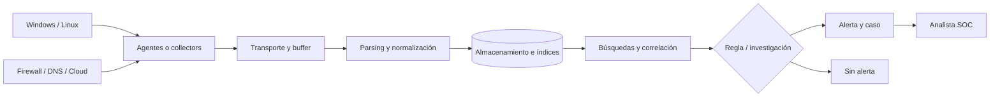
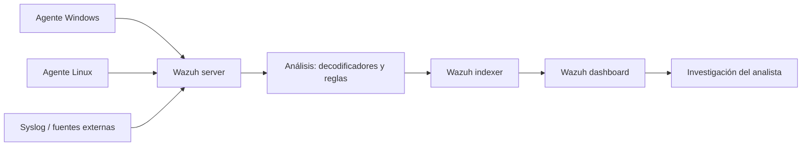
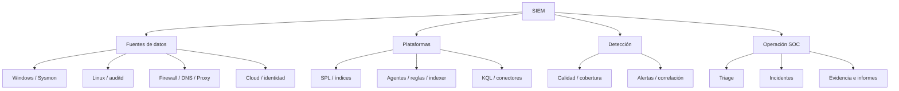
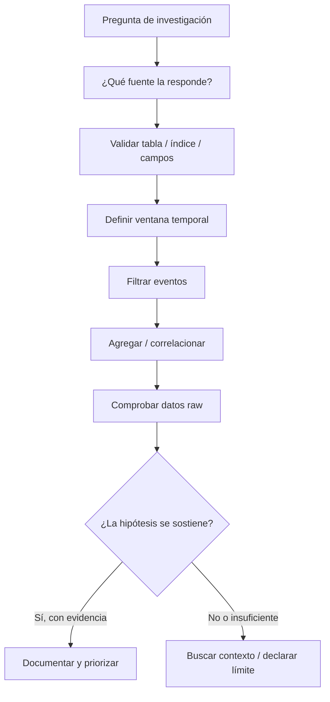
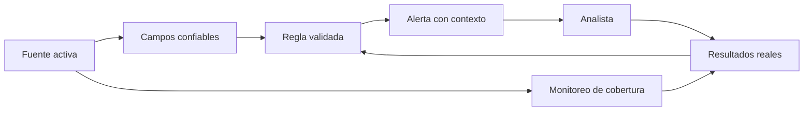

# Unidad 12 — SIEM: Splunk, Wazuh y Microsoft Sentinel

> Guía personal de estudio y consulta · Blue Team / SOC Analyst L1 → intermedio.
>
> **Alcance:** conceptos, arquitectura, consultas, reglas, investigación, operación y decisiones técnicas. Los ejemplos están resueltos con datos **sintéticos**; no se presentan como incidentes reales ni como prácticas ejecutadas por mí.
>
> **Seguridad:** consultar o generar datos solo en sistemas propios o autorizados. Evitar compartir registros reales, credenciales, tokens y datos personales en repositorios públicos.

## Índice

1. [Qué es un SIEM y por qué importa](#1-qué-es-un-siem-y-por-qué-importa)
2. [Arquitectura: del endpoint a una detección](#2-arquitectura-del-endpoint-a-una-detección)
3. [Datos: estructura, calidad y tiempos](#3-datos-estructura-calidad-y-tiempos)
4. [Splunk y el lenguaje SPL](#4-splunk-y-el-lenguaje-spl)
5. [Wazuh: agentes, reglas e indexación](#5-wazuh-agentes-reglas-e-indexación)
6. [Microsoft Sentinel y KQL](#6-microsoft-sentinel-y-kql)
7. [Traducción de investigaciones entre plataformas](#7-traducción-de-investigaciones-entre-plataformas)
8. [Ingeniería de detecciones](#8-ingeniería-de-detecciones)
9. [Investigación y operación SOC](#9-investigación-y-operación-soc)
10. [Operación segura, costos y mantenimiento](#10-operación-segura-costos-y-mantenimiento)
11. [Casos completos y resueltos](#11-casos-completos-y-resueltos)
12. [Historia, casos conocidos y aprendizajes](#12-historia-casos-conocidos-y-aprendizajes)
13. [Mapas conceptuales](#13-mapas-conceptuales)
14. [Errores de interpretación](#14-errores-de-interpretación)
15. [Glosario y referencias](#15-glosario-y-referencias)

---

# 1. Qué es un SIEM y por qué importa

Un **SIEM** (Security Information and Event Management) concentra datos de seguridad, los transforma en información consultable y permite detectar relaciones que quedarían escondidas si miráramos cada sistema por separado. Puede reunir autenticaciones de Windows, actividad de Linux, conexiones de firewall, eventos de DNS y señales de aplicaciones. La utilidad aparece cuando esas piezas se conectan.

No es una caja mágica que reconoce todos los ataques. Si las fuentes no envían eventos, si el parsing confunde un campo o si los relojes están desfasados, el resultado puede ser incompleto. Además, la misma secuencia de logs puede representar un incidente real, un trabajo de mantenimiento o una aplicación mal configurada.

La pregunta central que busco responder con un SIEM es: **¿qué ocurrió, cómo se relaciona con otros eventos, qué tan confiable es esa interpretación y qué corresponde hacer?**

## 1.1 De registros sueltos a una investigación

Imaginemos tres observaciones inventadas:

```text
08:42:10  Windows Security 4625  usuario=soporte1  origen=10.10.2.8
08:42:18  Windows Security 4624  usuario=soporte1  origen=10.10.2.8
08:43:02  Sysmon ID 1          host=PC-07      image=powershell.exe
```

Miradas por separado, la primera señala una autenticación fallida, la segunda una exitosa y la tercera un proceso iniciado. La correlación puede plantear la hipótesis de que las credenciales se usaron para entrar y ejecutar comandos. **No confirma** que fue un intruso: falta establecer si son la misma sesión, qué equipo recibió la autenticación, quién inició PowerShell, qué argumentos utilizó y si existía una tarea autorizada.

La diferencia entre detectar una señal y probar un incidente es una idea que vamos a repetir solo cuando sea realmente necesaria.

## 1.2 SIEM, EDR, XDR, NDR, SOAR: diferencias

| Tecnología | En qué se destaca | Qué límite conviene recordar |
|---|---|---|
| SIEM | Centralizar, consultar, correlacionar y gestionar detecciones basadas en datos | No obtiene datos que nadie recolectó |
| EDR | Telemetría y respuesta en endpoints | Su visibilidad puede limitarse al agente y los sistemas compatibles |
| NDR | Análisis de tráfico y comportamiento de red | El cifrado y los puntos de captura condicionan lo que se ve |
| XDR | Unificar señales y operaciones en un ecosistema | La cobertura depende de las integraciones reales |
| SOAR | Orquestar tareas y respuestas repetibles | Automatizar una mala decisión puede amplificar el daño |

Wazuh puede ofrecer funciones SIEM y XDR; Sentinel forma parte de una plataforma más amplia; Splunk se combina con herramientas e integraciones. Las etiquetas de marketing no reemplazan revisar arquitectura, datos y límites concretos.

## 1.3 Qué espera un SOC L1

En el trabajo cotidiano probablemente tenga que abrir una alerta, revisar su contexto, consultar eventos relacionados, evaluar falsos positivos, documentar evidencia, clasificar severidad y escalar cuando la situación supera mi autoridad o conocimiento. No necesito dominar todas las funciones avanzadas el primer día, pero sí entender por qué cada consulta devuelve un resultado y qué datos podría estar dejando afuera.

Una habilidad especialmente importante es **escribir una consulta que responda una pregunta precisa**. No buscar todo, todo el tiempo. Cuanto más concreta sea la hipótesis, más clara puede ser la investigación.

---

# 2. Arquitectura: del endpoint a una detección



El esquema simplifica arquitecturas distintas, pero sirve para entender dónde pueden aparecer fallas. Si no hay datos en un dashboard, no siempre significa que nunca existieron eventos. Pueden haberse perdido antes del envío, en transporte, en el análisis, en el almacenamiento o en una consulta demasiado restrictiva.

## 2.1 Fuentes, agentes y recolectores

Un **agente** corre en un equipo y genera o reúne datos. Un **collector** puede recibir syslog u otros flujos sin que el dispositivo remoto instale software adicional. La decisión depende de las fuentes, el volumen, la red, el acceso permitido y la confiabilidad esperada.

Un servidor Windows puede aportar Security Event Log, System y eventos Sysmon. Un Linux puede aportar journald, auditd y logs de aplicaciones. Un firewall aporta acciones permitidas o bloqueadas; un proxy aporta URL y decisiones de acceso; un proveedor cloud aporta auditoría del plano de control e identidades.

## 2.2 Envío, buffering y backpressure

Si la red falla durante diez minutos, ¿qué ocurre con los datos? Depende de si el agente tiene cola local, cuánto puede guardar, si retransmite y cómo maneja duplicados. En un diseño robusto hay que mirar **permanencia** y **pérdida**, no solo conectividad.

- **Buffer:** almacena temporalmente mientras el destino no está disponible.
- **Backpressure:** el sistema reduce o regula el flujo al saturarse una etapa.
- **Retransmisión:** intenta recuperar mensajes pendientes.
- **Deduplicación:** identifica copias repetidas, sin borrar accidentalmente eventos legítimos muy parecidos.

Si un collector anuncia 100 % de disponibilidad pero pierde el 30 % de los eventos de autenticación, la detección de password spraying puede fallar aunque el dashboard se vea perfecto.

## 2.3 Parsing y normalización: no son sinónimos

Supongamos que entra esta línea:

```text
Oct 25 12:18:01 srv-web sshd[3121]: Failed password for invalid user backup from 192.0.2.18 port 45291 ssh2
```

**Parsing** separa los campos: fecha, host, proceso, PID, acción, usuario e IP. **Normalización** traduce esos valores a nombres y tipos coherentes con otras fuentes; por ejemplo, `source.ip` en lugar de `client_addr` y `srcip` según la fuente. **Enriquecimiento** agrega contexto externo, como criticidad del equipo o información de inventario.

El evento original conviene conservarlo porque el parser podría equivocarse. Un campo normalizado es útil para buscar, pero no debería sustituir la evidencia cruda si la investigación requiere precisión.

## 2.4 Diferenciar procesamiento y detección

Una regla puede ejecutarse al entrar el evento, al buscar datos almacenados o como búsqueda programada. Cada enfoque tiene ventajas y costos. El análisis al ingreso puede reaccionar rápido; la búsqueda histórica permite reexaminar ventanas largas; una consulta programada puede encontrar patrones que solo aparecen al acumular eventos.

## 2.5 Alta disponibilidad y fallos parciales

Un sistema puede continuar respondiendo aunque una fuente importante no esté enviando información. Por eso se monitorean tanto la salud de componentes como la **cobertura de datos**: último evento recibido por fuente, volumen típico, retrasos y tasa de errores de parsing.

---

# 3. Datos: estructura, calidad y tiempos

## 3.1 Campos que conviene identificar

| Campo | Para qué sirve | Error habitual |
|---|---|---|
| Hora del evento | Ubicar cuándo ocurrió la actividad | Confundirla con la hora de ingestión |
| Hora de ingestión | Medir demoras del pipeline | Interpretarla como hora de ejecución |
| Fuente / canal | Entender quién produjo el registro | Confiar en campos sin conocer su origen |
| Usuario | Relacionar actividad con una identidad | Confundir usuario objetivo con actor |
| Equipo | Saber dónde ocurrió o se observó | Confundir emisor del log con sistema afectado |
| IP y puerto | Correlacionar conexiones | Atribuir identidad con IP pública compartida |
| PID / GUID | Vincular procesos | Unir PIDs reciclados en distintos momentos |
| Código de acción | Diferenciar permitido, fallido, bloqueado | Ignorar la semántica propia del fabricante |
| Mensaje original | Ver la evidencia sin transformación | Suponer que los campos extraídos son infalibles |

## 3.2 Timestamps: tres relojes distintos

1. **Event time:** cuando ocurrió lo que se observa.
2. **Ingestion time:** cuando el dato entró a la plataforma.
3. **Processing time:** cuando se transformó o evaluó, según la herramienta.

La cronología puede romperse al comparar registros en UTC con otros en UTC−03:00. Una recomendación práctica es normalizar internamente a UTC y mostrar la zona original cuando sea útil.

```text
2026-10-25T15:00:00Z       = 12:00:00 UTC-03:00
2026-10-25T12:00:00-03:00  = 15:00:00 UTC
```

Son dos representaciones del mismo instante. Si una plataforma interpreta erróneamente el segundo valor como UTC, desplazará la investigación tres horas.

## 3.3 Datos nulos, vacíos y ausentes

No es igual `source_ip=null`, `source_ip=""` y un evento donde `source_ip` ni siquiera existe. Un parser defectuoso puede volver nulos campos críticos; una fuente también puede no registrar IP para cierto tipo de autenticación. Antes de agrupar por ese campo, conviene medir cuántos registros lo tienen realmente.

## 3.4 Cardinalidad, volumen y costo

- **Volumen:** cantidad de datos generados/ingestados por tiempo.
- **Cardinalidad:** cantidad de valores distintos de un campo.
- **Selectividad:** cuánto reduce una condición un conjunto de eventos.
- **Retención:** cuánto tiempo permanece consultable un dato.

Una búsqueda con campo `process_guid` puede tener muchísimos valores únicos. Eso afecta el diseño de agregaciones y el uso de memoria. No significa que esté mal utilizarlo: significa que hay que elegir cuándo tiene sentido agrupar.

## 3.5 Duplicación y normalización cuidadosa

Puede haber eventos duplicados si dos collectors reciben la misma fuente, si se reenvía una cola o si se mezclan alertas derivadas con eventos crudos. Para deduplicar no basta con borrar entradas con el mismo usuario y timestamp redondeado; podrían ser acciones diferentes. Lo ideal es disponer de identificador de evento o una combinación de campos suficientemente específica, y registrar la regla aplicada.

## 3.6 Modelo común: una oportunidad y un riesgo

Normalizar la acción `LogonType` como `authentication.type` puede ayudar al correlacionar Windows con Linux, pero los protocolos no comparten exactamente las mismas categorías. Un modelo común debe simplificar las búsquedas **sin fingir equivalencias que no existen**.

---

# 4. Splunk y el lenguaje SPL

## 4.1 Cómo piensa Splunk

Splunk permite ingerir datos de muchas fuentes, indexarlos, buscarlos y construir análisis sobre eventos. Distingo algunos conceptos:

- **Index:** agrupación lógica de datos indexados que condiciona búsqueda y retención.
- **Sourcetype:** etiqueta asociada al formato del evento y al modo de procesarlo.
- **Host / source:** metadatos sobre procedencia; su interpretación debe validarse.
- **Search Head:** componente de búsqueda e interacción en arquitecturas distribuidas.
- **Indexer:** componente que administra indexación y búsquedas sobre datos.
- **Forwarder:** componente para enviar datos, según arquitectura y producto instalado.

Que un dashboard muestre métricas bonitas no significa que la búsqueda esté bien. Empiezo con una pregunta y una consulta sencilla que pueda explicar línea por línea.

## 4.2 SPL como pipeline de comandos

La idea general de SPL es comenzar con un conjunto de eventos y transformarlo utilizando tuberías (`|`). La sintaxis exacta depende de SPL/SPL2, la versión y el tipo de búsqueda; los ejemplos de este capítulo se presentan como **SPL clásico orientativo**.

```spl
index=security sourcetype=WinEventLog:Security EventCode=4625 earliest=-24h
| stats count as fallos by Account_Name, src_ip
| sort - fallos
```

Primero filtro eventos del índice y fuente esperados; después agrupo por identidad e IP y ordeno por cantidad de fallos. Si el sourcetype no tiene realmente `Account_Name` o `src_ip`, el resultado no será útil. **Verificar el esquema real precede a copiar consultas.**

## 4.3 Primer recorrido de búsqueda

```spl
index=security earliest=-1h
| head 20
| table _time host sourcetype _raw
```

Esta consulta verifica que existan datos, qué hosts aportan registros y cómo se ven los eventos crudos. Es una inspección inicial, no una detección.

```spl
index=security earliest=-24h
| stats count as eventos by sourcetype
| sort - eventos
```

Acá pregunto cuáles son los formatos más presentes. Me ayuda a notar un cambio brusco de volumen o un sourcetype inesperado.

## 4.4 Búsquedas y filtros específicos

```spl
index=security sourcetype=WinEventLog:Security (EventCode=4624 OR EventCode=4625)
| table _time host EventCode Account_Name Logon_Type src_ip
```

La consulta será válida solo si esos campos se extrajeron. A veces los nombres difieren (`EventID`, `TargetUserName`, `IpAddress`); conviene inspeccionar el evento y adaptar el SPL.

## 4.5 stats y eval

`stats` agrega datos; `eval` crea o transforma campos. Ejemplo:

```spl
index=security EventCode=4625 earliest=-1d
| eval account=coalesce(TargetUserName, Account_Name)
| stats count as failed_logons dc(host) as hosts by account
| where failed_logons >= 5
| sort - failed_logons
```

`coalesce` busca el primer campo no nulo. `dc(host)` calcula la cantidad aproximada/distinta de hosts, según la función. El umbral 5 es pedagógico, no un parámetro recomendado para todas las empresas.

## 4.6 timechart y tendencias

```spl
index=security sourcetype=WinEventLog:Security EventCode=4625 earliest=-7d
| timechart span=1h count as fallos
```

Sirve para visualizar cuándo aumentaron los fallos, pero no identifica cuentas ni explica su motivo. Un pico puede corresponder a un servicio con contraseña vieja.

## 4.7 dedup: una herramienta peligrosa si se usa sin pensar

```spl
index=security EventCode=4625 earliest=-2h
| dedup host Account_Name src_ip
| table _time host Account_Name src_ip
```

Esta búsqueda conserva un evento por combinación y puede ocultar la frecuencia real. Está bien para una vista de valores únicos, **no para contar intentos**. Para cantidad de eventos usar `stats count` sobre el conjunto sin deduplicar a ciegas.

## 4.8 rex y campos extraídos

Cuando una fuente registra un campo dentro del texto, `rex` puede extraerlo. Ejemplo sintético:

```spl
index=web sourcetype=app:auth
| rex field=_raw "user=(?<usuario>[^ ]+)"
| stats count by usuario
```

Esto es práctico, pero requiere validar entradas extrañas, espacios, escapes y líneas malformadas. Si existe un parser formal del producto, suele ser mejor que mantener decenas de expresiones regulares improvisadas.

## 4.9 eval para normalizar acciones

```spl
index=security earliest=-1d (EventCode=4624 OR EventCode=4625)
| eval outcome=case(EventCode=4624,"success", EventCode=4625,"failure", true(),"other")
| stats count by outcome host
```

La consulta simplifica el resultado; no demuestra que todos los éxitos sean accesos autorizados.

## 4.10 Primer diagnóstico de una búsqueda vacía

1. ¿Estoy usando el índice correcto?
2. ¿Existe ese `sourcetype`?
3. ¿El rango temporal incluye la actividad?
4. ¿El campo se llama como supuse?
5. ¿Hay eventos de esa fuente o el problema es de ingestión?
6. ¿Estoy mezclando texto crudo con campos extraídos?

La diferencia entre un incidente inexistente y una fuente sin visibilidad es crítica para un SOC.

## 4.11 tstats y modelos de datos

`tstats` puede aprovechar estructuras aceleradas según el modelo y la configuración; no es un sustituto universal de `stats`. Antes de utilizarlo, revisaría si los datos están en un modelo compatible, qué cobertura tienen y si la aceleración está habilitada.

## 4.12 Splunk Enterprise Security: detecciones y contexto

Según la edición y licencias, Splunk Enterprise Security puede sumar búsquedas de correlación, detecciones, investigación, gestión de hallazgos y contenido de seguridad. No hay que dar por hecho que una instalación de Splunk con logs tiene automáticamente todas estas funciones disponibles.

## 4.13 Ejemplo resuelto: una cuenta con muchos fallos

**Datos inventados:** en una hora hay 18 fallos de `backup_svc`, provenientes de un único host de aplicaciones, y luego ningún éxito. Existe un cambio de contraseña programado del día anterior. La consulta de agregación mostraría un pico; la correlación con el cambio sugiere un servicio desactualizado. La **conclusión razonable** es revisar la configuración del servicio y la autenticación, no afirmar que hubo brute force externo.

## 4.14 Ejemplo resuelto: múltiples cuentas desde un origen

**Datos inventados:** desde `192.0.2.41` aparecen fallos en 12 cuentas distintas durante cinco minutos, sin éxitos, en un servicio expuesto. Esto encaja con una **hipótesis de password spraying**. El hallazgo exige investigar controles de acceso, dispositivo de origen, secuencia temporal, reputación y cuentas objetivo. La consulta describe la distribución, pero no atribuye autoría ni demuestra un compromiso.

---

# 5. Wazuh: agentes, reglas e indexación

## 5.1 Arquitectura propia de Wazuh



Los componentes centrales son **server**, **indexer** y **dashboard**, además de los agentes que corren en endpoints. El servidor recibe y analiza eventos; los decodificadores extraen campos y las reglas evalúan condiciones; el indexer almacena información indexada y el dashboard permite observar e investigar. La arquitectura y algunas capacidades concretas dependen de la versión instalada.

## 5.2 Qué observa el agente

Wazuh puede reunir logs de seguridad, inventario, monitoreo de integridad de archivos (FIM), configuraciones de seguridad, vulnerabilidades y otras señales. La cobertura no aparece por arte de magia: hay que habilitar y validar cada fuente y módulo, con un equilibrio entre visibilidad, volumen y privacidad.

## 5.3 Decoder frente a rule

Un **decoder** interpreta el formato de una entrada y la separa en campos. Una **rule** aplica criterios sobre esos campos u otras propiedades del evento. Esta diferencia es fundamental: una regla no va a detectar bien si el parser entendió mal la IP, el usuario o la acción.

```text
Línea de log
   ↓
Pre-decoding (cabecera general, cuando corresponde)
   ↓
Decoding (campos)
   ↓
Matching (reglas)
   ↓
Alerta si corresponde
   ↓
Indexación y visualización
```

## 5.4 Ejemplo interpretado: autenticación SSH fallida

Entrada sintética:

```text
Oct 25 09:22:14 srv01 sshd[2201]: Failed password for invalid user prueba from 192.0.2.20 port 55211 ssh2
```

Se reconocen origen, usuario, host y fallo. Si una regla genera alerta, el resultado refleja ese evento registrado. Todavía falta conocer el resto de intentos, si el usuario existe, si el acceso está expuesto y si hubo autenticaciones exitosas.

## 5.5 Reglas XML: lectura conceptual

```xml
<group name="custom_auth,">
  <rule id="100210" level="5">
    <decoded_as>json</decoded_as>
    <field name="action">login_failed</field>
    <description>Ejemplo didáctico: fallo de autenticación JSON</description>
  </rule>
</group>
```

**Este fragmento es didáctico**: los IDs locales, el formato de decodificación y las rutas deben validarse en una instancia de prueba. En producción hay que revisar compatibilidad con reglas existentes, sintaxis y alcance. No hay que copiarlo a ciegas ni asumir que todas las fuentes usan el campo `action`.

## 5.6 Probar un decoder y una regla

Wazuh ofrece herramientas de prueba de reglas (por ejemplo `wazuh-logtest`, según la instalación) para enviar una línea de log y ver cómo se decodifica y clasifica. El orden de trabajo correcto es examinar la entrada, validar extracción de campos, confirmar qué regla coincide y recién entonces ajustar la detección.

## 5.7 Niveles de reglas y priorización

Un número de nivel de alerta no equivale automáticamente a la severidad empresarial. Un evento puede tener nivel elevado y afectar un equipo de pruebas; otro evento con menor puntaje puede involucrar una cuenta privilegiada en un activo crítico. La prioridad del analista surge de **señal + contexto + impacto**.

## 5.8 FIM: integridad y falsas interpretaciones

Un monitoreo de integridad puede registrar cambios en rutas vigiladas. Si se actualizó un archivo de configuración, necesito ver si fue un cambio aprobado, qué contenido cambió, quién lo ejecutó y qué otras señales lo acompañan. Además, el hash del contenido no resume todos los metadatos del archivo.

## 5.9 Agente desconectado: problema de cobertura

Un agente que no aparece puede deberse a fallos de red, certificados, servicio detenido, cambio de identificador o desregistro. La falta de eventos **no es evidencia de que el host estuvo inactivo**. Antes de evaluar una hipótesis de seguridad, verifico la salud del agente y la última recepción.

## 5.10 Registros de archivo y eventos de Windows

Wazuh puede recibir Windows EventChannel según configuración. Si quiero investigar eventos 4624, 4625 o Sysmon, primero valido que se estén recolectando los canales y eventos correctos. Si un evento no aparece en el indexer, reviso captura, agente, server, reglas e indexación, sin asumir que no ocurrió.

## 5.11 Indexer y dashboard

El indexer se apoya en índices de documentos consultables; el dashboard visualiza alertas y otras funciones. No hay que confundir un dashboard cargado correctamente con la garantía de que toda la telemetría histórica esté retenida y accesible.

## 5.12 Seguridad de la plataforma

Los agentes y los componentes centrales utilizan autenticación y comunicaciones protegidas, con puertos y protocolos configurables. En un entorno real conviene segmentar acceso administrativo, proteger certificados y secretos, minimizar permisos y limitar exposición de APIs y dashboard. El acceso a eventos también requiere controles: pueden contener datos sensibles.

## 5.13 Dimensionamiento

La guía oficial de inicio rápido de Wazuh recomienda, como referencia para despliegue central todo-en-uno y hasta 25 agentes, **4 vCPU, 8 GiB RAM y 50 GB** para un escenario definido de retención. Esto **no es un mínimo universal garantizado**: el volumen, los módulos activos y la retención cambian el consumo. Para una notebook modesta suele ser mejor comenzar por análisis de datos sintéticos o una VM cuidadosamente dimensionada.

## 5.14 Cómo se resuelve una alerta de FIM

**Secuencia simulada:** a las 10:05 se modifica `/etc/ssh/sshd_config`; a las 10:07 se reinicia sshd; a las 10:10 aparece una sesión nueva desde una IP administrativa. La correlación admite dos explicaciones: mantenimiento legítimo o cambio no autorizado. Si existe ticket aprobado y la diferencia del archivo coincide con el procedimiento, se documenta como cambio esperado. Si falta autorización y el cambio habilitó una configuración riesgosa, se escala. La regla de FIM por sí sola no decide entre esas dos historias.

## 5.15 Cuándo elegir Wazuh para practicar

Es una buena plataforma para aprender agentes, seguridad en endpoints, lectura de alertas, FIM, reglas, decoders e investigación de eventos. **No sustituye** el estudio de SPL y KQL; esas consultas representan destrezas relevantes en otras plataformas y organizaciones.

---

# 6. Microsoft Sentinel y KQL

## 6.1 Cómo funciona Sentinel

Microsoft Sentinel es un servicio SIEM nativo de nube y participa en las operaciones unificadas de seguridad de Microsoft. Permite integrar datos de múltiples entornos, consultar, generar detecciones, investigar incidentes y automatizar tareas con las debidas aprobaciones. Sus experiencias de portal y funciones evolucionan con el producto: **los menús y opciones pueden variar** entre el portal de Defender, el de Azure y la configuración contratada.

## 6.2 Workspace, tablas y conectores

Los eventos consultables se organizan en tablas asociadas a servicios de almacenamiento/analítica compatibles con KQL; no todos los datos aparecen en una tabla universal llamada `SecurityEvent`.

- **SecurityEvent:** puede contener eventos Windows enviados por conectores compatibles.
- **SigninLogs:** cuando se recopilan registros de inicio de sesión de Microsoft Entra, según integración, licencia y permisos.
- **CommonSecurityLog:** datos CEF de fuentes compatibles, cuando se ingieren.
- **Syslog:** registros de fuentes syslog compatibles, según ingesta.

El nombre de la tabla y el esquema son parte de la investigación. Antes de usar una consulta copiada, primero verifico qué conector está habilitado y cómo llegan sus campos.

## 6.3 KQL es un lenguaje de consulta, no una regla por sí misma

Kusto Query Language permite filtrar, proyectar, agrupar, combinar y analizar series temporales. Una consulta puede ejecutarse para explorar registros y también formar parte de una regla analítica programada. La existencia de una consulta no significa que exista una alerta configurada.

## 6.4 Primer contacto con una tabla

```kql
SecurityEvent
| where TimeGenerated > ago(1h)
| take 20
```

Si no devuelve resultados, podría no haber eventos, no haber permisos, no existir el conector o no incluir datos en esa ventana. Es una comprobación de cobertura, no una conclusión de seguridad.

## 6.5 Filtrar y proyectar

```kql
SecurityEvent
| where TimeGenerated > ago(24h)
| where EventID in (4624, 4625)
| project TimeGenerated, Computer, EventID, Account
| order by TimeGenerated desc
```

`where` filtra; `project` elige columnas; `order by` organiza. La consulta evita mostrar campos enormes que distraen durante una primera revisión.

## 6.6 summarize, countif y bin

```kql
SecurityEvent
| where TimeGenerated > ago(24h)
| where EventID in (4624, 4625)
| summarize Fallos=countif(EventID == 4625), Exitos=countif(EventID == 4624)
           by Account, bin(TimeGenerated, 1h)
| order by TimeGenerated asc
```

Agrupa las autenticaciones por cuenta y bloques de una hora. **Ojo:** la agrupación horaria puede ocultar un patrón de cinco minutos; la ventana debe corresponder a la hipótesis que investigo.

## 6.7 Distinct y dcount

```kql
SecurityEvent
| where TimeGenerated > ago(1d) and EventID == 4625
| summarize Hosts=dcount(Computer), Intentos=count() by Account
| order by Intentos desc
```

`dcount` es un conteo aproximado de valores distintos, útil para conjuntos grandes. Si necesito exactitud forense en un conjunto pequeño, debo considerar operaciones exactas o verificar los eventos base.

## 6.8 extend y case

```kql
SecurityEvent
| where TimeGenerated > ago(2h)
| where EventID in (4624, 4625)
| extend Resultado=case(EventID == 4624, "exito", EventID == 4625, "fallo", "otro")
| summarize Total=count() by Resultado, Computer
```

`extend` crea una columna; `case` clasifica. Nuevamente: éxito de autenticación no equivale a autorización legítima.

## 6.9 parse_json y datos dinámicos

Algunas tablas pueden incluir propiedades JSON. Puedo utilizar `parse_json()` para interpretarlas, pero no debería asumir que cualquier columna de texto contiene JSON válido. Si el campo ya es de tipo `dynamic`, no siempre hace falta parsearlo nuevamente.

## 6.10 join: correlación con cuidado

```kql
let Failures = SecurityEvent
  | where TimeGenerated > ago(1h) and EventID == 4625
  | summarize Fallos=count(), UltimoFallo=max(TimeGenerated) by Account, Computer;
let Successes = SecurityEvent
  | where TimeGenerated > ago(1h) and EventID == 4624
  | project Account, Computer, Exito=TimeGenerated;
Failures
| join kind=inner Successes on Account, Computer
| where Exito between (UltimoFallo .. UltimoFallo + 10m)
| project Account, Computer, Fallos, UltimoFallo, Exito
```

Es **una demostración de lógica**, no una regla lista para producción. Relaciona cuenta y equipo; no distingue por tipo de inicio de sesión, dirección de origen ni identificadores de sesión. Además, si hay múltiples éxitos, una sola agrupación de fallos puede emparejar eventos que pertenecen a secuencias distintas. Un detector real debe incorporar campos pertinentes y validarse con muestras reales del esquema.

## 6.11 ASIM y normalización

Microsoft promueve el uso de parsers del Advanced Security Information Model (ASIM) para diseños que puedan funcionar sobre diferentes orígenes. La ventaja es menor acoplamiento a una tabla concreta; el costo es comprender qué campos, categorías y cobertura provee cada parser. **Una abstracción no garantiza que todos los productos generen datos equivalentes.**

## 6.12 Scheduled analytics rules

Una regla programada ejecuta una consulta con una frecuencia y una ventana de búsqueda. Si las condiciones generan resultados, puede producir alertas. Entre los aspectos clave están:

- consulta y origen de datos;
- frecuencia de ejecución;
- período observado o *lookback*;
- umbral y agrupación;
- mapeo de entidades;
- supresión de ruido y excepciones;
- vínculo de alertas a incidentes;
- pruebas con históricos y revisión posterior.

La regla tiene que considerar latencia de ingesta. Si los datos tardan 15 minutos en llegar, una búsqueda de cinco minutos ejecutada inmediatamente puede perder eventos.

## 6.13 Entidades e incidentes

Una alerta describe una señal; un incidente agrupa información para su investigación, según la lógica y configuración. Las entidades (usuario, host, IP y otras) facilitan contexto, pero una IP NAT no debe interpretarse como identidad personal sin correlación adicional.

## 6.14 Automatización y playbooks

Las reglas de automatización y playbooks pueden crear tickets, notificar equipos o solicitar operaciones defensivas. Acciones como deshabilitar usuarios o aislar dispositivos requieren una política clara y aprobación cuando corresponda. Automatizar la clasificación es útil; automatizar una contención sin criterio puede interrumpir servicios legítimos.

## 6.15 Threat hunting

La cacería de amenazas parte de una hipótesis que podría no haber generado alerta: por ejemplo, «¿hay procesos que se iniciaron fuera del flujo habitual tras una autenticación remota?». No es mirar un dashboard hasta encontrar algo raro; implica definir qué señales espero, qué cobertura tengo y cómo interpretaría resultados negativos.

## 6.16 Costos y versiones

Microsoft Sentinel y sus servicios asociados pueden generar cargos por ingesta, almacenamiento, retención, consultas o funcionalidades relacionadas, según la arquitectura y el acuerdo comercial. **No doy un precio fijo en esta guía**, porque cambia con región, plan y fecha. Para estudiar sin presupuesto alto, conviene utilizar consultas sobre datos sintéticos y comprobar cualquier prueba gratuita o cuenta antes de activar servicios facturables.

## 6.17 Ejemplo resuelto: accesos fallidos en una cuenta

**Datos simulados:** `analista1` registra 9 fallos y 1 éxito durante una hora, todos desde un host corporativo que ejecuta un cliente VPN desactualizado. KQL agrupa 10 eventos; la verificación del dispositivo y del ticket técnico explica la secuencia por contraseña cacheada. Con esa evidencia, el caso se documenta como falso positivo para la hipótesis de intrusión, sin negar que los fallos ocurrieron.

## 6.18 Ejemplo resuelto: accesos desde distintos orígenes

**Datos simulados:** un usuario tiene éxitos desde dos direcciones IP públicas en 90 segundos. Puede ser una anomalía, pero no prueba «viaje imposible»: ambas IP podrían pertenecer a salidas de VPN, proxys corporativos o infraestructura compartida. Para concluir se necesitan detalles de dispositivo, contexto de sesión, tokens, zonas horarias y geolocalización confiable.

---

# 7. Traducción de investigaciones entre plataformas

No conviene memorizar «el mismo código» en tres lenguajes. Conviene formular una pregunta independiente de la herramienta y después adaptarla a cada esquema.

## 7.1 Pregunta: ¿cuántos fallos por usuario vi en un día?

**Splunk / SPL orientativo**

```spl
index=security EventCode=4625 earliest=-24h
| stats count as fallos by Account_Name
| sort - fallos
```

**Sentinel / KQL orientativo**

```kql
SecurityEvent
| where TimeGenerated > ago(24h) and EventID == 4625
| summarize Fallos=count() by Account
| order by Fallos desc
```

**Wazuh:** analizar eventos indexados del canal correspondiente mediante los campos realmente decodificados y agregarlos por usuario desde el dashboard o la API del indexer. Wazuh no utiliza SPL ni KQL como lenguaje nativo para estas reglas; la consulta exacta depende del índice y del documento guardado.

El concepto común es **filtrar origen + fallo + rango temporal, agrupar por identidad y contar**. Las diferencias aparecen en nombres de campos, retención, tipado y forma de buscar.

## 7.2 Pregunta: ¿qué fuente dejó de enviar datos?

En Splunk podemos agregar eventos por `host` y observar `max(_time)`; en Sentinel podemos obtener `max(TimeGenerated)` por `Computer`; en Wazuh podemos inspeccionar estado del agente y últimos eventos asociados. Las tres acciones parecen similares, pero la fuente y el significado de «último evento» cambian.

## 7.3 Pregunta: ¿qué proceso produjo una conexión?

Necesito telemetría con una relación fiable: Sysmon ProcessGuid, PID más hora/contexto, o señal EDR que vincule proceso y socket. Un firewall que solo registra IP, puerto y acción no siempre puede identificar el proceso de origen. **Ningún SIEM inventa un PID a partir de una IP.**

## 7.4 Tabla de traducción conceptual

| Idea | Splunk | Wazuh | Sentinel |
|---|---|---|---|
| Filtrar eventos | Búsqueda SPL | Filtros de índice/documento/reglas | `where` en KQL |
| Contar por campo | `stats count by` | Agregación/indexer/dashboard | `summarize count() by` |
| Agrupar por tiempo | `timechart span=` | Agregación temporal | `bin(TimeGenerated, ...)` |
| Transformar campos | `eval` | Decoder/procesamiento/agregación | `extend`, `project` |
| Detectar | Búsqueda/regla de seguridad | Reglas del motor y otros módulos | Reglas analíticas y otras detecciones |
| Investigar | Búsquedas y gestión de hallazgos | Alertas, agentes, índices | Incidentes, entidades, consultas |

---

# 8. Ingeniería de detecciones

## 8.1 Detectar no es poner cualquier umbral

Una regla útil parte de un comportamiento que me interesa reconocer, una fuente capaz de registrarlo y una hipótesis comprobable. Poner «más de cinco eventos = ataque» suele generar ruido. El umbral depende de la aplicación, de la cantidad de usuarios, de la hora, de dispositivos y de los patrones esperados.

## 8.2 Una buena detección tiene un contrato

- **Objetivo:** qué conducta concreta intenta encontrar.
- **Fuente:** qué eventos y campos necesita.
- **Lógica:** qué condiciones o secuencias exige.
- **Ventana:** cuánto tiempo observa.
- **Contexto:** qué entidades y activos distingue.
- **Excepciones:** qué actividad legítima conocida genera coincidencias.
- **Respuesta:** qué revisión humana corresponde.
- **Validación:** qué muestras positivas y negativas se ensayaron.
- **Mantenimiento:** quién revisará cambios y degradación.

Esto no implica una checklist repetida por cada caso. Es la especificación general de una detección, para no olvidar sus condiciones básicas.

## 8.3 Precisión, recall y equilibrio operativo

- **Verdadero positivo (TP):** alerta correcta sobre comportamiento relevante.
- **Falso positivo (FP):** alerta disparada por actividad que no pertenece al comportamiento buscado.
- **Falso negativo (FN):** comportamiento que debería detectarse y no generó alerta.
- **Verdadero negativo (TN):** actividad fuera del patrón que no alertó.

**Precisión = TP / (TP + FP)**; **recall = TP / (TP + FN)**. Una regla puede ser muy sensible y producir mucho ruido. Otra puede ser muy precisa, pero perder señales importantes. No existe una configuración perfecta para todos los entornos.

## 8.4 Correlación temporal con sesgos controlados

«Fallo seguido de éxito» no alcanza si las dos actividades pertenecen a equipos o usuarios distintos. La correlación necesita claves: usuario, destino, IP o identificador de sesión, junto a ventana temporal y reglas de orden. Si los campos faltan, debo reconocer esa incertidumbre.

## 8.5 Deduplicación y supresión

Supresión no es borrado forense. Una detección puede evitar crear cien tickets idénticos, conservando los eventos originales para investigación. El objetivo es reducir la fatiga de alertas sin eliminar evidencia ni esconder un aumento real de frecuencia.

## 8.6 Tuning documentado

Supongamos que un escáner autorizado genera cientos de conexiones a puertos internos. Una regla de port scanning lo detecta. Antes de excluir la IP completa reviso el alcance aprobado, activo, horario, duración y resultados. La excepción debe ser estrecha y revisable, no una puerta permanente para actividad inesperada.

## 8.7 Mapeo a MITRE ATT&CK

Una técnica ATT&CK ayuda a clasificar la conducta, no confirma autoría. Una regla de intentos de contraseña podría mapearse a una técnica de acceso a credenciales o fuerza bruta según su comportamiento específico. El mapeo debe justificarse y no añadirse como decoración del dashboard.

## 8.8 Sigma: formato portable con límites

Sigma describe detecciones con campos y condiciones abstractas; una conversión a consultas concretas necesita mapeos compatibles. Ejemplo conceptual:

```yaml
title: Ejemplo - muchos fallos por cuenta
status: experimental
logsource:
  product: windows
  service: security
selection:
  EventID: 4625
condition: selection
```

Este YAML **solo selecciona fallos**; no implementa el umbral de «muchos» ni una correlación temporal. Para una detección operativa habría que completar agregación/correlación con capacidades y convenciones soportadas por el backend elegido. No presento el fragmento como regla completa.

## 8.9 Evaluación continua

Una detección puede funcionar bien hoy y degradarse después de una actualización de agente o de un cambio de esquema. Se monitorean volumen, campos nulos, última ejecución, latencia de la fuente, tasas de alertas y resultados de investigaciones. **La salud de una regla depende también de la salud de sus datos.**

---

# 9. Investigación y operación SOC

## 9.1 Del evento al ticket

La alerta llega con cierta información: regla que se disparó, horario, entidades, registros relevantes y severidad inicial. El analista comprueba si la señal representa lo que promete, busca contexto, separa hechos de hipótesis y decide si cerrar, seguir investigando o escalar según procedimiento.

## 9.2 Escalar con información suficiente

Un escalamiento útil debe indicar:

- Qué se observó y en qué fuente.
- Qué activo/cuenta se ve afectado.
- Qué ventana temporal se analizó.
- Qué registros concretos apoyan el hallazgo.
- Qué factores contradicen la hipótesis.
- Qué tareas se hicieron y con qué resultado.
- Qué riesgo y próximos pasos requieren autorización.

No hace falta escribir un libro por incidente, pero sí dejar lo suficiente para que otro analista continúe sin repetir el mismo trabajo.

## 9.3 Severidad, prioridad y criticidad

**Severidad** del comportamiento no es lo mismo que **prioridad** del trabajo. Una alerta moderada sobre un controlador de dominio puede requerir más urgencia que una señal alta en una máquina aislada de pruebas. La prioridad depende de impacto, evidencia, exposición y capacidad de respuesta.

## 9.4 Línea de tiempo y trazabilidad

La cronología debe utilizar tiempos normalizados y conservar la zona/origen. Cuando falten eventos, se anota el hueco. Si dos sensores registran momentos incompatibles, se evalúan relojes y latencia antes de construir una historia imposible.

## 9.5 Investigar sin alterar evidencias

Siempre que sea posible, las primeras acciones son consultas de solo lectura y exportaciones documentadas. Detener procesos o aislar equipos puede ser necesario, pero corresponde a procedimientos de respuesta con autoridad definida. Una investigación SOC L1 no debería borrar datos ni modificar sistemas críticos por impulso.

---

# 10. Operación segura, costos y mantenimiento

## 10.1 Seguridad del propio SIEM

Un SIEM concentra datos valiosos: usuarios, hostnames, IP, rutas, horarios y eventos que podrían revelar debilidades. Necesita control de acceso basado en roles, MFA para administradores, registros de auditoría propios, cifrado, segmentación y gestión de secretos. Que sea una herramienta defensiva no lo vuelve inmune a problemas de seguridad.

## 10.2 Retención y minimización

No todos los datos necesitan almacenarse el mismo tiempo ni con el mismo nivel de detalle. Las políticas deben contemplar necesidades de investigación, requisitos legales, privacidad y costo. Las consultas históricas son inútiles si las fuentes relevantes ya rotaron o no se conservaron.

## 10.3 Costos de ingestión

Las plataformas pueden cobrar o requerir recursos según ingestión, infraestructura, almacenamiento, licencias, retención y funciones. **Más logs no es siempre mejor**: ingestión indiscriminada aumenta ruido, costos y datos sensibles. Mejor priorizar fuentes y campos vinculados a casos de detección concretos.

## 10.4 Métricas de calidad

| Métrica | Qué significa | Qué revisaría si empeora |
|---|---|---|
| Frescura de la fuente | Cuánto hace que llegó el último evento | Agente, collector, red, timestamps |
| Latencia | Diferencia entre evento e ingesta | Colas, parsers, límites, red |
| Cobertura | Activos esperados vs activos observados | Inventario, permisos, despliegue |
| Campos nulos | Porción de registros sin atributos clave | Parser, cambios de versión, fuente |
| Eventos descartados | Registros perdidos o filtrados | Cuotas, retención, buffering |
| Alertas por día | Carga operativa | Cambios de reglas, estacionalidad, incidentes |
| Falsos positivos | Alertas que no cumplen la hipótesis | Umbrales, contexto, exclusiones |

## 10.5 Control de cambios

Una modificación de regla debe quedar versionada y probada. Un parser nuevo puede cambiar columnas sin que nadie lo note. Para GitHub, conviene guardar detecciones en archivos separados y escribir en el README qué versión del esquema o fuente se utilizó. No subir datos sensibles para «demostrar» que una regla funciona.

## 10.6 Estrategia de estudio con presupuesto limitado

Para empezar conviene combinar un entorno gratuito/local cuando sea posible con datos sintéticos y documentación oficial. Wazuh puede servir para explorar agentes y reglas si hay hardware suficiente; SPL y KQL se pueden estudiar mediante ejemplos bien tipados sin activar servicios pagos. Una plataforma cloud no debe habilitarse sin entender su facturación y límites.

---

# 11. Casos completos y resueltos

Los siguientes casos son **situaciones simuladas** pensadas para razonar con datos concretos. Ninguna constituye evidencia de un incidente real. Cada una tiene un patrón y una explicación distinta: evito repetir veinte veces un formulario de investigación.

La decisión correcta no siempre es «ataque confirmado». Un SOC útil también encuentra causas operativas, errores de configuración, cambios autorizados y problemas de cobertura.

## Caso 01 — Autenticaciones fallidas en una cuenta de servicio

**Evidencia simulada.** 15 fallos de backup_svc desde APP-02 entre 08:00 y 08:10; no hay éxitos; el día anterior se rotó su contraseña.

**Qué significa.** La distribución se concentra en un host interno y coincide con una rotación. No hay evidencia adicional de acceso externo.

**Cómo lo analizaría.** Cruzar los 4625 con inventario de servicio y registro de cambios; comprobar ausencia de éxitos y origen real.

**Resultado del caso.** Desajuste probable de credenciales de un servicio. Comprobar tarea programada y secreto actualizado; no afirmar brute force.

## Caso 02 — Password spraying probable

**Evidencia simulada.** Una IP 192.0.2.60 genera 24 fallos en 18 cuentas, sin repetir más de dos veces por cuenta, dentro de 6 minutos.

**Qué significa.** El patrón distribuye intentos entre muchas identidades y en poco tiempo. No se observan éxitos en la muestra.

**Cómo lo analizaría.** Agrupar por origen y contar usuarios distintos, no solo cantidad de fallos.

**Resultado del caso.** La hipótesis de password spraying es plausible, sin compromiso confirmado. Escalar por exposición y revisar MFA/bloqueos.

## Caso 03 — Acceso RDP fuera del horario

**Evidencia simulada.** La cuenta soporte3 inicia sesión interactiva remota a las 02:10, con ticket de mantenimiento aprobado 02:00–03:00 y destino previsto.

**Qué significa.** El Logon Type 10 coincide con la ventana y el equipo autorizado; no aparecen acciones fuera de alcance en la muestra.

**Cómo lo analizaría.** Cruzar cuenta, destino, tipo de acceso, ticket y procesos posteriores.

**Resultado del caso.** Actividad consistente con mantenimiento; documentar como validada sin asegurar que toda actividad futura sea legítima.

## Caso 04 — Proceso de Office lanza intérprete

**Evidencia simulada.** Sysmon ID 1 indica WINWORD.EXE → powershell.exe con comando de descarga; luego Sysmon ID 3 registra salida a 198.51.100.40.

**Qué significa.** La cadena padre-hijo y conexión es atípica para lectura de documentos y requiere revisión de archivo y script.

**Cómo lo analizaría.** Vincular ProcessGuid con evento de red y el documento abierto.

**Resultado del caso.** Actividad sospechosa con prioridad alta; preservar documento, comando, hash y correlaciones. No afirmar malware por nombre solamente.

## Caso 05 — FIM registra cambio de SSH

**Evidencia simulada.** Un alerta FIM marca cambio de /etc/ssh/sshd_config y reinicio del servicio durante una actualización programada.

**Qué significa.** La diferencia de configuración está aprobada en ticket, y el servicio responde.

**Cómo lo analizaría.** Comparar checksum, diff, usuario de modificación y ticket.

**Resultado del caso.** Cambio legítimo validado, con evidencia de autorización. Mantener trazabilidad del contenido previo y posterior.

## Caso 06 — Pérdida de fuente Windows

**Evidencia simulada.** De pronto dejan de ingresar 4624/4625 desde PC-31; el agente tiene última conexión hace 20 minutos, pero otras fuentes siguen activas.

**Qué significa.** La falta de eventos coincide con fallo de entrega; no implica ausencia de accesos.

**Cómo lo analizaría.** Buscar último evento, estado de agente y buffer, no solo alertas de seguridad.

**Resultado del caso.** Incidente de visibilidad o agente desconectado, con riesgo de punto ciego. Escalar a operación de sensores.

## Caso 07 — DNS con subdominios largos

**Evidencia simulada.** Una máquina resuelve 40 subdominios largos hacia el mismo dominio de laboratorio durante una prueba de DLP aprobada.

**Qué significa.** La longitud de nombres es llamativa, pero la ventana y destino corresponden a la prueba interna.

**Cómo lo analizaría.** Correlacionar DNS con cambios aprobados y proceso de origen.

**Resultado del caso.** Anomalía explicada por ejercicio autorizado; conservar evidencia de autorización y monitorear fuera de ventana.

## Caso 08 — Conexiones bloqueadas a puertos

**Evidencia simulada.** Firewall observa 230 SYN bloqueados hacia distintos puertos de un equipo durante una evaluación de seguridad aprobada.

**Qué significa.** No hay conexiones exitosas; el escáner y rango estaban autorizados.

**Cómo lo analizaría.** Ver acciones firewall, destino, origen y ticket del ejercicio.

**Resultado del caso.** Escaneo legítimo confirmado por contexto. El patrón técnico existe, pero no es ataque no autorizado.

## Caso 09 — Conexión externa de software firmado

**Evidencia simulada.** Un binario firmado de software de backup transmite 2 GB a una IP de proveedor dentro de ventana nocturna establecida.

**Qué significa.** El proveedor y volumen aparecen en documentación del backup; los archivos involucrados pertenecen a esa tarea.

**Cómo lo analizaría.** Validar proceso, firma, destino, volumen, hora y tarea.

**Resultado del caso.** Transferencia coherente con backup, no evidencia de exfiltración. Recomendar confirmar contrato y cifrado.

## Caso 10 — Intentos SSH desde Internet

**Evidencia simulada.** sshd registra 60 fallos de usuarios inexistentes desde 198.51.100.15, sin autenticaciones exitosas.

**Qué significa.** Patrón de automatización contra un servicio expuesto; impacto observable limitado a intentos fallidos.

**Cómo lo analizaría.** Diferenciar fallo de acceso de compromiso confirmado.

**Resultado del caso.** Intentos de acceso no autorizados probables; no hay prueba de acceso logrado. Revisar endurecimiento y bloqueo.

## Caso 11 — Creación inesperada de servicio

**Evidencia simulada.** En SRV-API, Windows registra servicio nuevo apuntando a C:\Users\Public\updater.exe, sin ticket, y conexiones salientes.

**Qué significa.** Ruta y contexto no coinciden con mantenimiento conocido, y el proceso genera tráfico.

**Cómo lo analizaría.** Combinar servicio, Sysmon ID 1, actividad de red y cambios.

**Resultado del caso.** Sospecha elevada de persistencia o abuso. Escalar y preservar binario, hash, cuenta y eventos asociados.

## Caso 12 — Tarea programada de IT

**Evidencia simulada.** Windows registra tarea nueva de inventario que llama a script interno; figura en ticket aprobado.

**Qué significa.** El comando y horario corresponden a procedimiento del equipo de IT.

**Cómo lo analizaría.** Ver definición de tarea, firmante, autor y permiso.

**Resultado del caso.** Actividad esperada; cerrar hipótesis de persistencia maliciosa bajo la evidencia disponible.

## Caso 13 — NAT compartida por usuarios

**Evidencia simulada.** Proxy registra sesiones de dos equipos internos con misma IP pública 203.0.113.5 pero puertos diferentes y cookies de sesión distintas.

**Qué significa.** El NAT traduce múltiples conexiones a una dirección externa. Coincidencia de IP no identifica una persona.

**Cómo lo analizaría.** Cruzar IP/puertos/tiempo exactos con NAT, proxy y autenticación.

**Resultado del caso.** No atribuir las acciones de ambos usuarios al mismo actor. Emplear logs de traducción y datos de sesión.

## Caso 14 — Limpieza de auditoría

**Evidencia simulada.** Un servidor reporta Windows Security 1102. El usuario administrador tiene ticket de mantenimiento de retención vencido; no existe aprobación vigente.

**Qué significa.** El evento demuestra limpieza del registro; la autoría y legitimidad deben confirmarse mediante contexto.

**Cómo lo analizaría.** Consultar 1102, sesiones, cambios y logs remotos conservados.

**Resultado del caso.** Actividad de alto interés por impacto en evidencia; escalar para verificar control de cambios y cobertura histórica.

## Caso 15 — Cambio de grupos privilegiados

**Evidencia simulada.** Un evento 4732 incorpora una cuenta a grupo local administrador; el cambio fue solicitado por mesa de ayuda y aprobado por una hora.

**Qué significa.** Existe justificación, pero hay que verificar la revocación al terminar la ventana.

**Cómo lo analizaría.** Unir evento, cuenta afectada, ticket y eliminación posterior.

**Resultado del caso.** Cambio autorizado y temporal en principio; mantener seguimiento hasta comprobar reversión.

## Caso 16 — Pico de HTTP 404

**Evidencia simulada.** Un sitio registra 900 respuestas 404 desde una IP que corresponde a un monitor sintético mal configurado.

**Qué significa.** La IP y User-Agent aparecen en inventario y la tasa coincide con un despliegue de monitorización.

**Cómo lo analizaría.** Comparar patrón temporal, agente, ruta y cambios.

**Resultado del caso.** Falso positivo para reconocimiento hostil; corregir monitor y revisar si hay otros orígenes sospechosos.

## Caso 17 — Regla que dejó de detectar

**Evidencia simulada.** Tras actualizar un agente, el campo Account_Name cambia de nombre en los eventos enviados. La búsqueda SPL devuelve cero filas.

**Qué significa.** La fuente sigue generando eventos, pero el detector depende de un campo antiguo.

**Cómo lo analizaría.** Inspeccionar raw, distribución de nulos y versión del agente.

**Resultado del caso.** Degradación del parser/detección. Corregir mapping y probar datos históricos antes de declarar ausencia de ataques.

## Caso 18 — Alertas duplicadas por collectors

**Evidencia simulada.** Un firewall envía syslog a dos collectors que reenvían lo mismo y aparecen dos alertas por evento con mismos IDs de origen.

**Qué significa.** La duplicación artificial infla contadores y modifica severidad.

**Cómo lo analizaría.** Comparar identificadores y rutas de ingesta.

**Resultado del caso.** Problema de ingestión/deduplicación, no necesariamente aumento de ataques. Validar trazabilidad y no borrar originales.

## Caso 19 — Desfase temporal entre sensores

**Evidencia simulada.** Un proxy marca descarga 12:00 local UTC−3 y EDR marca ejecución 15:01Z; a simple vista parecen separadas tres horas.

**Qué significa.** Ambas marcas corresponden a momentos separados por un minuto al normalizar a UTC.

**Cómo lo analizaría.** Normalizar timestamps, conservar offsets y considerar reloj.

**Resultado del caso.** Secuencia temporal consistente tras conversión. No usar timestamps locales sin zona para atribuir causalidad.

## Caso 20 — Exportación con hash diferente

**Evidencia simulada.** El log exportado pesa 10 MB en origen y 9,6 MB en destino; SHA-256 es distinto, sin evidencia de malware.

**Qué significa.** Las muestras no son idénticas; la transferencia pudo truncarse. No se puede atribuir la causa sin revisión.

**Cómo lo analizaría.** Verificar tamaño, ruta, hash y proceso de transferencia.

**Resultado del caso.** Evidencia transferida inconsistente: repetir copia controlada, conservar ambos hashes y documentar incidencia.

---

# 12. Historia, casos conocidos y aprendizajes

## 12.1 De syslog y auditoría local a plataformas integradas

En muchos entornos los administradores comenzaron revisando archivos locales y eventos del sistema. Con más servidores, redes y aplicaciones, comparar registros manualmente se volvió difícil. Los SIEM crecieron para centralizar, conservar, buscar y correlacionar esas fuentes. La evolución actual añade automatización, integración con endpoints, cloud y análisis estadístico, pero conserva el problema original: distinguir observaciones de interpretaciones.

## 12.2 Por qué aparecieron los dashboards

Un dashboard permite identificar tendencias: caída de una fuente, picos de autenticaciones, cambios de cantidad de alertas. El riesgo es confundir apariencia con exactitud. Un indicador que marca «cero ataques» podría ocultar una fuente apagada. Por eso conviene combinar métricas de seguridad con **salud del pipeline**.

## 12.3 Log4Shell (2021): el valor de los registros retrospectivos

La divulgación de vulnerabilidades críticas en Apache Log4j en 2021 mostró por qué importa saber qué aplicaciones usan una biblioteca y conservar evidencias de solicitudes, errores y procesos. Tras conocer una técnica, los equipos pueden consultar logs históricos para buscar señales compatibles. Pero una cadena de texto sospechosa en un registro **no prueba por sí sola explotación exitosa**; el contexto y los efectos posteriores importan.

## 12.4 La cultura de investigar antes de automatizar

En un SOC, la automatización puede ahorrar trabajo, pero también puede aislar un servidor productivo por una detección defectuosa. Los equipos maduros distinguen entre enriquecimiento de contexto, acciones reversibles y contención disruptiva. Las aprobaciones, el control de cambios y las pruebas son parte de la seguridad, no obstáculos burocráticos sin sentido.

## 12.5 Evolución de los lenguajes de consulta

SPL y KQL reflejan necesidades parecidas de búsqueda y agregación, pero tienen diseños distintos. Los decodificadores y reglas de Wazuh abordan otra etapa del procesamiento. Aprender los tres enfoques enseña a pensar en términos de fuentes, campos, condiciones y evidencias en vez de depender de un botón específico.

---

# 13. Mapas conceptuales

## 13.1 Mapa principal de la Unidad 12



## 13.2 Mapa de consulta: qué hace un analista



## 13.3 Mapa de diferencias entre Splunk, Wazuh y Sentinel

```text
UNA MISMA PREGUNTA: ¿HUBO AUTENTICACIONES SOSPECHOSAS?

Splunk
  → localizar índice y sourcetype
  → buscar con SPL
  → contar/agrupar
  → investigar eventos raw

Wazuh
  → confirmar agente y fuente
  → revisar decoder/regla
  → consultar alertas e indexer
  → analizar campos y secuencia

Sentinel
  → confirmar conector y tabla
  → consultar con KQL
  → crear/ajustar regla analítica si corresponde
  → investigar entidades e incidentes

Lo común: fuentes confiables, contexto, hipótesis y evidencia.
```

## 13.4 Mapa de una detección saludable



## 13.5 Árbol de decisión ante una búsqueda vacía

```text
LA BÚSQUEDA DEVOLVIÓ CERO EVENTOS
  ├─ ¿Existe la fuente? No → revisar collector / agente
  ├─ ¿Está la tabla o índice correcto? No → corregir consulta
  ├─ ¿Ventana temporal correcta? No → normalizar horario
  ├─ ¿Campos correctos? No → revisar schema y parsing
  ├─ ¿Hubo eventos crudos? Sí → revisar regla/filtros
  └─ ¿No hubo eventos? → documentar el límite de visibilidad
```

---

# 14. Errores de interpretación

### Confundir la alerta con el incidente

Una regla disparada señala una condición. Un incidente es una evaluación posterior que necesita contexto, investigación y clasificación. Si digo «se confirmó una intrusión» solo por una alerta, estoy agregando una conclusión que los datos quizá no sostienen.

### Creer que un dashboard vacío equivale a cero actividad

Puede haber fallado una fuente o haberse aplicado un filtro erróneo. Hay que consultar salud de agentes y último evento recibido.

### Copiar consultas sin conocer el esquema

Los nombres de campos varían entre fuentes y conectores. Antes de usar `Account`, `Account_Name` o `TargetUserName` debo ver qué dato se guarda realmente.

### Confundir hora de ingestión con hora del evento

Un log atrasado puede alterar una correlación de pocos minutos. Comparar ventanas sin entender latencia aumenta falsos positivos y negativos.

### Atribuir una persona a partir de una IP pública

VPN, NAT y proxys pueden compartir direcciones. Necesito registros de sesión, equipo, identidad y puertos apropiados.

### Considerar que un hash igual prueba legitimidad histórica

Un hash comprueba consistencia de contenido con confianza criptográfica elevada, no demuestra quién creó el archivo ni qué ocurrió antes de adquirirlo.

### Pensar que un campo nulo es un valor real

Un `source_ip` ausente podría significar que la fuente no lo registra o que el parser falló. Agruparlo como una IP particular produce conclusiones falsas.

### Hacer excepciones demasiado amplias

Excluir un servidor completo porque genera ruido podría esconder una detección importante. Las excepciones deben ser justificadas, limitadas y revisables.

### Contar alertas en vez de eventos

Una alerta puede representar un evento, cien eventos o una correlación. No puedo inferir volumen de actividad exclusivamente de cantidad de tickets.

### No comprobar la salud de una regla después de una actualización

Un cambio de software puede renombrar campos o alterar formatos. La regla puede seguir activa pero dejar de detectar.

---

# Profundización — decisiones que aparecen en un SOC real

En esta parte profundizo conceptos que en un curso introductorio suelen quedar resumidos en una sola frase. No son nuevas plataformas: son problemas que se repiten cuando cualquier plataforma SIEM comienza a utilizarse en un entorno con usuarios, equipos, permisos, horarios y servicios reales.

---

## P1. La diferencia entre «no encontré nada» y «no pasó nada»

Un resultado vacío nunca es evidencia suficiente de que no ocurrió una actividad. Puede fallar una búsqueda por cuatro motivos muy distintos:

1. La actividad no ocurrió dentro del alcance observado.
2. La fuente no tenía el tipo de auditoría necesario.
3. El dato se generó, pero no llegó al sistema central.
4. El dato sí está guardado, pero la consulta utilizó el índice, tiempo o campo equivocado.

El primer motivo es una hipótesis sobre el mundo; los otros tres son limitaciones de observación. Esta separación es fundamental porque el analista no puede distinguirlos mirando solamente la cantidad de filas devueltas.

**Ejemplo concreto:** una búsqueda de 4625 da cero resultados. Si tengo confirmación de que el canal Security está activo, la fuente envía eventos y la consulta de cualquier EventID devuelve registros recientes, aumenta la confianza en que no se observaron fallos. Si el host ni siquiera aparece en el inventario del SIEM, la conclusión tiene que limitarse a «sin telemetría disponible».

**Qué escribiría en el informe:** «No se identificaron eventos 4625 en los registros disponibles del host dentro del período consultado; la conclusión depende de la cobertura y retención verificadas». Mucho mejor que «no hubo ataques».

## P2. El origen de una IP puede ser distinto según dónde estoy mirando

En un log de aplicación, `client_ip` podría representar la dirección del proxy inverso y no la del cliente original. En una VPN podría representar el túnel. En un firewall de salida, la IP pública puede ser la del NAT de toda la organización.

Para interpretar una IP necesito conocer la topología. Los encabezados HTTP como `X-Forwarded-For` pueden aportar contexto cuando vienen de un proxy confiable, pero no deberían tratarse como verdad absoluta si cualquier cliente puede enviarlos arbitrariamente.

**Ejemplo resuelto:** dos usuarios utilizan una misma IP pública, uno consulta un portal de RR. HH. y el otro ejecuta una descarga en un sistema externo. Si únicamente agrupé por IP pública, mi informe atribuiría erróneamente ambas acciones al mismo usuario. Con logs NAT/proxy y correlación temporal por puerto y sesión, la atribución se separa correctamente.

La lección es que **un dato técnico nunca tiene más significado que el que su fuente puede respaldar**.

## P3. Ingesta tardía y ventanas de detección

Supongamos que una regla se ejecuta cada cinco minutos y consulta únicamente los últimos cinco minutos de `TimeGenerated`. Si un agente acumula eventos durante una caída de red y los entrega veinte minutos después, la regla puede no verlos.

Esto obliga a diferenciar hora de evento, hora de ingreso y tiempo de procesamiento. Una alternativa es ampliar el período observado y deduplicar coincidencias, siempre evaluando costos y duplicación. Otra consiste en diseños basados en ingesta según capacidad de la plataforma.

**Ejemplo resuelto:** la autenticación ocurrió 14:00, llegó 14:20 y una regla consultó eventos entre 14:15 y 14:20 por hora original. No la detectó, aunque el evento está guardado posteriormente. El problema no es que la cuenta se haya autenticado correctamente; es la relación entre ventana y demora.

Para probar una detección no alcanza con enviar eventos «instantáneos»: hay que ensayar también eventos tardíos.

## P4. Identidad técnica e identidad de negocio

Una cuenta puede ser humana, de servicio, de máquina, temporal o compartida por razones heredadas. El campo `user` no cuenta esa historia. Las detecciones que aplican el mismo umbral a todas las identidades pueden generar mucho ruido.

La información de inventario puede indicar si una cuenta tiene acceso privilegiado, si debería ejecutar servicios o si corresponde a una persona. Sin embargo, el enriquecimiento puede quedar desactualizado: una cuenta que cambió de rol ayer puede seguir apareciendo con los permisos de hace un mes.

**Ejemplo resuelto:** un inicio de sesión nocturno de una cuenta de backup es esperable; el mismo patrón para una cuenta personal con acceso a finanzas podría tener mayor prioridad. En ambos casos el evento bruto es parecido, pero el contexto cambia el riesgo.

## P5. Servicios administrados, pipelines y responsabilidades

En un SIEM autogestionado necesito operar infraestructura, capacidad, almacenamiento y actualizaciones. En uno cloud administrado el proveedor se ocupa de varias de esas capas, pero la organización sigue siendo responsable de las fuentes conectadas, reglas, permisos y respuesta.

La diferencia no elimina los riesgos de mala configuración. Un servicio administrado puede estar funcionando mientras un collector manda eventos con timestamps incorrectos o una regla deja de coincidir porque el esquema cambió.

Al evaluar herramientas conviene preguntar: ¿quién administra el agente?, ¿quién valida el parser?, ¿quién paga ingestión?, ¿quién revisa los logs de auditoría del propio SIEM?, ¿quién mantiene las detecciones? Son preguntas operativas, no detalles menores.

## P6. Colección de datos y límites de privacidad

Los registros de autenticación pueden incluir nombres de personas, direcciones de red, dispositivos y horarios. Los logs de aplicaciones a veces guardan URLs completas que contienen identificadores o parámetros sensibles.

No conviene recolectar todo indiscriminadamente «por si algún día sirve». Hay que equilibrar utilidad de seguridad con minimización, retención y controles de acceso. Los datos compartidos para aprender deberían ser sintéticos o anonimizados de manera que no se pueda reidentificar a nadie.

También hay que evitar que una consulta de laboratorio quede guardada con tokens o secretos incrustados. Un repositorio público es excelente para mostrar capacidad de análisis, pero no debería convertirse en una filtración involuntaria.

## P7. Splunk: selección de tiempo absoluta y relativa

Una búsqueda puede utilizar `earliest=-24h` o un intervalo absoluto. El relativo es ideal para operación diaria; el absoluto sirve mejor cuando quiero reproducir una investigación histórica.

```spl
index=security earliest="10/24/2026:10:00:00" latest="10/24/2026:11:00:00"
| stats count by host
```

El formato y la interpretación de zona horaria dependen del ambiente y configuración de búsqueda; verificarlo antes de usar valores fijos. Guardar explícitamente el período que investigué evita que otra persona ejecute «últimas 24 horas» semanas después y obtenga otro resultado.

**Ejemplo:** si preparo un informe el lunes y lo revisan el viernes, una consulta relativa ya no recuperará la misma ventana. Para reproducibilidad conviene fijar horas y zona.

## P8. Splunk: contar eventos y contar sesiones son cosas diferentes

Un inicio de sesión puede generar varios eventos, y una sesión puede tener eventos relacionados separados en distintos canales. Si cuento líneas, estoy midiendo líneas, no necesariamente sesiones únicas.

```spl
index=security EventCode=4624 earliest=-1d
| stats count as eventos by Account_Name
```

La consulta es válida para número de eventos observados, no para cantidad precisa de sesiones reales. Para sesiones necesito campos de identificación adecuados, y conocer sus límites de unicidad.

**Ejemplo resuelto:** una cuenta presenta 100 eventos 4624. Si 80 son autenticaciones repetidas de red y 20 corresponden a actividad interactiva, escribir «100 personas ingresaron» sería incorrecto. El tipo de inicio y la relación entre eventos importan.

## P9. Splunk: diferencia entre `stats` y `eventstats`

`stats` devuelve una tabla agregada. `eventstats` incorpora estadísticas a los eventos originales, sin colapsarlos inmediatamente. Es útil cuando quiero ver el volumen de actividad de una cuenta junto a cada evento individual.

```spl
index=security EventCode=4625 earliest=-24h
| eventstats count as fallos_de_cuenta by Account_Name
| where fallos_de_cuenta >= 10
| table _time host Account_Name fallos_de_cuenta
```

No es lo mismo mirar «cuentas con más de diez fallos» que ver la secuencia temporal de esos fallos. Una agregación puede servir para elegir objetivos de investigación; los eventos individuales ayudan a reconstruirlos.

## P10. Splunk: diferencia entre `streamstats` y una agrupación final

`streamstats` calcula estadísticas acumuladas a medida que procesa eventos ordenados. Sirve para explorar secuencias, aunque hay que ordenar con cuidado y entender el alcance de agrupación.

```spl
index=security EventCode=4625 earliest=-1h
| sort 0 _time
| streamstats count as acumulado by Account_Name
| table _time Account_Name acumulado
```

El valor acumulado no implica que todos esos eventos pertenezcan a una misma sesión ni que provengan del mismo origen. Para ventanas de detección más precisas quizá haga falta reiniciar contadores por períodos, usar claves adicionales o un algoritmo distinto.

## P11. SPL: búsquedas base y filtros rápidos

Conviene filtrar índices, sourcetypes y rangos temporales temprano para no leer cantidades enormes de datos innecesarios. Después, realizar operaciones de agregación y presentación.

Una consulta que empieza por `index=*` y busca todos los datos históricos puede ser muy costosa y difícil de interpretar. No es que esté prohibida, pero debe tener un objetivo claro.

**Ejemplo:** para estudiar errores de Windows no necesito consultar primero logs de web, DNS, antivirus y telemetría cloud. Puedo acotar al índice y sourcetype correspondientes, validar volumen y ampliar si la hipótesis lo exige.

## P12. KQL: `where` antes de `summarize`

En KQL generalmente conviene filtrar por ventana temporal y condiciones relevantes antes de calcular agregaciones costosas. El motor optimiza consultas, pero pensar en reducción de datos sigue siendo una buena disciplina.

```kql
SecurityEvent
| where TimeGenerated between (datetime(2026-10-25T10:00:00Z) .. datetime(2026-10-25T11:00:00Z))
| where EventID == 4625
| summarize Total=count() by Computer
```

La consulta tiene una ventana reproducible en UTC. Sin embargo, la tabla puede no contener eventos de todos los hosts: la cobertura debe contrastarse con inventario y conectores.

## P13. KQL: `project`, `extend` y `project-away`

- `project` selecciona las columnas que quiero conservar.
- `extend` agrega campos derivados.
- `project-away` elimina columnas de la proyección.

```kql
SecurityEvent
| where TimeGenerated > ago(1h)
| extend DiaUTC=startofday(TimeGenerated)
| project TimeGenerated, DiaUTC, Computer, EventID, Account
```

Estas operaciones sirven para limpiar la presentación. **No modifican el evento original** guardado en la fuente de datos por ejecutar una consulta.

## P14. KQL: qué significa un join interno

En una consulta de correlación, un `join kind=inner` conserva pares de filas que coinciden en la condición elegida. Si una cuenta tiene diez eventos en una tabla y veinte en otra, unir únicamente por usuario puede generar muchísimas combinaciones.

**Ejemplo:** la cuenta `operador1` tiene tres fallos en PC-A y dos éxitos en PC-B. Si uno solo une por `Account`, aparecen asociaciones que podrían sugerir una secuencia, pero afectan equipos distintos. El criterio debería incorporar el host apropiado, el tiempo y, si existe, la sesión.

La correlación por identidad aislada no siempre es incorrecta: puede ser útil para ver movimiento entre equipos. Pero hay que explicar qué relación se está buscando y qué no se puede demostrar.

## P15. KQL: `has` frente a `contains`

KQL incluye operadores de texto con semántica diferente. Según el tipo de búsqueda, `has` trabaja con términos indexados y `contains` con subcadenas. Un filtro equivocado puede dejar de detectar patrones que parecen evidentes a simple vista.

```kql
SecurityEvent
| where TimeGenerated > ago(2h)
| where Activity contains "logon"
| take 20
```

Este ejemplo es orientativo: `Activity` debe existir y el idioma/texto del campo debe coincidir con la condición. Para eventos Windows suele ser más reproducible filtrar por `EventID` cuando se dispone de él.

## P16. KQL: listas de valores y volumen

`in (...)` permite comprobar varios valores sin escribir una sucesión larga de OR. Es útil para un conjunto pequeño de EventID.

```kql
SecurityEvent
| where TimeGenerated > ago(4h)
| where EventID in (4624, 4625, 4672, 4688)
| summarize Eventos=count() by EventID
```

No debería interpretar todos esos eventos como equivalentes: cada ID representa una actividad diferente y requiere contexto propio.

## P17. Detección de password spraying: pensar en usuarios distintos

El patrón típico involucra intentos contra varias cuentas, muchas veces con pocas contraseñas por cuenta. Por eso, contar únicamente fallos totales puede confundirlo con un servicio que insiste contra una misma identidad.

**Dataset A:** 80 fallos para `backup_svc` desde un servidor de aplicaciones. **Dataset B:** 25 fallos para 20 cuentas diferentes desde una IP externa. El segundo es más consistente con spraying. El primero puede ser un secreto desactualizado; ambos requieren revisión, pero por razones distintas.

Una detección debería observar cantidad de usuarios distintos, distribución de intentos, origen, ventana temporal y eventual actividad exitosa posterior.

## P18. Detección de autenticación y límites de las fuentes

No todas las autenticaciones de una organización terminan en eventos Windows Security. Una aplicación web puede gestionar sesiones internas; una VPN tiene sus propios registros; un proveedor de identidad puede emitir tokens en nube.

Si busco 4624 y 4625 exclusivamente, estoy investigando un subconjunto definido de autenticaciones Windows, no «todos los accesos corporativos».

El SOC necesita entender el recorrido del usuario: identidad → autenticador → recurso → sesión → acciones. Esa arquitectura decide dónde buscar.

## P19. DNS: muchas consultas no significan automáticamente túnel

Una aplicación legítima puede generar subdominios largos por identificadores, balanceo o telemetría. También existen técnicas maliciosas que usan DNS para transportar información. El patrón de nombres es una señal, no el veredicto.

**Ejemplo resuelto:** un host genera 200 consultas con cadenas largas hacia un dominio interno de pruebas de rendimiento. Se revisa documentación del proyecto y se confirma la carga sintética. La detección técnica observó anomalía real de volumen y longitud, pero la clasificación de incidente cambia por el contexto.

Para hipótesis de túnel DNS examinaría frecuencias, longitudes, entropía, tipos de registros, respuestas, proceso y destinos, según visibilidad disponible.

## P20. Firewall: permitido y bloqueado no tienen el mismo peso

Un registro `deny` informa que el control impidió una conexión según la regla del dispositivo. No demuestra que un atacante logró acceso. Un `allow` tampoco confirma que un usuario completó una autenticación o que se transfirieron datos relevantes.

**Ejemplo:** 10.000 intentos bloqueados contra un puerto cerrado pueden producir muchas alertas de red. Es importante evaluar exposición e intensidad, pero no informar 10.000 accesos exitosos.

El vocabulario importa: «intentos observados», «conexiones permitidas», «sesión establecida», «autenticación exitosa» y «actividad autorizada» representan estados distintos.

## P21. Vulnerabilidad, exposición y explotación

Un scanner puede encontrar una versión vulnerable de un servicio. Eso prueba una condición de riesgo, según la precisión de la detección, no demuestra explotación.

Para sostener una hipótesis de explotación hacen falta señales adicionales: solicitudes pertinentes, errores, ejecuciones, conexiones, modificaciones o evidencia de impacto. En ciertos casos los logs disponibles solo permiten decir que hubo intentos compatibles.

Un SIEM ayuda a correlacionar esos indicios; no reemplaza la evaluación técnica del servicio ni la investigación del activo.

## P22. Indicadores IOC frente a patrones de comportamiento

Un IOC puede ser una IP, hash, dominio o URL asociada a actividad de interés. Su utilidad puede disminuir cuando el atacante cambia infraestructura. Una detección de comportamiento busca relaciones o secuencias menos dependientes de un valor puntual.

**Ejemplo:** buscar una IP sospechosa puede encontrar conexiones pasadas, pero no detectará automáticamente futuras conexiones a otra IP. Una regla que observa procesos inusuales que crean conexiones tras abrir documentos apunta a un comportamiento más general.

Ambos tipos de señal se complementan y tienen falsos positivos posibles.

## P23. Severidad del producto versus prioridad para el negocio

Wazuh puede asignar un nivel de regla, Sentinel puede utilizar severidades de alerta y Splunk puede gestionar puntuaciones o prioridades según configuración y productos. Los valores no son directamente equivalentes.

Supongamos que un evento de severidad baja ocurre sobre la cuenta administradora del sistema de backups. El impacto potencial puede ser alto; el caso merece prioridad de análisis aunque la herramienta no lo haya marcado como crítico.

La priorización necesita inventario, privilegios, exposición y alcance.

## P24. Detecciones basadas en límites fijos frente a líneas base

Un umbral fijo es simple de explicar y probar. Una línea base compara comportamiento observado con un patrón previo. La línea base puede adaptarse a un host, pero también aprender actividad maliciosa si el período de entrenamiento está contaminado.

**Ejemplo:** 30 conexiones por minuto quizá es mucho para una impresora y normal para un proxy corporativo. Un detector sin contexto podría alertar siempre sobre el proxy y nunca sobre la impresora.

No hay que elegir un método por moda. Importa qué problema resuelve y qué datos permiten evaluarlo.

## P25. Tiempo de detección y tiempo de respuesta

En operaciones SOC se suelen medir tiempos de detección, reconocimiento, triage y respuesta. Son cosas diferentes.

- Un sensor puede detectar a los pocos segundos.
- Una alerta puede tardar minutos en llegar al SIEM.
- Un analista puede tardar más tiempo en revisar contexto.
- La contención puede requerir autorización adicional.

Medir todo como «tiempo de respuesta» esconde dónde está la demora. Un análisis serio separa etapas y define puntos de inicio y fin consistentes.

## P26. Detecciones retroactivas y búsqueda histórica

Cuando aparece una técnica o indicador nuevo, puedo buscar retrospectivamente en datos conservados para saber si hay señales pasadas. La efectividad depende de retención, calidad y campos disponibles.

**Ejemplo:** hoy descubro un dominio relevante para un incidente. Busco DNS de las últimas tres semanas, pero el entorno solo conserva siete días. La ausencia de registros anteriores no significa que nunca hubo consultas: es una limitación de retención.

Una búsqueda histórica tiene que documentar ese alcance.

## P27. Qué significa «incidente agrupado»

Una plataforma puede agrupar varias alertas en un incidente. Esa agrupación ayuda al analista a ver una historia, pero puede equivocarse al asociar eventos por entidades demasiado amplias.

Si dos personas comparten una IP pública y el sistema agrupa por IP exclusivamente, podría unir actividades que no pertenecen al mismo actor. Antes de dar por cierta la narrativa automática, verifico las reglas de agrupación y los campos que sustentan el vínculo.

## P28. Importancia de los nombres de campos al compartir consultas

Los ejemplos de GitHub deberían aclarar fuente y esquema, porque `Account` no equivale siempre a `TargetUserName`. Incluso un campo que se llama igual puede representar al sujeto en un producto y al destinatario de una operación en otro.

En una investigación de permisos, por ejemplo, el usuario que ejecuta una acción y el usuario al que se le cambia un privilegio son dos entidades distintas. Un parser que invierte ambos campos cambia el sentido de la historia.

La portabilidad de una consulta no depende solo de la sintaxis: también depende de semántica de datos.

## P29. Una regla bien escrita puede fallar por muestreo

Algunas fuentes o pipelines reducen volumen mediante muestreo, filtrado o cuotas. Si elimino nueve de cada diez eventos, una correlación que espera cinco eventos en un minuto puede dejar de dispararse.

El muestreo no siempre es incorrecto para estadísticas de volumen, pero puede ser incompatible con investigaciones forenses o detecciones de secuencia. Hay que documentar dónde ocurre y qué datos quedan fuera.

## P30. Eventos sin zona horaria explícita

Un timestamp como `2026-10-25 14:30:00` no me dice si corresponde a UTC o a hora local. Algunos sistemas interpretan ese dato según la configuración del collector o la fuente.

Por eso, en capturas de ejercicios prefiero ISO 8601 con `Z` o un offset explícito. Si la evidencia original carece de zona, no debo inventarla: registro el dato crudo y la hipótesis de conversión que usé.

## P31. Detección de limpieza de logs sin confundir mantenimiento

Windows Security Event 1102 señala limpieza del log de auditoría de seguridad. Es una señal sensible porque puede afectar la reconstrucción de eventos anteriores. Sin embargo, existen contextos operativos que podrían explicarla.

**Ejemplo:** el equipo de soporte informa mantenimiento de prueba aprobado sobre una máquina descartable. Si el evento coincide con la ventana y el actor autorizado, la hipótesis de encubrimiento pierde fuerza. En un controlador de dominio sin aprobación, la urgencia es distinta.

La regla debería preservar esa diferencia de contexto.

## P32. Separar datos fuente, eventos enriquecidos y alertas derivadas

Un firewall emite una línea: «conexión permitida». El SIEM puede enriquecerla con una etiqueta de activo crítico. Una regla puede generar una alerta basada en esa línea y una segunda regla generar otra alerta cuando la relaciona con un IOC.

Es tentador contar tres «eventos», cuando en realidad hay un dato fuente y dos productos analíticos derivados. Un informe sólido distingue qué elemento es observación primaria y cuáles son inferencias del sistema.

## P33. Errores de parsing que invierten resultados

Si un parser interpreta `status=403` como «éxito» por asumir que todo HTTP es correcto, una regla puede perder eventos de bloqueo. Si interpreta `action=allow` como «denied», puede inflar incidentes.

Antes de confiar en una nueva fuente conviene comparar ejemplos crudos y normalizados, incluir casos límite y verificar cada campo de resultado. El parsing es una decisión de seguridad, no solo de ingeniería de datos.

## P34. Cómo elegir una visualización útil

Un gráfico temporal sirve para mostrar tendencia; una tabla ordenada sirve para comparar cuentas; una línea de tiempo por entidad sirve para reconstruir secuencia. No conviene usar siempre el mismo dashboard para todo.

**Ejemplo:** si quiero detectar spraying, puede ayudar una tabla de IP origen, cantidad de cuentas distintas e intentos. Si quiero reconstruir una intrusión concreta, necesito eventos individuales ordenados con fuente y timestamp.

La visualización correcta depende de la pregunta, no de qué gráfico se ve mejor.

## P35. Qué sería evidencia suficiente para reportar un compromiso

No existe una lista única válida para todos los ataques. Un inicio de sesión exitoso inesperado y ejecución posterior de una herramienta pueden ser indicios. Para confirmar compromiso, quizá necesito corroborar que el usuario no reconoció la actividad, que el dispositivo era ajeno a la organización y que la sesión tuvo acciones no autorizadas.

Al redactar puedo graduar confianza: «actividad compatible con», «sospecha fundamentada» o «compromiso confirmado por...», siempre indicando qué evidencia concreta justifica cada expresión.

Un buen analista puede defender también una conclusión inconclusa si los datos no alcanzan.

## P36. Qué cambia cuando la investigación pasa a incident response

Un SOC L1 normalmente puede investigar y escalar; aislar un servidor, deshabilitar una cuenta o borrar archivos depende de los procedimientos y autorizaciones. En un incidente activo la velocidad importa, pero también la coordinación.

Una automatización que deshabilite indiscriminadamente cuentas por cada fallo de autenticación puede bloquear servicios críticos o facilitar una denegación de servicio. La política debe contemplar reversibilidad, falsos positivos y responsables.

## P37. Qué significa una detección «portable»

Una detección escrita en un formato abstracto como Sigma puede adaptarse a varias tecnologías, pero necesita mapping de campos, compatibilidad de operadores y fuentes equivalentes. La conversión sintáctica no garantiza detección semántica idéntica.

Si una fuente distingue tipos de inicio de sesión y otra no, ambas reglas podrían comportarse distinto aunque sus consultas se vean parecidas. Validar con datos de prueba es indispensable.

## P38. Costos y decisiones de ingesta

Si una aplicación emite 200 GB diarios de logs de depuración, enviarlos completos al SIEM podría consumir gran parte del presupuesto sin mejorar las detecciones. Tal vez convenga priorizar auditoría de accesos, errores relevantes y señales de cambios de configuración, con retención diferenciada.

**Pero cuidado:** descartar información puede impedir una investigación futura. La selección de fuentes requiere evaluación del riesgo, necesidades de detección y obligaciones de retención.

La pregunta no es «¿cómo ingiero lo máximo posible?», sino «¿qué señales necesito preservar para responder mis hipótesis de seguridad?».

## P39. Documentar la calidad de una consulta en GitHub

Una consulta pública es más útil cuando explica:

- qué fuentes y campos espera;
- qué comportamiento intenta identificar;
- qué ventana temporal utiliza;
- qué condiciones podrían causar falsos positivos;
- qué evidencia adicional sería necesaria;
- qué parte se validó con un dataset sintético.

No necesito una enorme ficha repetida cada vez. Basta con acompañar los fragmentos más importantes con su contexto y un ejemplo concreto.

## P40. El SIEM como herramienta de investigación, no como autoridad final

Splunk, Wazuh y Sentinel pueden ser muy potentes. Aun así, todos dependen de sensores, permisos, configuración, datos, lógica de detección y decisiones humanas.

Cuando una plataforma afirma «riesgo alto», mi trabajo no es repetir el número: debo comprender qué eventos lo generaron, qué entidad está afectada y cuál sería el impacto real. El objetivo del estudio no es aprender a confiar ciegamente en un producto, sino **aprender a justificar técnicamente una conclusión**.

Con esa mentalidad, cambiar de plataforma se vuelve más fácil porque la metodología permanece.

# 15. Glosario y referencias

## Glosario esencial

| Término | Significado práctico |
|---|---|
| SIEM | Plataforma para centralización, consulta, detección y gestión de datos de seguridad |
| Ingesta | Entrada de datos a la plataforma |
| Pipeline | Recorrido y transformación de datos desde la fuente |
| Parser | Componente que extrae campos de un registro |
| Normalización | Conversión de formatos a una representación común |
| Enriquecimiento | Agregado de contexto a eventos |
| Índice | Estructura lógica para almacenar/buscar datos según plataforma |
| Sourcetype | Clasificación de formato/fuente usada en Splunk |
| SPL | Lenguaje de búsqueda asociado a Splunk |
| KQL | Lenguaje Kusto para consultar y analizar datos |
| Decoder | Componente de Wazuh que interpreta campos de eventos |
| Rule | Condición que evalúa eventos y puede generar una alerta |
| Lookback | Ventana histórica considerada por una búsqueda o regla |
| Triage | Evaluación inicial para decidir relevancia y próximos pasos |
| Falso positivo | Alerta que no representa el comportamiento objetivo |
| Falso negativo | Comportamiento relevante que no fue detectado |
| IOC | Indicador de compromiso: señal observable que puede ser relevante |
| Telemetría | Señales registradas sobre actividad de sistemas |
| Cobertura | Fuentes y activos efectivamente observados |
| Retención | Período de conservación consultable de datos |
| Cardinalidad | Cantidad de valores diferentes de un campo |

## Referencias oficiales verificables

- [Splunk — documentación del lenguaje de búsqueda y productos](https://help.splunk.com/)
- [Wazuh — arquitectura](https://documentation.wazuh.com/current/getting-started/architecture.html)
- [Wazuh — decoders](https://documentation.wazuh.com/current/user-manual/ruleset/decoders/index.html)
- [Wazuh — guía de instalación y dimensionamiento](https://documentation.wazuh.com/current/quickstart.html)
- [Microsoft Sentinel — documentación general](https://learn.microsoft.com/en-us/azure/sentinel/)
- [Kusto Query Language — documentación](https://learn.microsoft.com/en-us/kusto/query/)
- [Microsoft Sentinel — scheduled analytics rules](https://learn.microsoft.com/en-us/azure/sentinel/scheduled-rules-overview)
- [MITRE ATT&CK](https://attack.mitre.org/)
- [SigmaHQ — repositorio de reglas](https://github.com/SigmaHQ/sigma)

**Nota de versiones:** los servicios en la nube, los esquemas y las interfaces cambian. Antes de usar una consulta o una configuración en un sistema productivo, verificar documentación de la versión instalada y el esquema realmente disponible.

## Cierre

La idea más importante que me llevo de esta unidad es que aprender SIEM no significa aprender a usar tres menús. Significa **saber qué datos necesito, cómo buscarlos, qué relaciones son defendibles y qué conclusiones no debería apresurar**. SPL, reglas de Wazuh y KQL son maneras diferentes de poner en práctica ese razonamiento.

La siguiente etapa consiste en consolidar consultas con datos propios o sintéticos, documentar resultados reproducibles y aprender a convertir una señal en una investigación SOC que otro analista pueda revisar.

# Anexo A — Consultas comentadas adicionales

Este anexo amplía la referencia técnica sin sustituir los capítulos de cada plataforma. Los ejemplos son orientativos; se deben adaptar a índices, tablas, permisos y campos disponibles.

## Splunk: ranking de equipos con errores

```spl
index=security earliest=-24h EventCode=4625
| stats count as fallos by host
| sort - fallos
```

No presupongo que un host con más fallos sea el más comprometido. Puede ser un servidor con cientos de conexiones o un sistema con credenciales caducadas.

## Splunk: identificar horas inusuales

```spl
index=security EventCode=4624 earliest=-7d
| eval hour=strftime(_time,"%H")
| stats count as accesos by hour
| sort hour
```

El gráfico sirve como línea base agregada. Para investigar una identidad concreta necesito segmentar usuario, día, tipo de acceso y contexto.

## Splunk: buscar inactividad de un host

```spl
index=security earliest=-7d
| stats latest(_time) as ultimo by host
| eval ultima_lectura=strftime(ultimo,"%Y-%m-%d %H:%M:%S")
| table host ultima_lectura
```

No todas las máquinas generan eventos con la misma frecuencia. La ausencia debe compararse con el comportamiento esperado.

## Splunk: visualizar programas

```spl
index=sysmon EventCode=1 earliest=-1d
| stats count by Image
| sort - count
```

Una ruta ejecutable rara justifica mirar firma, proceso padre y usuario; el nombre por sí solo no confirma una amenaza.

## Splunk: distribución de destinos

```spl
index=firewall earliest=-1h action=allowed
| stats count as conexiones by dest_ip dest_port
| sort - conexiones
```

Si el firewall no informa programa responsable, no puedo deducirlo a partir de esta agregación.

## KQL: tabla de logons con hora

```kql
SecurityEvent
| where TimeGenerated > ago(12h) and EventID == 4624
| summarize Accesos=count() by bin(TimeGenerated, 30m), Computer
| order by TimeGenerated asc
```

La ventana de 30 minutos es elegida para exploración; una regla de respuesta rápida requeriría parámetros propios.

## KQL: equipos activos por evento

```kql
SecurityEvent
| where TimeGenerated > ago(2d)
| summarize UltimoEvento=max(TimeGenerated), Total=count() by Computer
| order by UltimoEvento asc
```

Los equipos sin ningún evento en el período no aparecerán en esta tabla; para detectarlos hace falta contrastar contra inventario.

## KQL: cuenta de mayor volumen

```kql
SecurityEvent
| where TimeGenerated > ago(7d) and EventID == 4625
| summarize Fallos=count() by Account
| top 20 by Fallos desc
```

La cantidad de fallos no reemplaza la distribución por IP y tipo de autenticación.

## KQL: calidad de campo

```kql
SecurityEvent
| where TimeGenerated > ago(1d)
| summarize Total=count(), SinCuenta=countif(isempty(Account))
| extend PorcentajeVacio=round(100.0*SinCuenta/iff(Total==0,1,Total),2)
```

Medir valores vacíos ayuda a detectar cambios de parsing o problemas de fuente, pero no explica su causa por sí solo.

## KQL: actividad por horarios

```kql
SecurityEvent
| where TimeGenerated > ago(7d) and EventID == 4624
| extend HoraUTC=datetime_part("hour", TimeGenerated)
| summarize Accesos=count() by HoraUTC
| order by HoraUTC asc
```

Una distribución en UTC debe interpretarse correctamente respecto al horario operativo local.
