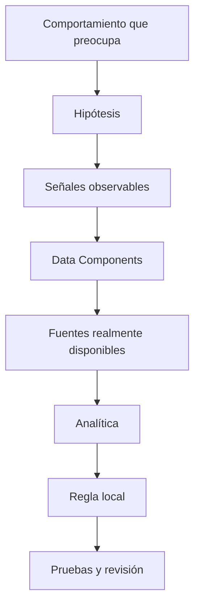
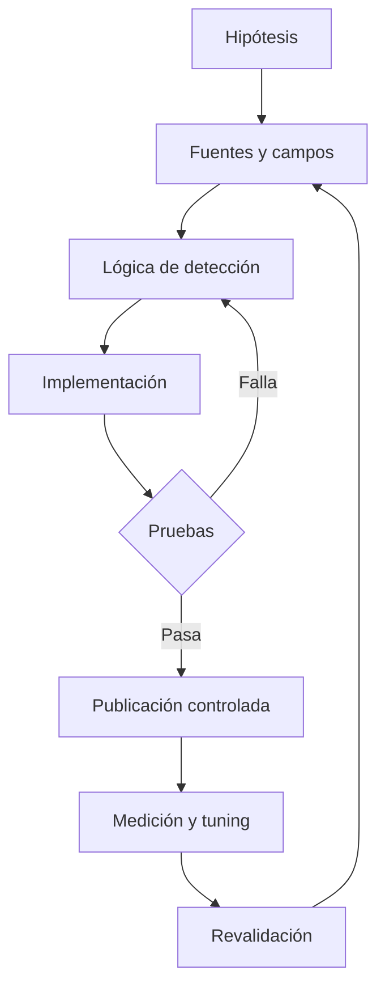
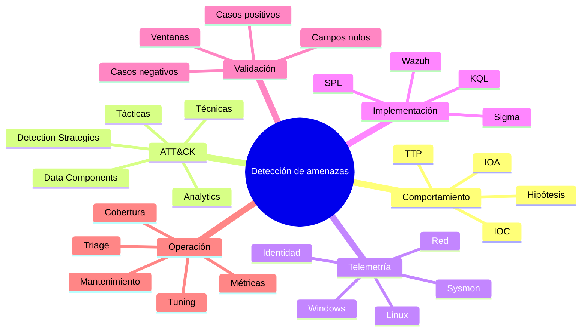
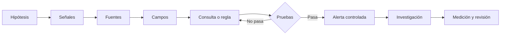
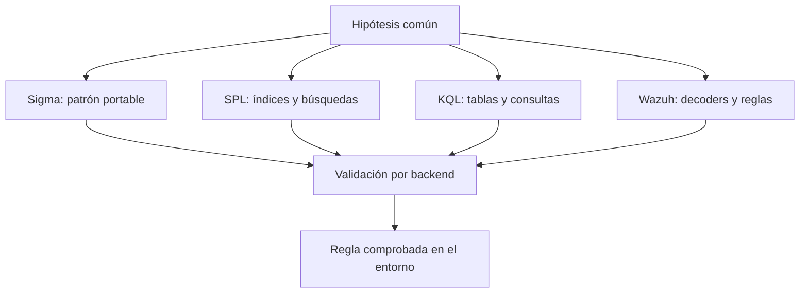
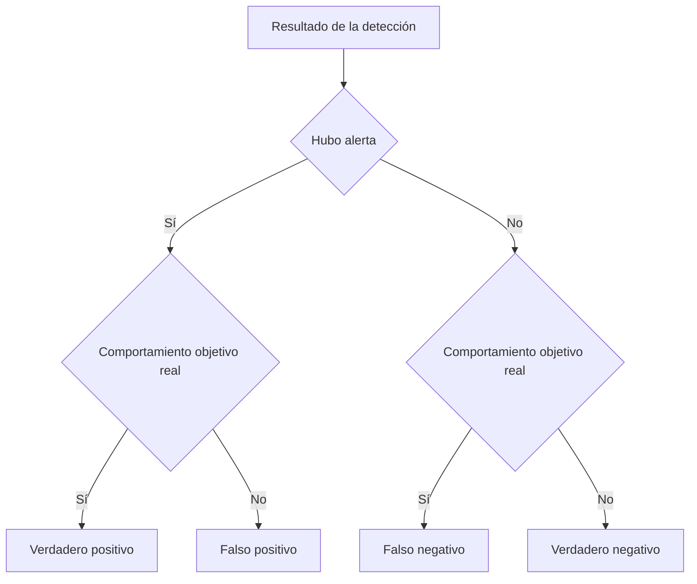

# Unidad 13 — Detección de amenazas y Detection Engineering

> Guía de estudio y referencia técnica para Blue Team, SOC Analyst L1 e introducción a Detection Engineering.
>
> **Alcance:** diseño de hipótesis, telemetría, MITRE ATT&CK, Sigma, SPL, KQL, Wazuh, validación, ajuste y documentación de detecciones.
>
> **Nota:** los registros e incidentes de ejemplo son **sintéticos**. Los resultados se explican sobre esos datos, sin presentarlos como actividad observada en un entorno real. Las reglas de consulta dependen del esquema, versión y configuración de cada plataforma.

## Índice

- [1. Qué cambia cuando paso de analizar alertas a diseñarlas](#1-qué-cambia-cuando-paso-de-analizar-alertas-a-diseñarlas)
- [2. Conceptos que conviene diferenciar](#2-conceptos-que-conviene-diferenciar)
- [3. Historia y evolución de la detección](#3-historia-y-evolución-de-la-detección)
- [4. MITRE ATT&CK explicado con criterio defensivo](#4-mitre-attck-explicado-con-criterio-defensivo)
- [5. Telemetría y requisitos de observabilidad](#5-telemetría-y-requisitos-de-observabilidad)
- [6. El proceso de construir una detección](#6-el-proceso-de-construir-una-detección)
- [7. Detecciones por IOC, comportamiento y secuencia](#7-detecciones-por-ioc-comportamiento-y-secuencia)
- [8. Ventanas, umbrales, baselines y cardinalidad](#8-ventanas-umbrales-baselines-y-cardinalidad)
- [9. Sigma: reglas portables con sus límites](#9-sigma-reglas-portables-con-sus-límites)
- [10. SPL: ingeniería de detecciones en Splunk](#10-spl-ingeniería-de-detecciones-en-splunk)
- [11. KQL: ingeniería de detecciones en Sentinel](#11-kql-ingeniería-de-detecciones-en-sentinel)
- [12. Wazuh: decoders, reglas y correlación](#12-wazuh-decoders-reglas-y-correlación)
- [13. Validación y pruebas de detecciones](#13-validación-y-pruebas-de-detecciones)
- [14. Falsos positivos, falsos negativos y tuning](#14-falsos-positivos-falsos-negativos-y-tuning)
- [15. Cobertura ATT&CK y prioridades](#15-cobertura-attck-y-prioridades)
- [16. Calidad del contenido y ciclo de vida](#16-calidad-del-contenido-y-ciclo-de-vida)
- [17. Threat hunting y detección](#17-threat-hunting-y-detección)
- [18. Casos de investigación resueltos](#18-casos-de-investigación-resueltos)
- [19. Métricas y evaluación de resultados](#19-métricas-y-evaluación-de-resultados)
- [20. Errores frecuentes y cómo evitarlos](#20-errores-frecuentes-y-cómo-evitarlos)
- [21. Diccionario de campos y comandos](#21-diccionario-de-campos-y-comandos)
- [22. Mapas conceptuales](#22-mapas-conceptuales)
- [23. Proyecto integrador resuelto](#23-proyecto-integrador-resuelto)
- [24. Autoevaluación](#24-autoevaluación)
- [25. Referencias](#25-referencias)

---

# 1. Qué cambia cuando paso de analizar alertas a diseñarlas

Hasta la Unidad 12 estuve aprendiendo a encontrar eventos, filtrarlos y reconstruir secuencias dentro de un SIEM. En esta unidad aparece otra pregunta: **¿cómo decido qué vale la pena detectar y cómo hago para que el sistema lo reconozca?**

Una regla útil no es la que más alertas genera. Es la que permite identificar un comportamiento relevante con suficiente información para que alguien pueda investigarlo. Una regla que alerta por cada ejecución de PowerShell tal vez produce miles de resultados. Otra que detecta PowerShell iniciado desde un proceso ofimático y ejecutando una acción inusual puede ser mucho más útil; igual necesita validación.

La detección tiene tres capas:

1. **Comportamiento:** qué podría estar haciendo un adversario o qué cambio representa un riesgo.
2. **Observación:** qué señales concretas dejaría ese comportamiento en nuestros sistemas.
3. **Implementación:** cómo expresar esa señal en una consulta o regla que funcione con nuestros registros.

A veces la idea defensiva es buena, pero faltan registros. A veces tenemos los registros, pero están mal normalizados. Y a veces la consulta funciona, pero el umbral genera tanto ruido que nadie puede investigarla. Hay que resolver los tres niveles.

## 1.1 Qué se espera de una detección madura

Una detección debería poder responder sin vueltas:

- Qué comportamiento intenta identificar.
- Por qué ese comportamiento importa en el entorno.
- Qué campos y fuentes necesita.
- Qué consulta o regla implementa el criterio.
- Qué condición activa la alerta.
- Qué situaciones legítimas pueden parecerse.
- Qué pruebas se hicieron y con qué datos.
- Qué debería revisar primero el analista.
- Quién mantiene la detección y cuándo se volvió a validar.

No todas las reglas necesitan veinte páginas de documentación, pero sí información suficiente para mantenerlas y comprobar que funcionan.

## 1.2 Detección, investigación y respuesta no son lo mismo

**Detección:** identifica una señal. **Investigación:** busca contexto y evidencia para entender esa señal. **Respuesta:** toma medidas autorizadas de contención, erradicación o recuperación.

Por ejemplo, seis intentos fallidos contra seis usuarios diferentes desde una IP pueden activar una detección. Todavía no demuestran por sí solos un compromiso. Una investigación puede descubrir que se trata de un escáner de pruebas autorizado o de una actividad sospechosa. La decisión de bloquear, resetear credenciales o escalar depende del contexto y del procedimiento.

---

# 2. Conceptos que conviene diferenciar

## 2.1 IOC frente a IOA

Un **IOC** (Indicator of Compromise) es un artefacto observable asociado potencialmente a una actividad maliciosa: un hash, dominio, dirección IP, nombre de archivo o ruta, por ejemplo. No todos los IOC tienen la misma estabilidad. Una IP puede cambiar de dueño o ser compartida; un hash identifica un contenido concreto, pero una modificación mínima cambia ese valor.

Un **IOA** (Indicator of Attack) apunta al comportamiento: una cuenta que enumera múltiples sistemas, un proceso que intenta desactivar controles, una secuencia de creación de servicios remotos, o autenticaciones anómalas. El IOA suele resistir mejor cambios triviales de infraestructura, pero puede generar ambigüedades y exige contexto.

| Enfoque | Ejemplo | Ventaja | Límite |
|---|---|---|---|
| IOC | Coincidencia con hash conocido | Específico | Pierde visibilidad ante variantes |
| IOC | Conexión a dominio de riesgo | Fácil de buscar | Reputación y atribución cambian |
| Comportamiento | Office inicia intérprete de comandos | Describe técnica observable | Puede ocurrir en automatizaciones legítimas |
| Secuencia | Fallos multiusuario + éxito + actividad posterior | Contexto más fuerte | Requiere varias fuentes y correlación temporal |

## 2.2 Evento, condición, regla, alerta e incidente

Un evento es un hecho registrado. La condición es un criterio lógico sobre uno o varios eventos. Una regla implementa ese criterio. Una alerta aparece cuando se cumple la condición configurada. Un incidente es una entidad de trabajo que agrupa información y puede requerir respuesta.

Una regla puede producir varias alertas. Varias alertas pueden terminar en un solo incidente. Y un incidente puede contener evidencias de más de una técnica. Mezclar estos niveles dificulta medir resultados.

## 2.3 Hipótesis de detección

Una buena hipótesis expresa un comportamiento comprobable:

> Si una misma dirección de origen produce fallos de autenticación para numerosas cuentas distintas en poco tiempo, podría existir actividad de password spraying. Quiero detectar esa diversidad de cuentas y excluir fuentes operativas conocidas solo cuando la exclusión esté justificada.

La clave es la palabra **podría**. No estoy confundiendo una coincidencia con una atribución.

## 2.4 TTP, táctica, técnica y procedimiento

Las **tácticas** expresan objetivos del adversario. Las **técnicas** describen formas de alcanzar esos objetivos. Los **procedimientos** son implementaciones concretas observadas en circunstancias particulares. TTP significa Tactics, Techniques and Procedures.

Un mismo comando no define toda una técnica. Una misma técnica puede implementarse con distintas herramientas. Esto explica por qué conviene detectar comportamientos más que nombres de software aislados.

## 2.5 Regla de búsqueda frente a regla de alertado

Puedo escribir una búsqueda para explorar datos sin crear ninguna alerta. Para pasarla a producción debo definir período de ejecución, tiempo observado, entidad, severidad, deduplicación, agrupación de incidentes, supresiones, propietario, mantenimiento y comportamiento cuando no llegan logs.

---

# 3. Historia y evolución de la detección

La detección no nació con los SIEM modernos. Durante décadas se apoyó en firmas, antivirus, registros de sistemas y mecanismos de auditoría. La madurez actual surge de combinar diferentes formas de observación.

## 3.1 Firmas y detección basada en indicadores

Los primeros enfoques ampliamente utilizados reconocían patrones conocidos: cadenas de bytes, firmas de malware o coincidencias de tráfico. Siguen siendo valiosos porque pueden identificar amenazas específicas con rapidez. El problema es que una firma suele necesitar actualizaciones cuando cambia el artefacto.

## 3.2 La consolidación de los SIEM

Con miles de equipos y aplicaciones, revisar archivos independientes se volvió inviable. Los SIEM permitieron centralizar y correlacionar registros. Pero centralizar no significa comprender: una organización puede almacenar muchos terabytes y seguir teniendo poca capacidad de detección si faltan campos o contexto.

## 3.3 MITRE ATT&CK como lenguaje común

ATT&CK ayudó a organizar técnicas adversarias y conectar observaciones con comportamiento. La utilidad real no está en llenar dashboards de etiquetas ATT&CK, sino en descubrir qué técnicas tienen sentido para los activos de la organización y qué parte se puede observar.

En **octubre de 2025**, ATT&CK v18 incorporó cambios importantes en su arquitectura defensiva: pasó a organizar la detección alrededor de **Detection Strategies**, **Analytics** y **Data Components**, y marcó **Data Sources** como deprecado en ese modelo. Esto importa porque muchas guías anteriores todavía explican el catálogo antiguo como si fuese el diseño vigente. Conviene reconocerlo al leer documentación de distintos años.

## 3.4 De buscar un evento a entender una secuencia

Un evento de creación de proceso es una observación. Una secuencia que vincula documento, intérprete, conexión saliente y archivo descargado permite formular una historia más específica. El cambio de enfoque no elimina las reglas simples: las complementa cuando necesitamos mayor precisión.

## 3.5 Detecciones como código

Tratar reglas como código implica versionarlas, revisarlas, probarlas y registrar cambios. Una modificación pequeña de un filtro puede borrar silenciosamente buena parte de la cobertura. Git, pruebas automáticas, revisiones entre pares y documentación permiten reducir ese riesgo.

---

# 4. MITRE ATT&CK explicado con criterio defensivo

MITRE ATT&CK es una base de conocimiento de comportamientos adversarios observados y organizados. **No** es una lista de acciones que necesariamente ocurren en orden, ni una prueba de compromiso cuando una regla contiene una etiqueta ATT&CK.

## 4.1 Tácticas: para qué se hace algo

Una táctica representa un objetivo. Por ejemplo, Credential Access reúne formas de intentar obtener credenciales; Persistence agrupa maneras de conservar acceso; Lateral Movement cubre movimientos entre sistemas; Exfiltration se refiere a sacar información.

Las tácticas describen propósitos, no herramientas específicas. La misma herramienta administrativa podría aparecer en actividades vinculadas con distintas tácticas según su uso.

## 4.2 Técnicas y sub técnicas: cómo

Las técnicas representan métodos. Las sub técnicas refinan esos métodos cuando el marco distingue variantes útiles. La identificación por código permite referirnos a comportamientos sin depender del idioma de la descripción.

Ejemplos de identificadores ampliamente conocidos que aparecen en análisis defensivos:

- **T1110:** Brute Force.
- **T1110.003:** Password Spraying.
- **T1059:** Command and Scripting Interpreter.
- **T1053:** Scheduled Task/Job.
- **T1543:** Create or Modify System Process.
- **T1070:** Indicator Removal.
- **T1041:** Exfiltration Over C2 Channel.

Siempre conviene confirmar el título, versión y alcance del identificador contra la fuente oficial antes de publicar una detección. Una etiqueta incorrecta no rompe una consulta, pero sí deforma la cobertura que reportamos.

## 4.3 Detection Strategies, Analytics y Data Components

Una **Detection Strategy** expresa cómo defenderse mediante observación y análisis de un comportamiento. Las **Analytics** describen patrones y lógica de detección. Los **Data Components** identifican tipos concretos de telemetría necesarios para apoyar el análisis.

No son sinónimos:

- La estrategia plantea qué comportamiento quiero reconocer.
- La analítica especifica señales y condiciones.
- El componente de datos identifica qué necesito observar.
- La regla local traduce todo eso a campos, índices y límites de mi ambiente.

Por eso una analítica ATT&CK no se copia necesariamente como una consulta lista para ejecutar. Hace falta adaptación.

## 4.4 Cómo usar ATT&CK sin forzar el mapeo

Primero describo el comportamiento que de verdad observé. Después busco la técnica más precisa. Si una regla detecta cuatro fallos de login desde una IP, eso no prueba que haya password spraying: puede ser un error de configuración, una tarea automatizada o un usuario con contraseñas viejas. La correspondencia con ATT&CK expresa qué técnica **podría** investigar la detección, no un veredicto.

## 4.5 Qué significa cobertura

No alcanza con escribir «cubro T1110». Tengo que poder decir qué variante, qué sistemas, qué fuentes, qué volumen observado, qué limitaciones y qué pruebas sostienen esa afirmación.

Ejemplo:

> Cobertura parcial de T1110.003 para autenticaciones de Windows enviadas al SIEM desde controladores de dominio incluidos en la colección, basada en múltiples usuarios afectados por una misma IP de origen durante una ventana temporal definida.

Eso es mucho más útil que poner un casillero verde que diga «Brute Force: cubierto».

## 4.6 Detecciones de evento único y detecciones compuestas

La creación de un servicio nuevo puede generar una alerta simple. Si la correlaciono con un inicio de sesión desde una ubicación inusual y una ejecución posterior, obtengo una detección compuesta. Esta última suele tener más contexto, pero depende de la calidad de varias fuentes y puede perder eventos si alguna falla.



---

# 5. Telemetría y requisitos de observabilidad

La pregunta inicial no debería ser «¿qué consulta escribo?», sino «¿qué datos tengo y qué datos faltan?». Si quiero detectar conexiones por proceso, necesito una fuente que relacione procesos con actividad de red. Un firewall perimetral normalmente no puede decirme por sí solo cuál fue el proceso padre en una estación Windows.

## 5.1 Windows Security Log

Suele aportar señales de autenticación, privilegios, cambios de cuentas y auditoría. Algunos identificadores importantes:

| ID | Qué puede aportar | Limitación |
|---|---|---|
| 4624 | Inicio de sesión exitoso | No demuestra que el actor sea legítimo |
| 4625 | Inicio de sesión fallido | No distingue por sí solo error de ataque |
| 4688 | Creación de proceso | Requiere auditoría; command line depende de configuración |
| 4672 | Privilegios especiales en una sesión | Puede ser esperado para cuentas administrativas |
| 4720 | Creación de cuenta de usuario | Necesita contexto de cambio autorizado |
| 4728 / 4732 | Membresía de grupos | Verificar tipo de grupo, dominio y políticas |
| 1102 | Limpieza del registro Security | Puede tener causa administrativa |

La ausencia de un evento puede deberse a auditoría no habilitada, pérdida, permisos, ventana de retención o actividad que ocurrió en otro equipo.

## 5.2 Sysmon como sensor complementario

Sysmon puede registrar procesos, hashes, conexiones, creación de archivos, consultas DNS y otras actividades, según versión y configuración. No reemplaza al Security Log ni es un detector automático de malware.

Campos especialmente útiles para correlación:

- `ProcessGuid` y `ParentProcessGuid`: ayudan a vincular ejecuciones incluso cuando se reutilizan PID.
- `Image` y `ParentImage`: rutas de ejecutables.
- `CommandLine` y `ParentCommandLine`: argumentos de ejecución, si están disponibles.
- `User`: identidad asociada.
- `Hashes`: huellas configuradas sobre el ejecutable.
- `DestinationIp`, `DestinationPort`: si se captura telemetría de red y están disponibles.

**Sysmon ID 1** suele indicar creación de proceso; **ID 3** conexión de red, si está habilitada; **ID 11** creación de archivo; **ID 22** consulta DNS. No conviene asumir que todos los IDs están presentes en toda instalación.

## 5.3 Linux: auth, journal, auditd y servicios

En Linux no existe una sola ruta de logs universal. Algunas distribuciones mantienen registros en `/var/log/auth.log`, otras en `/var/log/secure`, y muchas utilizan `journald`.

`auditd` permite registrar operaciones seleccionadas por políticas. Las sesiones SSH, los cambios en `sudo`, las modificaciones de unidades systemd y las tareas cron pueden dejar señales valiosas si el entorno las conserva.

```bash
# Solo lectura: últimas entradas del servicio, si se conserva el journal
journalctl -u ssh --since '1 hour ago' --no-pager

# En otras distribuciones la unidad puede llamarse sshd
journalctl -u sshd -b --no-pager

# Eventos de auditoría de una ventana, si auditd está configurado
sudo ausearch -ts recent
```

No todas las máquinas tienen `auditd` instalado ni conservan journals persistentes. Hay que verificar antes de diseñar reglas.

## 5.4 Red: firewall, proxy, DNS y NDR

Los registros de red permiten observar conexiones, consultas, acciones permitidas o bloqueadas, cantidades de bytes y a veces usuarios autenticados. Pero una IP compartida por NAT no identifica sola a un equipo. DNS muestra intención de resolución, no necesariamente una conexión posterior. Una conexión TLS puede ocultar el contenido de aplicación.

## 5.5 Identidad y nube

En ambientes con Microsoft Entra ID, AWS, Google Cloud u otros proveedores conviene distinguir eventos de autenticación, cambios de privilegio, auditoría de recursos y actividad de aplicaciones. Los nombres de las tablas y su contenido dependen de licencias, conectores y configuraciones.

## 5.6 Requisitos mínimos de un evento útil

En general busco:

1. Tiempo del hecho y zona horaria clara.
2. Fuente y equipo que lo generó.
3. Acción o tipo de evento.
4. Identidad, si corresponde.
5. Origen y destino, si es una comunicación.
6. Identificadores de correlación: sesión, proceso, solicitud o evento.
7. Resultado y error cuando existan.
8. Registro original para recuperar detalles no normalizados.

No todos los eventos tienen todos esos campos. La ausencia de un campo debe formar parte de los límites documentados.

## 5.7 Tiempo del evento frente a tiempo de ingesta

`event_time` es cuando ocurrió el hecho según la fuente. `ingest_time` es cuándo llegó a la plataforma. Pueden diferir por buffering, latencia, desconexiones o problemas de reloj. Si una detección usa solo el tiempo de ingesta, puede agrupar juntos hechos que ocurrieron en momentos distintos.

## 5.8 Normalización: una ayuda con riesgos

Traducir `src_ip`, `client_ip` y `source.address` a un campo común facilita buscar. El riesgo aparece cuando los campos no tienen el mismo significado o se pierde el original. Conviene conservar el dato sin modificar y documentar cada transformación.

## 5.9 Cobertura y salud de la colección

Antes de confiar en una regla, verifico que los agentes reporten, que las fuentes esperadas estén llegando, que la tasa de eventos sea razonable y que no existan brechas. Un detector silencioso puede significar «no hubo actividad» o «se dejó de recibir telemetría».

---

# 6. El proceso de construir una detección

Una metodología concreta evita que el diseño se reduzca a inventar umbrales.

## 6.1 Definir el problema

Ejemplo: «quiero detectar la posible utilización de una cuenta administrativa durante una ventana no habitual, seguida de una modificación sensible». Esto ya marca dos comportamientos que deben relacionarse.

Todavía no tengo una consulta. Primero determino a qué equipos afecta, qué cuentas son relevantes y qué cambios serían sensibles en ese entorno.

## 6.2 Formular una hipótesis comprobable

Una hipótesis expresa qué patrón espero ver si el comportamiento ocurre. Por ejemplo:

> Después de un inicio de sesión administrativo desde una fuente poco habitual, se observa la creación de un servicio en el mismo equipo dentro de una ventana temporal corta.

Ese patrón no es sinónimo de ataque. La hipótesis también debe contemplar mantenimiento legítimo.

## 6.3 Inventariar campos y fuentes

Para ese escenario podría necesitar:

- Autenticación: tiempo, usuario, equipo, dirección de origen, tipo de inicio.
- Creación de servicio: tiempo, equipo, nombre y ruta del servicio.
- Cambios aprobados: mantenimiento, responsable y ticket.

Si no puedo relacionar ambos eventos por equipo y hora, la regla compuesta puede no ser viable.

## 6.4 Diseñar lógica antes de escribir código

```text
Fuente A: autenticación administrativa válida
      ↓ mismo host + ventana temporal
Fuente B: creación inesperada de servicio
      ↓ aplicar contexto
¿Existe cambio aprobado? → sí: bajar prioridad y documentar
                    → no: priorizar investigación
```

Una ventaja de expresar primero la lógica en lenguaje natural es que puedo revisar si realmente describe el comportamiento deseado.

## 6.5 Elegir unidad de análisis

No es lo mismo agrupar por IP, por usuario, por equipo o por sesión. La unidad de análisis determina qué eventos se relacionan. Agrupar únicamente por IP puede mezclar personas detrás de NAT; agrupar por nombre de usuario sin dominio puede unir identidades distintas.

## 6.6 Escribir la consulta y verificar datos

Antes de implementar la condición final, suelo inspeccionar eventos crudos, campos nulos, variantes de nombres y distribución temporal. Si la columna `SourceIP` está vacía en la mitad de las filas, una detección basada en ese campo va a tener una cobertura parcial.

## 6.7 Definir salida útil

Una detección debería devolver contexto: hora inicial y final, identidad, equipo, origen, cantidad de eventos, IDs relacionados, criterio disparado y algún enlace o identificador para investigar. Una regla que solo devuelve «true» obliga al analista a rehacer todo el trabajo.

## 6.8 Probar escenarios positivos y negativos

Necesito al menos:

- Un escenario que debería activar la detección.
- Uno parecido que no debería activarla.
- Un caso con campos ausentes.
- Un caso que cruce límites de ventanas.
- Un caso con varios equipos o usuarios.
- Un escenario de volumen elevado.

## 6.9 Ajustar, publicar y mantener

Después de probar, documento la versión, creo un responsable y reviso los resultados en producción autorizada. Una regla que hoy funciona puede dejar de funcionar cuando cambia un conector, formato de log o flujo de autenticación.



---

# 7. Detecciones por IOC, comportamiento y secuencia

## 7.1 Coincidencia de hash

Si una fuente de endpoint informa un hash que aparece en una lista de indicadores de alta confianza, puedo iniciar una investigación. Pero la regla debe incluir contexto: ruta, firma, host, usuario, origen de la lista y fecha de validez del IOC.

Un hash distinto no demuestra que el archivo sea seguro. Y la coincidencia tampoco demuestra por sí sola que el archivo se ejecutó.

## 7.2 Dominio o IP de riesgo

Detectar acceso a destinos señalados por inteligencia puede ser útil. Tengo que considerar vigencia de la reputación, IP compartidas, proxys, servicios de alojamiento y posibilidad de falsos positivos.

## 7.3 Abuso de herramientas legítimas

PowerShell, Bash, WMI y herramientas de administración son útiles para operaciones normales y también pueden ser abusadas. Detectar su nombre aislado es insuficiente. Conviene revisar quién las ejecuta, qué proceso las inició, con qué argumentos y qué ocurre después.

## 7.4 Cambios de persistencia

Crear una tarea programada, una unidad systemd, una entrada cron o un servicio puede ser una señal relevante. La detección debe conocer los procesos de administración que normalmente producen esos cambios.

## 7.5 Autenticaciones anómalas

Hay varios patrones diferentes:

- Muchos intentos sobre una sola cuenta.
- Una fuente intentando numerosas cuentas.
- Una cuenta desde múltiples orígenes.
- Acceso exitoso después de fallos relevantes.
- Uso de credenciales privilegiadas fuera de contexto.

No conviene llamar a todo «brute force». El diseño debe diferenciar la diversidad de usuarios, las tasas y las ventanas.

## 7.6 Integridad de archivos

Un evento FIM puede informar un cambio de archivo o configuración. Eso no equivale a malware. Importa saber qué cambió, quién tenía permiso, si hay mantenimiento aprobado y si la modificación afecta un activo sensible.

## 7.7 Detecciones basadas en secuencia

Ejemplo ilustrativo:

```text
09:00: documento abierto
09:01: proceso ofimático inicia intérprete
09:02: intérprete escribe archivo temporal
09:03: proceso temporal establece conexión externa
```

La secuencia aporta más contexto que cualquiera de los cuatro eventos aislados. Igual hay que revisar causalidad y falsos enlaces, especialmente cuando hay varios procesos similares.

---

# 8. Ventanas, umbrales, baselines y cardinalidad

## 8.1 Qué significa una ventana temporal

Una ventana agrupa eventos durante un período. Por ejemplo, «cinco minutos» no dice nada por sí solo si no especifico si se trata de ventanas fijas, deslizantes o del período que consulta una regla programada.

### Ventana fija

Agrupa 10:00–10:05, 10:05–10:10 y así sucesivamente. Dos eventos muy cercanos a un límite pueden quedar en grupos distintos.

### Ventana deslizante

Se evalúa respecto de distintos instantes o actualizaciones. Puede captar relaciones que una ventana fija separa, pero requiere más cuidado con duplicados y costo computacional.

## 8.2 Conteo total frente a usuarios distintos

Estos datos sintéticos muestran la diferencia:

| Hora | Origen | Cuenta | Resultado |
|---|---|---|---|
| 10:01 | 192.0.2.10 | ana | fallo |
| 10:02 | 192.0.2.10 | ana | fallo |
| 10:03 | 192.0.2.10 | ana | fallo |
| 10:04 | 192.0.2.10 | leo | fallo |
| 10:05 | 192.0.2.10 | sol | fallo |

Hay cinco fallos, pero solo tres cuentas distintas. Una regla de password spraying debería prestar atención a **cuántas identidades distintas** afectó el origen, no únicamente al total de errores.

## 8.3 Cardinalidad y `dcount`

La cardinalidad es la cantidad de valores distintos de un campo. En algunas plataformas `dcount` es aproximado, según función y configuración. Si necesito precisión exacta sobre un dataset pequeño, conviene confirmar si existe una variante exacta y evaluar costo.

## 8.4 Baseline: qué es normal para ese entorno

Un servidor de autenticación puede recibir cientos de fallos diarios sin que exista ataque. Una estación de un solo usuario podría volver sospechosos quince fallos en pocos segundos. Por eso «normal» depende del activo, el rol y el período.

Un baseline no debería aprender ciegamente de períodos comprometidos o de despliegues excepcionales. La calidad del punto de comparación importa tanto como el umbral.

## 8.5 Umbrales estáticos y dinámicos

Un umbral estático es fácil de entender y mantener. Uno dinámico se adapta a variaciones, pero puede ser difícil de explicar y ocultar cambios si se recalcula con datos anómalos. La elección depende de madurez, volumen y capacidad de evaluación.

## 8.6 Supresión y deduplicación

Una supresión reduce alertas repetidas durante un intervalo, pero no debería eliminar evidencia cruda. Deduplicar demasiado pronto puede borrar información necesaria para contar intentos. Conviene diferenciar **reducir notificaciones** de **descartar eventos**.

## 8.7 Latencia, retrasos y eventos fuera de orden

Una regla programada puede perder eventos que llegaron tarde. Una solución puede ampliar el período de búsqueda, pero hay que controlar que el solapamiento no produzca alertas duplicadas. El diseño debe contemplar `TimeGenerated`, tiempo de ingesta y periodicidad real.

---

# 9. Sigma: reglas portables con sus límites

Sigma es un formato de reglas de detección basado en YAML para describir patrones sobre logs. Ayuda a intercambiar detecciones, revisarlas como código y convertirlas a distintos sistemas mediante herramientas compatibles. **No garantiza portabilidad automática**, porque cada SIEM tiene campos, funciones y modelos diferentes.

## 9.1 Partes de una regla

Una regla suele incluir `title`, `id`, `status`, `description`, `logsource`, `detection`, `falsepositives`, `level` y `tags`. La sintaxis y los modificadores se rigen por la especificación de Sigma.

Ejemplo didáctico de coincidencia sencilla:

```yaml
# Ejemplo pedagógico, no validado contra un backend específico.
title: Office Launching PowerShell - Example
id: 9b2df1ca-8dc2-4fd3-b75d-6b6d6f7a1313
status: experimental
description: Detecta PowerShell iniciado por una aplicación ofimática.
logsource:
  product: windows
  category: process_creation
detection:
  selection_parent:
    ParentImage|endswith:
      - '\WINWORD.EXE'
      - '\EXCEL.EXE'
  selection_child:
    Image|endswith: '\powershell.exe'
  condition: selection_parent and selection_child
falsepositives:
  - Automatización administrativa documentada
level: medium
tags:
  - attack.execution
  - attack.t1059.001
```

Este YAML expresa una relación entre ejecutables. Para una detección real necesito comprobar normalización, mayúsculas/minúsculas, extensiones, rutas, otras versiones de PowerShell y procesos legítimos que produzcan esa cadena.

## 9.2 Selecciones y condiciones

Una selección define criterios. La condición establece la lógica que relaciona selecciones. Puedo expresar una coincidencia simple, combinaciones `and/or`, exclusiones y operadores compatibles con la especificación.

La legibilidad importa. Si una regla contiene condiciones difíciles de seguir, conviene dividirlas en selecciones con nombres descriptivos y probar variantes por separado.

## 9.3 Modificadores comunes

- `endswith`: útil cuando me interesa el final de una ruta.
- `contains`: busca una subcadena; puede ser demasiado amplio.
- `startswith`: compara prefijos.
- `all`: cambia el comportamiento para listas en contextos compatibles.
- `re`: usa expresiones regulares según soporte del conversor/backend.

Los modificadores pueden traducirse de forma diferente entre herramientas. Por eso necesito inspeccionar la consulta generada.

## 9.4 Sigma no equivale a una regla productiva

Aunque el YAML sea válido, falta confirmar que exista el logsource, que los campos se mapeen correctamente, que la plataforma pueda expresar la condición y que los resultados sean útiles. También hay que resolver severidad, periodicidad y agrupación, que Sigma por sí solo no define universalmente para todos los sistemas.

## 9.5 Errores habituales en reglas Sigma

**Copiar una regla sin revisar `logsource`.** Una consulta de procesos Windows no funcionará si solo recolecto autenticaciones.

**Usar `contains` para una palabra muy común.** Puede producir ruido enorme.

**Confiar en la etiqueta ATT&CK sin revisar el comportamiento.** El mapeo debe estar justificado.

**No revisar el resultado de la conversión.** Una regla formalmente correcta puede traducirse a campos incorrectos.

## 9.6 Versionado

Para GitHub conviene conservar un archivo por regla, identificador estable, descripción del problema, pruebas y cambios relevantes. Una actualización que reduce ruido debe explicar qué eventos deja de detectar.

---

# 10. SPL: ingeniería de detecciones en Splunk

SPL trabaja con búsquedas y comandos encadenados. La potencia está en combinar filtros, agregaciones, transformaciones y enriquecimientos. El nombre de índice, sourcetype y campos **depende del entorno**.

## 10.1 Primero inspeccionar, después agregar

```spl
index=security sourcetype=windows:security (EventCode=4624 OR EventCode=4625)
| table _time host EventCode user src_ip
| head 30
```

Esta consulta es ilustrativa: `index=security`, `sourcetype=windows:security`, `user` y `src_ip` son nombres que deberían verificarse en la instalación. No existe garantía de que todos aparezcan exactamente así.

## 10.2 Conteos por usuario

```spl
index=security EventCode=4625
| stats count AS failed_logins by user
| sort - failed_logins
```

Permite revisar cuentas con mayor cantidad de fallos. Todavía no detecta spraying: solo muestra conteos por cuenta.

## 10.3 Diversidad de usuarios por origen

```spl
index=security EventCode=4625 src_ip=*
| stats count AS total_fallos dc(user) AS usuarios_distintos values(user) AS cuentas by src_ip
| where usuarios_distintos >= 5
| sort - usuarios_distintos
```

Si una fuente genera 30 fallos contra un solo usuario, `usuarios_distintos=1` y no cumple el criterio mostrado. Si genera siete fallos sobre seis identidades diferentes, sí podría aparecer. **Falta delimitar una ventana temporal** para que esto no agrupe toda la retención.

## 10.4 Agregar ventanas de cinco minutos

```spl
index=security earliest=-24h EventCode=4625 src_ip=*
| bin _time span=5m
| stats count AS fallos dc(user) AS cuentas_distintas values(user) AS usuarios by src_ip _time
| where cuentas_distintas >= 5
| sort 0 _time
```

Esta variante tiene ventanas fijas de cinco minutos. Un patrón que cruce los límites de dos ventanas podría quedar dividido. Para un entorno real hay que evaluar esa limitación.

## 10.5 Uso de `eval`

```spl
index=security (EventCode=4624 OR EventCode=4625)
| eval resultado=case(EventCode=4624, "success", EventCode=4625, "failure", true(), "other")
| stats count by resultado
```

`eval` ayuda a crear campos interpretables sin modificar el evento original almacenado. Conviene preservar diferencias importantes en vez de normalizar todo a categorías excesivamente amplias.

## 10.6 `eventstats`, `streamstats` y `stats`

- `stats` consolida eventos en resultados agregados.
- `eventstats` calcula estadísticas y las añade a los eventos originales.
- `streamstats` puede calcular valores acumulados siguiendo un orden.

Elegir mal el comando puede borrar información necesaria para correlacionar. Por ejemplo, después de un `stats by user` ya no tengo automáticamente cada línea original ni su identificador de evento.

## 10.7 `transaction` y costo

`transaction` agrupa eventos relacionados, pero puede ser costoso y frágil con sesiones incompletas. Muchas correlaciones se pueden expresar con `stats` u otras estrategias más controlables. Hay que comparar resultados, no asumir que un comando es superior por ser más directo de leer.

## 10.8 Caso resuelto: intentos multiusuario

Datos sintéticos de 09:00 a 09:05:

- `198.51.100.70`: 8 fallos hacia 7 cuentas.
- `198.51.100.71`: 14 fallos hacia 1 cuenta.
- `198.51.100.72`: 2 fallos hacia 2 cuentas.

Con la consulta de cinco minutos y umbral `cuentas_distintas >= 5`, aparece **198.51.100.70** únicamente. No aparece `.71`, a pesar de generar más fallos, porque el criterio busca diversidad de usuarios. El resultado justifica triage, no confirma la técnica sin contexto.

## 10.9 Consultas vacías: diagnóstico

Una búsqueda sin resultados puede deberse a índices incorrectos, sourcetype distinto, ventana demasiado pequeña, nombres de campo equivocados, falta de permisos, ausencia de eventos o demoras de ingesta. Antes de cambiar la regla, compruebo primero si existen datos crudos para esa fuente.

---

# 11. KQL: ingeniería de detecciones en Sentinel

Microsoft Sentinel se apoya en KQL para consultar tablas de Log Analytics y generar reglas analíticas. Los nombres de tablas dependen de los conectores. Una consulta que funciona sobre `SecurityEvent` no necesariamente sirve para `SigninLogs` o `DeviceProcessEvents`.

## 11.1 Consultar datos existentes

```kusto
SecurityEvent
| where TimeGenerated > ago(1h)
| take 20
```

Esta consulta requiere que `SecurityEvent` exista y contenga información. Si no hay resultados, primero verifico conector, permisos y retención.

## 11.2 Filtrar fallos

```kusto
SecurityEvent
| where TimeGenerated > ago(24h)
| where EventID == 4625
| project TimeGenerated, Computer, Account, IpAddress, EventID
```

La disponibilidad de `IpAddress` y otros campos depende de las características de los registros. Antes de basar una regla en ellos hay que revisar valores nulos y formatos.

## 11.3 Conteo y diversidad por ventana

```kusto
SecurityEvent
| where TimeGenerated > ago(24h)
| where EventID == 4625
| where isnotempty(IpAddress) and isnotempty(Account)
| summarize Fallos=count(), CuentasDistintas=dcount(Account), Cuentas=make_set(Account, 20)
    by IpAddress, bin(TimeGenerated, 5m)
| where CuentasDistintas >= 5
| order by TimeGenerated asc
```

`dcount` devuelve una estimación de cardinalidad. Para datasets pequeños en los que importe exactitud puede evaluarse `count_distinct()`, considerando sus límites y costos. La versión anterior es útil para introducir el patrón, no para fijar un umbral universal.

## 11.4 Por qué `project` y `extend` son importantes

`project` permite seleccionar las columnas que verá el analista. `extend` crea campos derivados. Si proyecto demasiado pronto puedo eliminar información útil; si extiendo campos basados en nulos sin control, puedo producir resultados engañosos.

## 11.5 `join`: relacionar sin inventar causalidad

Con `join` puedo unir eventos por usuario, host o identificador. El peligro es producir combinaciones espurias si la clave no es única o la ventana temporal no está limitada. Una coincidencia por cuenta no demuestra que un proceso pertenezca a una sesión determinada.

## 11.6 Reglas programadas

Una regla analítica programada define, entre otras cosas:

- Cuándo corre la consulta.
- Cuánto tiempo hacia atrás busca.
- Qué resultados producen alertas.
- Qué entidades y detalles se mapean.
- Cómo se agrupan incidentes.
- Qué severidad se asigna.

Si la búsqueda examina diez minutos y se ejecuta cada cinco, hay solapamiento. Ese solapamiento puede ser útil para datos tardíos, pero exige revisar duplicados de alertas e incidentes. Sentinel documenta mecanismos y consideraciones específicas para la latencia de ingesta.

## 11.7 Caso resuelto: accesos nocturnos privilegiados

Supongamos que un servicio tiene tres accesos administrativos entre 01:00 y 01:15. Uno coincide con una ventana de mantenimiento aprobada; los otros dos provienen de un dispositivo inusual.

Una regla que solo detecte «hora fuera de oficina» generaría tres candidatos. Con enriquecimiento de cambios aprobados y origen, priorizaría los dos no explicados. No los llamaría intrusión confirmada. El resultado esperado es **dos casos prioritarios para revisión**, no tres incidentes.

## 11.8 ASIM y normalización

ASIM facilita consultar diferentes fuentes mediante esquemas comunes, pero hay que entender qué parser se utilizó, qué campos se normalizaron y qué semántica conserva. La normalización no elimina la obligación de revisar el registro original.

---

# 12. Wazuh: decoders, reglas y correlación

Wazuh organiza buena parte de su detección de logs mediante **decoders** y **reglas**. El decoder interpreta el evento; la regla evalúa criterios y determina alertas. Otros módulos de Wazuh, como FIM, aportan señales distintas de los registros de autenticación.

## 12.1 Decoder frente a rule

Un decoder identifica y extrae campos del log. Una regla determina qué hacer cuando esos campos cumplen una condición. Si el decoder no extrae bien la dirección IP, una regla que agrupe por IP puede dejar de funcionar.

## 12.2 Ubicaciones de configuración

Las reglas personalizadas suelen ubicarse bajo `/var/ossec/etc/rules/`, y los decoders personalizados bajo `/var/ossec/etc/decoders/`, según la instalación. La documentación de Wazuh recomienda identificadores específicos para reglas personalizadas y probar los cambios antes de desplegarlos.

## 12.3 Ejemplo de regla personalizada sencilla

```xml
<!-- Ejemplo ilustrativo; validar con la configuración real y wazuh-logtest. -->
<group name="local,authentication,">
  <rule id="100201" level="5">
    <decoded_as>json</decoded_as>
    <field name="action">login_failed</field>
    <description>Ejemplo: fallo de autenticación en aplicación</description>
    <group>authentication_failed,</group>
  </rule>
</group>
```

Para que funcione tiene que llegar un JSON correctamente decodificado con `action=login_failed`. La estructura del archivo de reglas, la versión y los campos deben verificarse. Esta regla **no** detecta password spraying; detecta un tipo de evento.

## 12.4 Correlación por frecuencia

Wazuh permite reglas de correlación con `frequency`, `timeframe` y condiciones que relacionan eventos anteriores. La semántica depende de si se usa `if_matched_sid`, `same_srcip`, `same_field` u otras opciones.

Ejemplo didáctico:

```xml
<group name="local,authentication,">
  <rule id="100202" level="10" frequency="5" timeframe="300">
    <if_matched_sid>100201</if_matched_sid>
    <same_field>src_ip</same_field>
    <description>Ejemplo: múltiples fallos con misma IP en cinco minutos</description>
  </rule>
</group>
```

**Importante:** el decoder debe exponer `src_ip` como campo dinámico para que `same_field` resulte aplicable. La correlación del ejemplo cuenta fallos por una misma IP; **no garantiza usuarios distintos**. Si necesito detectar diversidad de cuentas, debo diseñar explícitamente ese criterio y validar qué capacidades reales ofrece mi versión de Wazuh o combinarla con consultas en el indexador/SIEM.

## 12.5 `wazuh-logtest`

Es una herramienta para comprobar cómo Wazuh decodifica y evalúa ejemplos. Puede ayudar a detectar errores de campos y reglas antes de producir cambios operativos. Una prueba local no sustituye observar que el agente, la cadena de ingestión y la generación real de alertas funcionan de extremo a extremo.

## 12.6 FIM como fuente de detección

Un evento de File Integrity Monitoring puede indicar creación, modificación o eliminación de archivos monitoreados. Es muy útil para cambios sensibles, pero genera falsos positivos si monitoreo rutas que cambian constantemente o si confundo mantenimiento con actividad maliciosa.

## 12.7 Tuning y niveles

Wazuh usa niveles de reglas para expresar relevancia y tratamiento. Un número alto no demuestra que ocurrió un incidente grave: es una prioridad definida por lógica y contexto, que puede necesitar adaptación al ambiente.

## 12.8 Agentes sin conexión

Una detección puede quedar silenciosa cuando deja de llegar telemetría. Conviene controlar salud del agente, último contacto y volumen esperado de eventos, además de diseñar reglas de amenaza.

---

# 13. Validación y pruebas de detecciones

Una consulta que devuelve lo esperado para tres filas no está necesariamente lista para producción. La validación debe comprobar tanto la lógica como las dependencias técnicas y operativas.

## 13.1 Prueba unitaria de reglas

En una regla simple, preparo ejemplos positivos y negativos. El resultado esperado debe quedar por escrito antes de ejecutar la prueba.

| Caso | Datos | ¿Debe alertar? |
|---|---|---|
| A | 6 cuentas fallidas desde una IP en 5 min | Sí, para umbral de 5 |
| B | 8 fallos sobre una cuenta | No, si el criterio es diversidad |
| C | 4 cuentas fallidas | No, si el umbral es 5 |
| D | 5 cuentas desde orígenes distintos | No, si se agrupa por origen |
| E | 5 cuentas, pero falta IP en todos | No con la lógica actual; evidencia de limitación |

La tabla expresa una especificación comprobable, no resultados de un SIEM concreto.

## 13.2 Pruebas con datos retrasados

Simulo que un evento ocurrido a las 10:01 llega a las 10:09. ¿La regla lo encuentra? ¿Produce una alerta duplicada? ¿Pierde el vínculo con otros eventos? Estos casos importan mucho cuando los agentes se desconectan.

## 13.3 Pruebas de fronteras temporales

Si cuatro eventos ocurren a las 10:04:59 y uno a las 10:05:01, una ventana fija de cinco minutos puede separarlos. Si la hipótesis exige «cinco en cualquier período de cinco minutos», la implementación debe respetarlo; de lo contrario, hay una diferencia entre lo que digo detectar y lo que realmente detecto.

## 13.4 Pruebas de nulos y duplicados

- Evento sin usuario.
- Evento sin dirección IP.
- Misma cuenta escrita en formatos diferentes.
- Evento duplicado por reenvío.
- Distintos equipos con un mismo nombre corto.
- NAT compartido.
- Relojes desalineados.

Los casos límite suelen ser responsables de detecciones frágiles.

## 13.5 Pruebas end-to-end

Una validación integral recorre sensor, agente, transporte, índice, parser, consulta, alerta e incidente. Si la consulta funciona sobre un CSV importado pero nunca llega un evento real desde el endpoint, no hay cobertura operativa completa.

## 13.6 Pruebas seguras y autorizadas

Para entrenar y validar podemos utilizar registros sintéticos, muestras inocuas, máquinas propias o simulaciones permitidas. No hace falta atacar servicios públicos ni producir tráfico perjudicial para demostrar que una detección funciona.

## 13.7 Evidencias de la prueba

Conservaría versión de la regla, dataset utilizado, timestamp, resultado esperado, resultado real, diferencias y decisión. Si modifico una exclusión, vuelvo a probar los casos que podría afectar.

## 13.8 Regression testing

Una actualización puede corregir un falso positivo y abrir un falso negativo. Por eso conviene mantener ejemplos anteriores como pruebas de regresión: la regla nueva tiene que pasar los casos viejos relevantes, además de los nuevos.

---

# 14. Falsos positivos, falsos negativos y tuning

## 14.1 Matriz de resultados

| Realidad | La detección alerta | La detección no alerta |
|---|---|---|
| Comportamiento que buscamos | Verdadero positivo | Falso negativo |
| Comportamiento benigno | Falso positivo | Verdadero negativo |

La dificultad real está en definir el **ground truth**: saber con suficiente respaldo cuál fue el comportamiento. Si una investigación quedó inconclusa, no conviene etiquetarla automáticamente como falso positivo.

## 14.2 Precisión y recall

**Precisión** responde: de lo que alerté, ¿cuánto era realmente relevante? **Recall** responde: de los casos relevantes que ocurrieron, ¿cuántos detecté?

En operaciones reales no siempre conocemos todos los ataques que ocurrieron, así que el recall puede ser difícil de estimar. Por eso conviene usar datasets controlados y validaciones complementarias.

## 14.3 El problema del ruido

Si una regla produce cientos de alertas benignas al día, los analistas pueden perder tiempo, fatiga y confianza. Pero si suprimimos todo lo que hace ruido sin revisar la lógica, podemos ocultar señales legítimas.

## 14.4 Ajuste contextual

Una forma responsable de tuning puede incluir:

- Excluir una automatización **específica** que fue documentada.
- Ajustar un umbral según volumen observado y riesgo.
- Añadir una condición de comportamiento adicional.
- Exigir más contexto para escalar severidad.
- Separar una regla de alto volumen en dos hipótesis distintas.

## 14.5 El riesgo de las allowlists

Una allowlist enorme puede convertirse en un punto ciego. Si excluyo toda una subred administrativa, puedo dejar de ver abuso desde un equipo comprometido en esa red. Las excepciones deben ser tan específicas como sea razonable y tener vencimiento o revisión periódica.

## 14.6 Ejemplo resuelto de tuning

Regla inicial: alerta por **cualquier** PowerShell iniciado por Office.

En una semana sintética aparecen 40 alertas: 32 provienen de una macro corporativa documentada y 8 de otras fuentes. No sería correcto excluir todo Office ni todo PowerShell. Una alternativa es filtrar la automatización identificada por ruta, firma, usuario técnico, hash/versión y contexto aprobado, y conservar el resto para investigación.

El resultado esperado tras una exclusión correcta no es «cero alertas», sino que desaparezcan las 32 coincidencias conocidas **sin perder** las otras 8. Luego verifico si esa automatización puede cambiar y si la exclusión sigue siendo segura.

## 14.7 Falsos negativos invisibles

Un falso positivo molesta porque aparece. Un falso negativo puede pasar desapercibido. Para descubrirlos hacen falta pruebas de ataque simuladas, revisión de cobertura, hunting, telemetría saludable y análisis posterior a incidentes.

---

# 15. Cobertura ATT&CK y prioridades

## 15.1 Una matriz no es un certificado

Mapear diez reglas a una técnica no significa cubrirla por completo. Tal vez todas observan la misma variante o dependen de la misma fuente. La cantidad de etiquetas no mide por sí sola la calidad.

## 15.2 Cobertura por técnica, activo y fuente

Conviene registrar:

| Técnica | Alcance | Evidencia disponible | Estado honesto |
|---|---|---|---|
| T1110.003 | Controladores de dominio | 4625 con origen/cuenta | Parcial, depende de campos y ventanas |
| T1059.001 | Endpoints Windows con Sysmon | Proceso/parent/command line | Parcial, depende de política |
| T1053 | Hosts auditados | Tareas programadas / cron | Parcial por plataforma |
| T1543 | Servidores monitoreados | Cambios de servicios | Parcial, requiere contexto |

Es un ejemplo orientativo. El estado real depende de las pruebas realizadas.

## 15.3 Priorización por riesgo

No todas las técnicas tienen igual valor para todas las organizaciones. Priorizo lo que afecta activos críticos, identidades privilegiadas, sistemas expuestos y comportamientos que pueden tener impacto alto. También considero el esfuerzo de implementación y la disponibilidad de telemetría.

## 15.4 Cobertura negativa

También vale documentar **qué no puedo detectar**. Por ejemplo: «no tenemos visibilidad de creación de procesos en equipos sin agente». Esa información permite tomar decisiones de inversión y evitar confianza injustificada.

## 15.5 ATT&CK Navigator

Una capa del Navigator puede comunicar técnicas priorizadas, evidencias y límites, pero no reemplaza la especificación de detecciones ni sus pruebas. Conviene acompañar la matriz con datos verificables.

---

# 16. Calidad del contenido y ciclo de vida

## 16.1 Detección como artefacto mantenible

Una regla debería tener identificador, versión, propietario, objetivo, consultas, dependencias, escenarios de prueba, cambios y fecha de revisión.

## 16.2 Diseño en GitHub

Una estructura posible es:

```text
detecciones/
├── windows/
│   ├── office-child-interpreter.yml
│   └── suspicious-service-creation.yml
├── identity/
│   └── multi-account-failures.yml
├── tests/
│   └── README.md
└── README.md
```

El README de una detección debería explicar las condiciones reales necesarias para reproducirla, pero **no publicar credenciales, registros sensibles ni datos identificables**.

## 16.3 Revisión de cambios

Cambiar `>= 5` por `>= 10` parece pequeño, pero afecta sensibilidad y resultados. El cambio debe tener motivo, prueba y revisión. Las exclusiones nuevas merecen especial cuidado porque pueden generar puntos ciegos.

## 16.4 Detecciones obsoletas

Una regla puede volverse obsoleta cuando desaparece un sistema, cambia una fuente o se modifica la técnica que pretendía detectar. El mantenimiento incluye retirar reglas inservibles, no solo agregar nuevas.

## 16.5 Separar severidad de confianza

Una señal puede tener impacto potencial alto y confianza baja. Ejemplo: conexión externa desde un servidor crítico sin otras evidencias. Otra puede tener alta confianza de un comportamiento benigno, como una tarea administrativa repetitiva. Separar ambos ejes ayuda a priorizar mejor.

---

# 17. Threat hunting y detección

Threat hunting es una búsqueda proactiva basada en hipótesis, no necesariamente activada por una alerta previa. Puede producir nuevas detecciones cuando se identifica un patrón repetible y suficientemente observable.

## 17.1 Del hunting a la regla

1. Formulo una hipótesis sobre un comportamiento relevante.
2. Identifico fuentes disponibles.
3. Busco patrones y casos negativos.
4. Valido si hay algo que merece investigación.
5. Si el patrón es repetible, diseño una detección.
6. Mido resultados y ajusto.

## 17.2 Cuándo no convertir un hallazgo en regla

No todo hallazgo produce una detección útil. A veces se basa en un evento único, un campo inestable o un contexto demasiado específico. Puede ser mejor documentarlo como consulta de hunting o control de auditoría.

## 17.3 Hunting no es atribución automática

La coincidencia con una técnica ATT&CK no identifica al grupo que la ejecutó. Múltiples actores y administradores pueden utilizar herramientas semejantes. La atribución requiere evidencias distintas y suele exceder el alcance de un SOC L1.

---
# 18. Casos de investigación resueltos

Todos los siguientes casos usan registros **inventados para estudiar**. La idea es practicar cómo se llega a una conclusión y qué parte de esa conclusión queda realmente sostenida. Cada caso presenta una situación distinta, no una plantilla que se repite.

## Caso 01 — Muchos fallos, pero una sola cuenta

Un SIEM muestra 18 fallos en cuatro minutos desde `192.0.2.21`, todos contra `analista1`.

**Interpretación:** existe una tasa de fallos que merece revisión, pero no coincide con una detección que exija múltiples usuarios afectados. Podría tratarse de un intento sobre una sola cuenta, una contraseña vieja de servicio o un usuario con un cliente mal configurado.

**Conclusión:** el comportamiento se ajusta mejor a una hipótesis de intentos repetidos sobre una cuenta que a un patrón multiusuario de spraying. Investigo procesos y servicios que usan esa identidad, origen y posibles autenticaciones posteriores. La regla de diversidad de cuentas no debería activarse.

## Caso 02 — Una IP contra muchas cuentas

Entre 08:00 y 08:04, `198.51.100.20` genera ocho fallos contra ocho cuentas distintas. En la misma ventana, `198.51.100.21` genera diez fallos contra una sola cuenta.

Si la regla exige **al menos seis cuentas distintas desde un origen en cinco minutos**, solo el primer origen cumple. El segundo presenta más eventos, pero otro comportamiento.

**Conclusión:** `198.51.100.20` es candidato a investigación por patrón compatible con spraying. La evidencia no permite afirmar compromiso ni éxito. `198.51.100.21` podría ser analizado por una regla de repetición sobre una cuenta.

## Caso 03 — Éxito después de fallos

Un servidor registra cinco fallos de una cuenta administrativa entre 21:00 y 21:02, seguidos por un 4624 a las 21:03. El origen coincide, pero no existen datos sobre las acciones posteriores.

La secuencia aumenta el interés, pero **un 4624 significa autenticación exitosa, no legitimidad**. Tampoco sabemos si los fallos provinieron de la misma persona que completó el acceso.

**Conclusión:** alerta de prioridad de investigación, con búsqueda de tipo de sesión, dispositivo, MFA disponible y actividad posterior. No hay evidencia suficiente para declarar intrusión confirmada.

## Caso 04 — Office inicia PowerShell

Sysmon registra `WINWORD.EXE` iniciando `powershell.exe`, con una línea de comandos que ejecuta una tarea de importación local. La cuenta es un usuario técnico y hay un cambio aprobado para ese documento automatizado.

La relación padre-hijo puede ser sospechosa en general, pero el contexto presenta una explicación legítima verificable.

**Conclusión:** señal técnicamente correcta, clasificada como actividad autorizada en el escenario sintético. Si la automatización se repite, conviene una excepción precisa que no excluya todas las ejecuciones Office → PowerShell.

## Caso 05 — Office inicia un intérprete inesperado

Un evento Sysmon ID 1 informa que `EXCEL.EXE` inicia `cmd.exe` desde la sesión de un usuario sin tareas automatizadas conocidas. El proceso ejecuta una secuencia no vinculada con las macros habituales y crea un archivo temporal desconocido.

Los datos no demuestran malware, pero el patrón tiene mayor interés que una coincidencia genérica de Office con un intérprete.

**Conclusión:** priorizar investigación de documento, comando, archivo creado y actividad posterior. La regla puede ganar precisión al correlacionar dos o más señales, en lugar de confiar solo en el proceso padre.

## Caso 06 — Servicio nuevo durante mantenimiento

El registro de un servidor muestra creación de un servicio a las 02:14. El equipo pertenece a una ventana de despliegue aprobada de 02:00 a 03:00, y la ruta corresponde a un paquete instalado por la plataforma corporativa.

**Conclusión:** la creación del servicio fue observada, pero el escenario justifica una explicación administrativa. Puede etiquetarse como cambio legítimo verificado si los datos de aprobación realmente coinciden. No conviene excluir para siempre todas las creaciones de servicios en horario nocturno.

## Caso 07 — Servicio nuevo fuera del cambio

Otro servidor registra un servicio nuevo ejecutado desde una carpeta temporal de usuario y no aparece ninguna aprobación de cambio. La cuenta que lo instaló tiene privilegios elevados y, minutos antes, inició sesión desde un origen atípico.

**Conclusión:** correlación de alto interés. La combinación de ruta, privilegios, ausencia de cambio y sesión inusual justifica escalamiento según procedimientos. Todavía no prueba por sí sola una intrusión, pero el caso tiene más evidencias que una detección de evento único.

## Caso 08 — Cron modificado en Linux

En `/etc/cron.d/` se detecta la creación de una entrada que ejecuta un script de respaldo. El script está firmado o controlado por el equipo de operaciones, tiene propietario esperado y existe solicitud de mantenimiento.

**Conclusión:** la persistencia mediante cron es una posibilidad técnica, pero la explicación de administración parece consistente. La regla FIM que detectó el cambio funcionó; el desenlace analítico es benigno dentro de la simulación.

## Caso 09 — Unidad systemd inesperada

Un servidor Linux registra una nueva unidad `systemd` que ejecuta un binario bajo `/tmp/`. El archivo no pertenece a un paquete conocido y la creación coincide con una sesión administrativa no identificada.

**Conclusión:** es razonable elevar la prioridad, preservar unidad, ruta, hashes, registros de `journalctl`, sesiones y cambios de archivos. La decisión de detener el servicio debe seguir el procedimiento de respuesta y considerar evidencia volátil.

## Caso 10 — Evento FIM durante actualización

Wazuh genera cientos de alertas FIM después de actualizar una aplicación que reemplaza bibliotecas y archivos de configuración. La línea temporal coincide con el gestor de paquetes y existe cambio aprobado.

**Conclusión:** las alertas describen modificaciones reales, pero no maliciosas según la evidencia sintética. La mejora adecuada puede ser acotar rutas ruidosas, ajustar el nivel de alertado y conservar visibilidad sobre archivos verdaderamente sensibles, no deshabilitar FIM por completo.

## Caso 11 — Dirección IP compartida por NAT

Un proxy informa conexiones externas desde `203.0.113.10`, una IP pública compartida. Los registros internos permiten distinguir que una solicitud provino de `10.0.0.11:50444` y otra de `10.0.0.12:50445`.

**Conclusión:** la IP pública sola no permite atribuir ambas solicitudes a un usuario ni unirlas como una sesión. La correlación necesita puertos, tiempos, traducciones NAT y, cuando están disponibles, identidad y dispositivo.

## Caso 12 — DNS extraño sin conexión posterior

Un host genera diez consultas a un dominio de apariencia aleatoria, pero no se observan conexiones confirmadas al destino. El DNS registra respuestas NXDOMAIN.

**Conclusión:** existe una señal que puede justificar revisión de procesos y patrones de consulta; no hay evidencia suficiente para decir que se descargó contenido o que ocurrió exfiltración. DNS y tráfico de aplicación representan hechos diferentes.

## Caso 13 — Conexión externa de un binario firmado

Un servicio firmado establece conexión TLS con un destino poco habitual. Los registros muestran 2 KB enviados y 5 KB recibidos, pero no hay visibilidad del contenido ni acceso previo a archivos sensibles.

**Conclusión:** la conexión existe; no se puede inferir exfiltración con esos datos. Una firma válida tampoco garantiza uso legítimo. Investigo destino, historial, versión, sesión, proceso padre y datos de proxy si existen.

## Caso 14 — Limpieza del Security Log

Se registra un evento de borrado del registro Security a las 16:05. Cinco minutos antes, una cuenta de mantenimiento había iniciado sesión de forma remota. No hay ticket identificado.

**Conclusión:** señal de alta prioridad para revisión porque reduce visibilidad y puede formar parte de anti-forensics. El borrado registrado es un hecho; la motivación maliciosa es una hipótesis pendiente de validar.

## Caso 15 — Duplicación por agentes

Una plataforma recibe dos copias de cada evento porque dos recolectores procesan la misma fuente. Una regla de diez fallos cuenta veinte eventos y dispara antes del umbral real.

**Conclusión:** falso incremento por duplicación. La solución está en corregir la ingesta o deduplicar usando identificadores seguros, no simplemente duplicar el umbral de detección.

## Caso 16 — Ventana mal definida

Cuatro fallos ocurren a las 10:04:59 y dos a las 10:05:01. Una regla agrupada en ventanas fijas de cinco minutos produce grupos con cuatro y dos eventos, así que no dispara un umbral de cinco.

**Conclusión:** falso negativo respecto de una hipótesis de «cinco fallos en cualquier período de cinco minutos». El comportamiento ocurrió en dos segundos, pero la implementación no lo reconoce. Hay que revisar la estrategia de ventana o aclarar honestamente el alcance.

## Caso 17 — Campo vacío en la mitad de los eventos

Una regla agrupa por `src_ip`; en un dataset de 1000 autenticaciones, 480 tienen ese campo vacío. El equipo pensaba que analizaba todos los accesos.

**Conclusión:** la detección tiene un punto ciego de cobertura de campo. Debe investigarse si hay otro campo de origen, tipos de inicio que no lo proveen o un problema de parsing. No se resuelve inventando valores de IP.

## Caso 18 — Señales de ejecución remota

Un host registra autenticación de red, inicio de un servicio nuevo y posterior ejecución de un binario desde una ruta administrativa. Los tiempos se correlacionan y la misma cuenta aparece en la secuencia.

**Conclusión:** patrón compatible con actividad administrativa remota y también con posibles técnicas de movimiento lateral. Hace falta comprobar autorización, origen, ruta, herramienta y contexto; la coincidencia temporal sostiene investigación, no atribución.

## Caso 19 — Agente desconectado

Una regla no generó alertas durante seis horas. Se descubre que los endpoints dejaron de reportar por un error de certificado del agente.

**Conclusión:** no podemos interpretar el silencio como ausencia de ataques. Es un incidente de visibilidad. Hay que recuperar la colección, revisar el intervalo sin cobertura y evaluar fuentes alternativas para reconstruirlo.

## Caso 20 — Regla con severidad excesiva

Un equipo asigna criticidad máxima a cada intento de autenticación fallida. Un SOC pequeño recibe miles de alertas diarias sin contexto adicional.

**Conclusión:** la detección registra señales reales, pero la priorización es ineficiente. Una mejora razonable separa errores individuales, patrones de volumen, diversidad de cuentas, éxito posterior y privilegios de la identidad. Se conserva evidencia y se reduce ruido operativo.

## Caso 21 — Indicador de amenaza desactualizado

Una lista de reputación identifica una IP como maliciosa, pero la entrada es antigua y la IP pertenece actualmente a infraestructura compartida de un servicio legítimo.

**Conclusión:** la coincidencia debe enriquecerse con vigencia, contexto de alojamiento y actividad específica. El resultado no debería tratarse como prueba automática de compromiso.

## Caso 22 — Cuenta privilegiada fuera de horario

Una cuenta administrativa se utiliza a las 03:00 en un sistema crítico. El mismo usuario trabaja regularmente en otra zona horaria y existe un cambio programado aprobado.

**Conclusión:** el horario por sí solo puede inducir un falso positivo. El modelo debería contemplar zonas horarias, turnos y mantenimiento sin crear exclusiones permanentes demasiado amplias.

## Caso 23 — Posible manipulación de logs en Linux

El servicio de logging se detiene inesperadamente a las 11:00, aparece una brecha de treinta minutos y luego se reanuda. No hay evidencia sobre la causa.

**Conclusión:** señal de pérdida de visibilidad que merece investigación de cambios, errores del servicio, espacio en disco, reinicios y cuentas activas. La ausencia de registros no demuestra borrado malicioso, pero tampoco lo descarta.

## Caso 24 — Detección que depende de un campo eliminado

Tras actualizar un conector, el campo `ParentCommandLine` deja de poblarse y una regla con una condición obligatoria sobre ese campo no devuelve resultados.

**Conclusión:** regresión de cobertura. La solución es revisar el contrato de datos, corregir parsing o cambiar lógica después de probarla. El monitoreo de salud de campos podría haber detectado antes el problema.

## Caso 25 — Dos señales que parecen una cadena

A las 09:00 un usuario falla al autenticarse en un servidor y a las 09:01 se crea un servicio en otro host. Ambos registros comparten el mismo nombre corto de usuario, pero hay dos dominios diferentes.

**Conclusión:** no se puede afirmar continuidad de actor sin resolver identidades y dominios. Un `join` por nombre corto generó una relación falsa; la clave debe incluir información que preserve identidad de dominio o sesión.

---

# 19. Métricas y evaluación de resultados

## 19.1 Volumen de alertas

Es útil medir alertas por día, regla, activo, equipo y severidad. Un descenso abrupto puede ser una mejora de tuning o una falla de ingestión. La métrica aislada no explica cuál de las dos ocurrió.

## 19.2 Tasa de falsos positivos

No todas las alertas cerradas como «benignas» son falsos positivos técnicos. Una detección puede reconocer correctamente una actividad que resulta autorizada. Conviene documentar categorías de cierre y criterios para distinguir ruido de regla, contexto benigno e investigación inconclusa.

## 19.3 Precisión sobre un dataset controlado

Supongamos 20 alertas sintéticas revisadas con ground truth conocido:

- 14 eran comportamientos objetivo.
- 6 eran benignas.

La precisión sería `14 / (14 + 6) = 70 %`. Eso no dice cuántos comportamientos objetivo ocurrieron y no fueron alertados.

## 19.4 Recall sobre una prueba controlada

Supongamos que una validación generó 18 casos objetivo y la regla encontró 15. El recall de esa prueba es `15 / 18 = 83,3 %` aproximadamente. No garantiza recall equivalente frente a adversarios reales.

## 19.5 MTTD y latencia

MTTD puede definirse como tiempo medio hasta detectar un comportamiento, pero hay que declarar qué instante se toma como inicio y cuál como detección. Un MTTD bajo con muchas alertas erróneas puede ser poco útil.

## 19.6 Tiempo de investigación

Medir cuánto tarda el analista desde que abre la alerta hasta que toma una decisión permite mejorar enriquecimientos y salidas. Las reglas deberían entregar suficiente contexto para reducir consultas repetidas sin omitir evidencia necesaria.

## 19.7 Salud de la telemetría

Métricas como último evento recibido, lag de ingesta, porcentaje de campos nulos, cantidad de agentes activos y evolución del volumen pueden ser tan importantes como contar amenazas. No existe detección confiable sobre una fuente que nadie sabe si está llegando.

## 19.8 Cobertura verificable

Una afirmación útil podría ser: «la prueba de creación de servicio remoto produjo el evento esperado en 9 de 10 endpoints controlados». Eso refleja el experimento y su limitación. «Cubrimos toda la persistencia» no es defendible.

---

# 20. Errores frecuentes y cómo evitarlos

## 20.1 Confundir alertas con incidentes

Una regla disparada es un punto de partida, no una sentencia. La salida debe distinguir observación de interpretación.

## 20.2 Poner etiquetas ATT&CK por parecido superficial

La etiqueta se asigna después de describir el comportamiento específico, no por encontrar una palabra similar.

## 20.3 Diseñar sin conocer los datos

Si el campo no existe o está vacío, la regla puede no hacer nada. Siempre conviene comprobar datos y distribución antes de declarar cobertura.

## 20.4 Copiar reglas entre SIEM sin validación

SPL, KQL y Wazuh difieren en sintaxis y semántica. Una traducción manual o automática necesita pruebas.

## 20.5 Usar umbrales universales

Cinco fallos en un servidor crítico no equivalen necesariamente a cinco en un entorno de cientos de miles de usuarios.

## 20.6 Ignorar los límites temporales

Ventanas fijas, ingesta tardía y relojes desalineados pueden separar eventos relacionados o unirlos falsamente.

## 20.7 Deduplicar demasiado pronto

Si elimino eventos antes del conteo, puedo cambiar la cantidad real de intentos. Primero entiendo por qué existe la duplicación.

## 20.8 Excluir subredes enteras

Una allowlist amplia puede esconder actividad desde un host comprometido dentro de una red confiable.

## 20.9 Basarse solo en reputación

La reputación puede ser incorrecta, antigua o demasiado general. Necesita contexto de comportamiento.

## 20.10 Interpretar un hash como veredicto

Un hash identifica contenido con enorme confianza práctica, pero no define automáticamente intención o procedencia.

## 20.11 Tratar un binario firmado como seguro

Una firma puede validar quién firmó una versión concreta, pero no demuestra que el uso actual sea legítimo o no haya abuso de herramientas firmadas.

## 20.12 Descuidar las fallas de sensores

Sin datos no hay alerta. El estado de los agentes y la calidad de ingesta forman parte de la cobertura.

## 20.13 No registrar por qué se cambió una regla

Un umbral nuevo sin justificación vuelve difícil detectar regresiones futuras.

## 20.14 Publicar datos sensibles en GitHub

Conviene trabajar con direcciones reservadas para documentación, usuarios ficticios y eventos anonimizados o sintetizados. No publicar tokens ni logs corporativos sin autorización.

## 20.15 No registrar la versión del producto

Una sintaxis puede variar por versión. Una regla documentada debe indicar dónde fue probada y qué presupone.

## 20.16 Confundir ausencia de evidencia con evidencia de ausencia

No ver un evento puede significar falta de captura, retención, parsing o visibilidad. Antes de concluir, reviso salud y alcance de fuentes.

## 20.17 Tratar todos los errores de autenticación como ataques

Hay servicios con credenciales antiguas, errores de usuarios y problemas de configuración. El patrón de contexto es decisivo.

## 20.18 Priorizar por volumen únicamente

Muchos eventos no siempre implican alto riesgo. Un solo cambio privilegiado en un sistema sensible podría importar más.

## 20.19 Olvidar los casos negativos

Una prueba que solo verifica que la regla dispara no comprueba que sea selectiva. También hay que probar actividades parecidas que deberían quedar fuera.

## 20.20 Confundir detección de técnica con detección de actor

Diferentes grupos y administradores pueden ejecutar comportamientos semejantes. Las TTP no dan atribución automática.

---

# 21. Diccionario de campos y comandos

## 21.1 Campos habituales de un evento

| Campo orientativo | Para qué sirve | Precaución |
|---|---|---|
| `timestamp` | Tiempo informado por la fuente | Confirmar formato y zona |
| `ingest_time` | Llegada al sistema | No reemplaza hora del evento |
| `host` | Equipo asociado | Puede ser nombre corto y no único |
| `user` | Identidad | Incluir dominio/tenant cuando sea necesario |
| `src_ip` | Dirección de origen | NAT, proxys y campos ausentes |
| `dst_ip` | Destino | No demuestra contenido transferido |
| `process_guid` | Instancia de proceso | Depende de sensor |
| `parent_guid` | Proceso padre | Validar enlace y tiempos |
| `event_id` | Tipo de evento | Significado depende de proveedor |
| `action` | Acción normalizada | Conservar valor original |
| `result` | Éxito o fallo | Éxito no demuestra legitimidad |

## 21.2 Comandos de Windows orientados a consulta

```powershell
# Eventos de autenticación, con permisos adecuados
Get-WinEvent -FilterHashtable @{
  LogName = 'Security'
  Id = 4624,4625
  StartTime = (Get-Date).AddHours(-2)
} -MaxEvents 100 | Select-Object TimeCreated, Id, Message

# Comprobar canal Sysmon si existe
Get-WinEvent -ListLog 'Microsoft-Windows-Sysmon/Operational'

# Eventos recientes de creación de proceso de Sysmon
Get-WinEvent -FilterHashtable @{
  LogName = 'Microsoft-Windows-Sysmon/Operational'
  Id = 1
} -MaxEvents 20
```

Estas consultas no habilitan políticas de auditoría por sí solas. Si el canal está vacío o falta, hay que revisar la configuración.

## 21.3 Comandos Linux orientados a consulta

```bash
# Consultar eventos recientes
journalctl --since '30 minutes ago' --no-pager

# Solo errores de prioridad err o superior
journalctl -p err --since today --no-pager

# Consultar servicio SSH según nombre disponible
journalctl -u sshd -b --no-pager

# Historial de arranques disponibles
journalctl --list-boots

# Metadatos de un archivo sin modificar permisos
stat /etc/ssh/sshd_config

# SHA-256 del contenido
sha256sum /etc/ssh/sshd_config
```

## 21.4 Vocabulario breve

**Baseline:** patrón de referencia construido sobre un conjunto representativo de actividad.

**Cardinalidad:** cantidad de valores distintos observados en un campo.

**Correlación:** relación entre eventos basada en claves y condiciones verificables.

**Detection-as-Code:** tratar las detecciones como artefactos versionados y probables.

**Enriquecimiento:** agregar contexto a un evento sin confundirlo con el dato original.

**Falso negativo:** comportamiento objetivo que ocurrió pero la regla no alertó.

**Falso positivo:** alerta para un caso fuera del comportamiento que se pretendía reconocer.

**Ground truth:** referencia de lo que realmente ocurrió, utilizada para evaluar.

**IOC:** indicador observable ligado potencialmente a un compromiso.

**IOA:** indicio de comportamiento de ataque.

**Lookback:** período hacia atrás examinado por una consulta.

**Parser:** componente que extrae campos de un registro.

**Precision:** proporción de alertas correctas entre las alertas positivas.

**Recall:** proporción de casos objetivo detectados dentro del conjunto conocido.

**Regresión:** pérdida de funcionamiento después de modificar lógica o dependencias.

**Suppression:** reducción controlada de alertas repetidas, distinta de borrar registros.

**Tuning:** ajuste de condiciones para mejorar utilidad y reducir ruido injustificado.

---

# 22. Mapas conceptuales

## 22.1 Mapa general de la unidad



## 22.2 Mapa: de hipótesis a alerta



## 22.3 Mapa: relaciones entre plataformas



## 22.4 Mapa: falsos positivos y falsos negativos



## 22.5 Recorrido simplificado de una investigación

```text
ALERTA
  |
  +-- ¿Qué condición se cumplió?
  |
  +-- ¿Cuáles fueron los eventos originales?
  |
  +-- ¿De qué equipos y cuentas estamos hablando?
  |
  +-- ¿Qué contexto legítimo existe?
  |
  +-- ¿Qué señales adicionales deberían aparecer?
  |
  +-- ¿Los sensores registraban bien en ese período?
  |
  +-- Conclusión: observación + confianza + límites + decisión
```

---

# 23. Proyecto integrador resuelto

## 23.1 Objetivo

Diseñar una detección de posible password spraying con registros de autenticación sintéticos, expresar su lógica, mostrar cómo se implementaría en SPL/KQL y evaluar el resultado. No se ejecuta ningún ataque real.

## 23.2 Dataset

```csv
time,src_ip,user,result
2026-10-10T09:00:00Z,192.0.2.30,ana,failure
2026-10-10T09:00:30Z,192.0.2.30,bruno,failure
2026-10-10T09:01:00Z,192.0.2.30,carla,failure
2026-10-10T09:01:30Z,192.0.2.30,diego,failure
2026-10-10T09:02:00Z,192.0.2.30,elena,failure
2026-10-10T09:02:30Z,192.0.2.30,federico,failure
2026-10-10T09:00:15Z,192.0.2.31,ana,failure
2026-10-10T09:00:45Z,192.0.2.31,ana,failure
2026-10-10T09:01:15Z,192.0.2.31,ana,failure
2026-10-10T09:01:45Z,192.0.2.31,ana,failure
2026-10-10T09:02:15Z,192.0.2.31,ana,failure
2026-10-10T09:02:45Z,192.0.2.31,ana,failure
2026-10-10T09:03:00Z,192.0.2.32,lucia,failure
2026-10-10T09:03:30Z,192.0.2.32,marcos,failure
```

Las IP pertenecen a rangos reservados para documentación. Los usuarios son ficticios.

## 23.3 Hipótesis

Una dirección de origen que provoca fallos para al menos **cinco cuentas distintas** dentro de una ventana de **cinco minutos** amerita revisión por patrón compatible con spraying.

Este umbral es pedagógico, no un valor recomendado universalmente.

## 23.4 Resultado esperado

- `192.0.2.30`: **6 fallos, 6 cuentas distintas** → activa la detección.
- `192.0.2.31`: **6 fallos, 1 cuenta distinta** → no activa esta detección.
- `192.0.2.32`: **2 fallos, 2 cuentas distintas** → no activa esta detección.

El resultado esperado es **una IP candidata a investigación**, sin afirmar acceso exitoso ni compromiso.

## 23.5 Implementación conceptual en SPL

Suponiendo que el CSV estuviera indexado con campos `time`, `src_ip`, `user` y `result` y tiempos correctamente interpretados:

```spl
index=lab_unit13 result=failure src_ip=*
| bin _time span=5m
| stats count AS fallos dc(user) AS usuarios_distintos values(user) AS cuentas by src_ip _time
| where usuarios_distintos >= 5
| table _time src_ip fallos usuarios_distintos cuentas
```

Esta es una ventana fija, y el dataset fue construido dentro de ella. Para eventos que cruzan límites sería necesario probar una lógica de ventana diferente.

## 23.6 Implementación conceptual en KQL

Suponiendo que el dataset se hubiera cargado en una tabla de laboratorio con las columnas indicadas:

```kusto
LabAuth_CL
| where result_s == "failure"
| summarize Fallos=count(), UsuariosDistintos=dcount(user_s), Cuentas=make_set(user_s)
    by src_ip_s, bin(TimeGenerated, 5m)
| where UsuariosDistintos >= 5
```

Los nombres `LabAuth_CL`, `result_s`, `user_s` y `src_ip_s` son **supuestos**. Se deben adaptar al esquema real. `dcount` es una estimación; conviene comprender su efecto antes de depender de valores límite.

## 23.7 Sobre Sigma y Wazuh

Una regla Sigma simple podría describir un fallo de autenticación individual, pero expresar cardinalidad de usuarios distintos dentro de ventanas requiere capacidades de correlación y soporte del backend. No sería correcto prometer que una regla Sigma básica ya implementa este caso completo.

En Wazuh, una regla de frecuencia con la misma IP podría contar varios fallos, pero eso tampoco garantiza usuarios distintos. Se necesita lógica adicional o una plataforma de agregación que permita calcular esa cardinalidad.

## 23.8 Validación

El dataset permite probar tres tipos de comportamiento:

1. Múltiples cuentas desde un origen.
2. Muchos intentos sobre una sola cuenta.
3. Pocos intentos sobre pocas cuentas.

La clasificación esperada separa esos comportamientos. También faltaría probar casos de frontera temporal, campos nulos y registros duplicados antes de llamar a la detección apta para producción.

## 23.9 Resultado del proyecto

El ejercicio demuestra cómo convertir una hipótesis en una condición concreta y cómo evaluar el resultado sobre un conjunto pequeño, explícito y reproducible.

**Conclusión técnica:** se detectó en el dataset sintético un único origen compatible con un patrón de intentos multiusuario. La evidencia no incluye autenticación exitosa, ejecución posterior ni identidad real del actor. La decisión correcta sería abrir una investigación, no declarar por sí sola un incidente confirmado.

---

# 24. Autoevaluación

Para comprobar que se entendio la unidad seria bueno intentar responder sin mirar las respuestas anteriores:

1. ¿Qué diferencia hay entre IOC e IOA y cuándo elegiría uno u otro?
2. ¿En qué se distingue una táctica ATT&CK de una técnica?
3. ¿Qué cambió en la arquitectura defensiva de ATT&CK v18?
4. ¿Por qué un Data Component no es lo mismo que una regla lista para ejecutar?
5. ¿Qué problema introduce NAT al agrupar por IP?
6. ¿Por qué `dcount` y conteo total no expresan lo mismo?
7. ¿Cómo puede una ventana fija generar falsos negativos?
8. ¿Qué necesito comprobar antes de usar una regla Sigma en Splunk o Sentinel?
9. ¿Qué diferencia existe entre decoder y rule en Wazuh?
10. ¿Qué limitación tiene una regla Wazuh de cinco fallos desde una IP para detectar spraying?
11. ¿Qué datos mínimos debería conservar una detección para investigarla?
12. ¿Cómo comprobaría una regresión después de agregar una excepción?
13. ¿Por qué un binario firmado puede seguir siendo interesante para un SOC?
14. ¿Cuál es la diferencia entre una alerta falsa y una alerta correcta por comportamiento benigno?
15. ¿Por qué no puedo estimar recall con seguridad si desconozco todos los casos reales ocurridos?
16. ¿Qué métricas de salud de telemetría revisaría?
17. ¿Cuándo conviene mantener una consulta como hunting en vez de crear una alerta?
18. ¿Qué afirmaría y qué no afirmaría después de detectar seis fallos contra seis usuarios?

## Resumen personal

Al finalizar esta unidad debería poder elegir una conducta relevante, convertirla en una hipótesis verificable, ubicar los registros necesarios, escribir consultas razonables y probar que la lógica diferencia casos positivos y negativos.

Lo más importante es **no confundir una coincidencia con una conclusión**. Una buena detección reduce la incertidumbre y le entrega al analista una señal con contexto. Su calidad depende tanto de la idea original como de la telemetría, la implementación, las pruebas y el mantenimiento.

---

# 25. Referencias

Fuentes primarias recomendadas para profundizar y verificar sintaxis, cambios de versión y comportamiento de herramientas:

- [MITRE ATT&CK — sitio oficial](https://attack.mitre.org/)
- [MITRE ATT&CK — actualización de octubre de 2025, v18](https://attack.mitre.org/resources/updates/updates-october-2025/)
- [MITRE ATT&CK — Data Sources (advertencia de deprecación)](https://attack.mitre.org/datasources/)
- [Sigma — documentación y especificación](https://sigmahq.io/docs/)
- [SigmaHQ — repositorio público de reglas](https://github.com/SigmaHQ/sigma)
- [Splunk Search Reference](https://docs.splunk.com/Documentation/Splunk/latest/SearchReference/)
- [Microsoft Learn — operadores de KQL](https://learn.microsoft.com/en-us/kusto/query/)
- [Microsoft Learn — reglas analíticas programadas de Sentinel](https://learn.microsoft.com/en-us/azure/sentinel/scheduled-rules-overview)
- [Wazuh — reglas personalizadas](https://documentation.wazuh.com/current/user-manual/ruleset/rules/custom.html)
- [Wazuh — sintaxis XML de reglas](https://documentation.wazuh.com/current/user-manual/ruleset/ruleset-xml-syntax/rules.html)
- [Wazuh — documentación principal](https://documentation.wazuh.com/current/)
- [Microsoft Sysmon](https://learn.microsoft.com/en-us/sysinternals/downloads/sysmon)
- [Microsoft Learn — eventos de auditoría Windows](https://learn.microsoft.com/en-us/windows/security/threat-protection/auditing/)
- [NIST SP 800-61 Rev. 3 — Incident Response](https://csrc.nist.gov/pubs/sp/800/61/r3/final)
