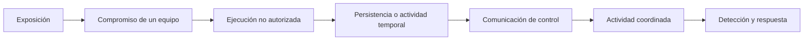
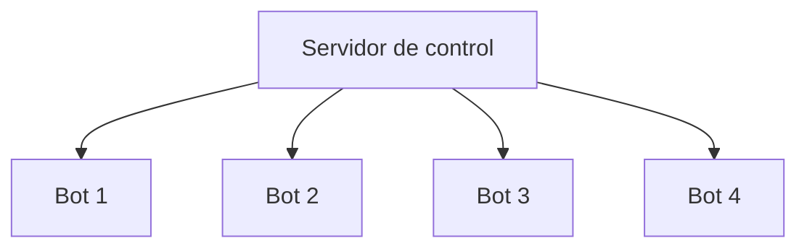
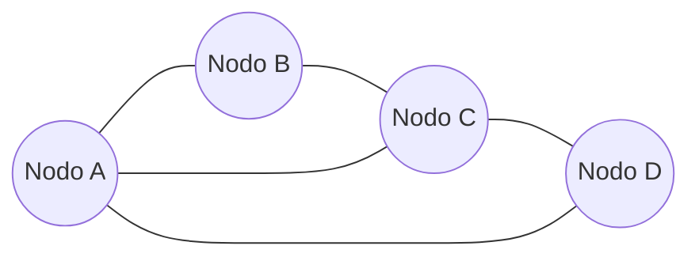
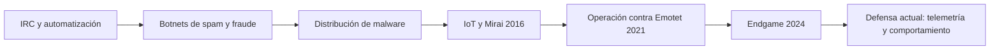
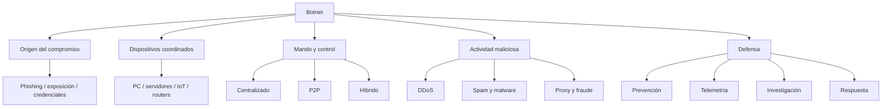
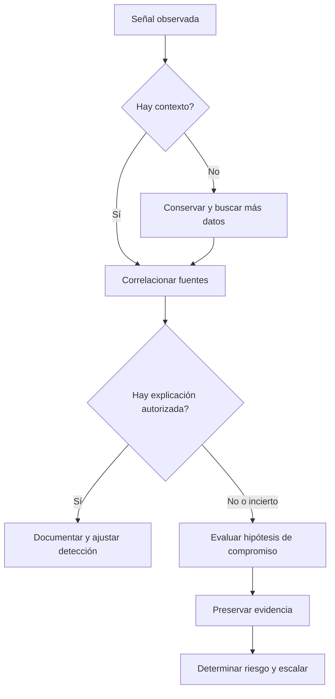

# Botnets — Guía completa de estudio para Blue Team y SOC

> Documento independiente de las unidades de ciberseguridad. Está pensado como material de referencia para GitHub: conceptos, historia, arquitectura, análisis de tráfico, investigación de incidentes y ejemplos resueltos.
>
> **Alcance:** los ejemplos técnicos son sintéticos o se basan en hechos públicos documentados. Las direcciones de ejemplo usan los bloques reservados `192.0.2.0/24`, `198.51.100.0/24` y `203.0.113.0/24`. No son indicadores de compromiso reales.
>
> **Enfoque:** defensa, análisis de telemetría, prevención y respuesta. Se describe el funcionamiento de la amenaza sin detallar procedimientos para infectar equipos, montar una infraestructura clandestina ni ejecutar ataques.

## Índice

1. [Qué es una botnet](#1-qué-es-una-botnet)
2. [Vocabulario fundamental](#2-vocabulario-fundamental)
3. [Historia y evolución](#3-historia-y-evolución)
4. [Cómo se forma una botnet](#4-cómo-se-forma-una-botnet)
5. [Cómo se controla: mando y control](#5-cómo-se-controla-mando-y-control)
6. [Arquitecturas centralizadas, P2P e híbridas](#6-arquitecturas-centralizadas-p2p-e-híbridas)
7. [Protocolos y comunicación](#7-protocolos-y-comunicación)
8. [DNS, DGA, fast-flux y rotación](#8-dns-dga-fast-flux-y-rotación)
9. [Familias y tipos de botnets](#9-familias-y-tipos-de-botnets)
10. [Qué hacen las botnets](#10-qué-hacen-las-botnets)
11. [DoS, DDoS y amplificación](#11-dos-ddos-y-amplificación)
12. [Botnets IoT, routers y dispositivos de borde](#12-botnets-iot-routers-y-dispositivos-de-borde)
13. [Botnets corporativas y redes de proxies](#13-botnets-corporativas-y-redes-de-proxies)
14. [Infraestructura y economía criminal](#14-infraestructura-y-economía-criminal)
15. [Casos históricos y lecciones](#15-casos-históricos-y-lecciones)
16. [Cómo detectar señales en el endpoint](#16-cómo-detectar-señales-en-el-endpoint)
17. [Cómo detectar señales en la red](#17-cómo-detectar-señales-en-la-red)
18. [Cómo buscar señales en DNS](#18-cómo-buscar-señales-en-dns)
19. [Cómo distinguir una señal de una prueba](#19-cómo-distinguir-una-señal-de-una-prueba)
20. [Investigaciones sintéticas resueltas](#20-investigaciones-sintéticas-resueltas)
21. [Consultas defensivas de ejemplo](#21-consultas-defensivas-de-ejemplo)
22. [Respuesta a incidentes y erradicación](#22-respuesta-a-incidentes-y-erradicación)
23. [Prevención y arquitectura defensiva](#23-prevención-y-arquitectura-defensiva)
24. [IoC, IoA, ATT&CK y cobertura](#24-ioc-ioa-attck-y-cobertura)
25. [Dudas y errores frecuentes](#25-dudas-y-errores-frecuentes)
26. [Mapas conceptuales](#26-mapas-conceptuales)
27. [Glosario](#27-glosario)
28. [Fuentes y lecturas recomendadas](#28-fuentes-y-lecturas-recomendadas)

---

## 1. Qué es una botnet

Una **botnet** es una red de dispositivos comprometidos que un operador puede coordinar para realizar tareas sin la autorización de sus dueños. Cada dispositivo controlado suele llamarse **bot**, **zombi** o **nodo**. El responsable de dirigir esa actividad puede denominarse **botmaster** u operador.

La palabra viene de *robot network*. Lo importante no es el tipo de dispositivo, sino la capacidad de coordinar varios equipos. Una botnet puede reunir computadoras, servidores, cámaras, grabadores de video, routers, sistemas IoT e incluso recursos cloud que hayan quedado bajo control ajeno.

No toda red automatizada es una botnet maliciosa. Una empresa puede administrar miles de equipos mediante herramientas legítimas. La diferencia está en el **consentimiento, la finalidad y el control autorizado**. Tampoco es correcto decir que cualquier malware constituye una botnet: un programa malicioso aislado no necesariamente participa en una red coordinada.

### Una imagen mental

```text
                    OPERADOR NO AUTORIZADO
                             │
                   INFRAESTRUCTURA DE CONTROL
                       (directa o indirecta)
                             │
           ┌─────────────────┼──────────────────┐
           │                 │                  │
         BOT A             BOT B              BOT C
     PC comprometida   Cámara comprometida   Router
           │                 │                  │
           └─────────────────┴──────────────────┘
                 ACTIVIDAD COORDINADA
```

Este esquema es conceptual. Las botnets modernas pueden no tener un único servidor de control y su topología puede cambiar con el tiempo.

### ¿Que tienen de relevante?

Porque convierten una intrusión individual en capacidad colectiva. Una cámara doméstica puede tener poca potencia. Miles de cámaras actuando a la vez pueden generar grandes volúmenes de tráfico. Una computadora aislada puede emitir poco spam; miles pueden distribuir campañas a gran escala. Además, las IP observadas suelen pertenecer a víctimas intermedias, no a quienes dirigen la operación.

**En un SOC**, una pregunta clave sería: ¿este host está siendo atacado, está participando involuntariamente en una campaña, o simplemente se está comunicando con un servicio legítimo que se parece a uno malicioso?

## 2. Vocabulario fundamental

| Término | Significado operativo | Qué podría observar un defensor |
|---|---|---|
| Bot | Dispositivo que ejecuta órdenes de un operador no autorizado | Procesos, servicios o conexiones inesperadas |
| Botnet | Conjunto coordinado de bots | Patrones semejantes entre varios hosts |
| Botmaster | Operador que dirige o alquila la capacidad de una botnet | Generalmente no se identifica solo a partir de una IP |
| C2 / C&C | Command and Control, comunicación para dar instrucciones y recibir resultados | DNS, sesiones web, flujos de salida, telemetría del proceso |
| Beacon | Comunicación periódica o semiperiódica de contacto | Intervalos repetidos, con posibles variaciones |
| Payload | Componente o acción maliciosa ejecutada | Archivo, proceso, script o acción observable |
| Loader / dropper | Componentes que introducen o ejecutan otro componente | Relaciones entre procesos y descargas |
| DGA | Algoritmo de generación de dominios | Muchos dominios consultados y errores NXDOMAIN, según el caso |
| Fast-flux | Cambios frecuentes de IP asociadas a ciertos dominios | Historial DNS de alta rotación; no prueba por sí solo abuso |
| Sinkhole | Infraestructura controlada por defensores para desviar u observar conexiones | Resolución a destinos especiales y reportes de inteligencia |
| Takedown | Desarticulación de infraestructura, habitualmente legal y coordinada | Caída o sustitución de nodos C2, cambios de campañas |
| IoC | Indicador concreto, por ejemplo un hash o dominio | Coincidencias que necesitan contexto |
| IoA | Indicio conductual: lo que hace un actor o programa | Secuencias de comportamiento, más resilientes que una IP |

### Dos distinciones útiles

**Infección no significa control continuo.** Un equipo puede conservar un artefacto malicioso aunque su infraestructura de control haya desaparecido. Del mismo modo, un dispositivo puede tener comunicación sospechosa sin estar demostrado que recibió órdenes.

**Botnet no es sinónimo de DDoS.** Algunas botnets realizan DDoS, otras distribuyen malware, recolectan datos, hacen fraude o sirven como redes de proxy. Algunas hacen varias cosas en distintas etapas.

## 3. Historia y evolución

### Antecedentes: automatización, IRC y gusanos

En las décadas de 1980 y 1990 aparecieron bots legítimos que automatizaban tareas en redes y canales de conversación. En IRC (*Internet Relay Chat*) los bots podían moderar canales, responder comandos autorizados y mantener servicios. Esta posibilidad de administrar muchos clientes mediante mensajes influyó en las primeras generaciones de malware coordinado.

Las primeras botnets maliciosas importantes aprovecharon canales IRC para centralizar órdenes. Esto permitió que un operador controlara muchos equipos desde una infraestructura relativamente simple. La facilidad de administración venía acompañada de una debilidad: el canal o servidor central podía localizarse, bloquearse o intervenirse.

### Década de 2000: crecimiento y profesionalización

El aumento de conexiones permanentes y equipos domésticos facilitó que dispositivos comprometidos quedaran conectados durante mucho tiempo. Las botnets pasaron a utilizarse para spam masivo, fraude publicitario, robo de datos, ataques de disponibilidad y distribución de malware.

Se fueron adoptando mecanismos de comunicación web, redes distribuidas y sistemas de renovación de infraestructura. El operador intentaba que una baja de servidores no desarmara toda la operación.

### Década de 2010: IoT y malware como servicio

Dos cambios hicieron crecer el problema: la incorporación masiva de dispositivos conectados con seguridad deficiente y la separación de funciones criminales. Un grupo podía operar infraestructura, otro distribuir malware y otro contratar servicios. Las botnets dejaron de ser necesariamente un producto administrado por un solo actor.

En 2016, **Mirai** se volvió un ejemplo emblemático del uso de dispositivos IoT comprometidos para generar ataques DDoS. El estudio académico *Understanding the Mirai Botnet* analizó su crecimiento y documentó un máximo de aproximadamente 600.000 infecciones observadas durante el período de estudio. La cifra no debe interpretarse como cantidad constante de bots disponibles todo el tiempo.

### Década de 2020: cadenas criminales, resiliencia y desarticulaciones

El caso **Emotet** muestra cómo una amenaza puede evolucionar. Se identificó inicialmente como troyano bancario en 2014 y luego funcionó como una plataforma importante para abrir acceso y distribuir otras amenazas. En enero de 2021, autoridades de varios países coordinaron una interrupción de su infraestructura.

En mayo de 2024, la **Operación Endgame** coordinó acciones internacionales contra infraestructura asociada con varias familias de malware. Estas operaciones recuerdan algo importante: neutralizar servidores de control no equivale automáticamente a limpiar todos los dispositivos infectados.

### Qué cambió para Blue Team

Antes podía bastar con bloquear un dominio conocido. Hoy es frecuente que los operadores cambien destinos, utilicen servicios comunes o incorporen intermediarios. Por eso las defensas dependen cada vez más de **comportamientos, contexto y correlación entre fuentes**.

## 4. Cómo se forma una botnet

Una botnet no aparece de golpe. Normalmente hay una sucesión de etapas que conviene entender desde la investigación defensiva.



### Exposición

Puede haber dispositivos con firmware desactualizado, configuraciones por defecto, servicios innecesarios publicados, credenciales comprometidas o usuarios engañados mediante phishing. No todos los compromisos ocurren del mismo modo.

### Compromiso

La etapa de entrada depende del entorno. En una PC puede intervenir un correo malicioso o un programa descargado; en IoT puede tratarse de software sin parches o accesos inseguros. En una investigación no hay que atribuir el vector sin evidencia: la presencia del bot no demuestra cómo entró.

### Ejecución

Una vez que un componente no autorizado se ejecuta, puede intentar contactar infraestructura externa, descubrir información del dispositivo o preparar una actividad posterior. En endpoints modernos esa actividad podría verse en registros de procesos, antivirus o EDR. En cámaras o routers muchas veces no hay una fuente equivalente disponible.

### Persistencia

Algunas familias buscan sobrevivir a reinicios; otras dependen de reinfección o solo residen temporalmente. **Mirai clásico**, por ejemplo, mostró comportamientos propios de malware de memoria en ciertos dispositivos: reiniciar podía desalojarlo temporalmente, pero no corregía la exposición que permitía volver a comprometerlos.

### Registro y coordinación

Los bots suelen necesitar que su operador sepa que existen y que están disponibles. A partir de ese momento pueden recibir tareas, reportar resultados o funcionar como intermediarios. Desde Blue Team interesan los contactos salientes, las cuentas implicadas, los procesos que originaron la comunicación y las variaciones temporales.

### Ciclo de vida operativo

No todos los equipos participan continuamente. Puede haber bots apagados, desconectados, detrás de NAT o removidos por defensores. Por eso una cifra de “equipos infectados” no equivale necesariamente a potencia operativa instantánea.

## 5. Cómo se controla: mando y control

La infraestructura **Command and Control (C2)** sirve para comunicar órdenes o intercambiar datos con dispositivos comprometidos. En MITRE ATT&CK está relacionada con la táctica **TA0011**.

La comunicación puede adoptar dos formas generales:

- **Push:** la infraestructura envía una instrucción cuando dispone de un canal para hacerlo.
- **Pull:** el bot consulta periódicamente si existen tareas o nuevas instrucciones.

La segunda forma suele aparecer como *polling* o *beaconing*. Un patrón repetido a intervalos parecidos merece análisis, pero no debe confundirse automáticamente con malware: aplicaciones, agentes de monitoreo y actualizadores legítimos hacen lo mismo.

### Qué transporta ese canal, conceptualmente

Puede comunicar estados del dispositivo, disponibilidad, identificadores, instrucciones de trabajo o resultados. Los contenidos concretos varían según la familia y pueden estar cifrados u ofuscados.

### Cifrado y ocultamiento

Que un canal use HTTPS no lo vuelve legítimo. HTTPS protege la comunicación en tránsito, pero no verifica la intención de quien se comunica. A su vez, un tráfico cifrado no demuestra actividad maliciosa. La interpretación requiere combinar dominios, procesos, certificados, patrones temporales y contexto del negocio.

### La diferencia entre C2 e infraestructura de ataque

Un servidor C2 puede dar órdenes sin participar directamente en el volumen de tráfico final. Si varios bots realizan un DDoS, el destino atacado puede ver miles de IP de origen, pero no necesariamente la dirección del operador o del C2.

## 6. Arquitecturas centralizadas, P2P e híbridas

### Centralizada



**Ventaja para el operador:** permite administrar y coordinar con cierta facilidad.

**Desventaja:** los puntos centrales se convierten en objetivos de investigación, bloqueo o intervención.

**Señal defensiva típica:** muchos dispositivos contactan destinos comunes. No siempre; pueden existir intermediarios o varios dominios.

### Peer-to-peer (P2P)



En P2P, los nodos pueden intercambiar información o referencias a otros pares. No depende necesariamente de un único servidor. Esta arquitectura puede ser más resistente a una baja puntual, aunque genera retos de coordinación y puede dejar patrones de conexión entre pares.

**Señal defensiva:** un dispositivo empieza a establecer muchas relaciones poco habituales con otros equipos o destinos dispersos. Esto también puede ocurrir en software P2P legítimo, por lo que importa conocer qué aplicación genera las conexiones.

### Híbrida

Combina componentes centrales con distribución entre nodos o intermediarios. No siempre es posible clasificar una campaña en una sola categoría.

### Comparación

| Característica | Centralizada | P2P | Híbrida |
|---|---|---|---|
| Dependencia de pocos puntos | Mayor | Menor | Variable |
| Facilidad de observación del destino común | A veces mayor | Más difícil | Variable |
| Resiliencia ante baja de un servidor | Menor | Generalmente mayor | Depende del diseño |
| Telemetría interesante | Destinos compartidos | Relaciones entre pares | Destinos, pares y cambios |
| Riesgo de falso positivo | Servicios legítimos centralizados | Aplicaciones P2P legítimas | Ambos |

## 7. Protocolos y comunicación

Los canales de control pueden aprovechar protocolos habituales. No existe un puerto universal de botnets ni un único patrón válido.

### IRC

Es importante por su valor histórico. Algunas botnets tempranas utilizaron canales IRC como mecanismo de coordinación. Hoy aparece menos como arquitectura dominante de amenazas modernas, pero sigue siendo útil entenderlo.

### HTTP y HTTPS

El tráfico web permite mezclarse con comunicaciones comunes. Desde la defensa, importan la URL, host, método, agente de usuario, TLS, frecuencia y proceso originador, siempre que estén disponibles y respetando límites de privacidad.

### DNS

DNS puede servir para descubrir destinos de control, facilitar cambios de infraestructura o, en algunas campañas, transportar información. Sin embargo, volumen alto de consultas o nombres extraños no son pruebas concluyentes.

### TCP, UDP y otras capas

Distinguir el protocolo de transporte del propósito de la comunicación es fundamental. TCP/UDP por sí solos no clasifican a un flujo como C2. Un flujo a un puerto común también puede ser malicioso; un flujo a un puerto raro puede ser legítimo.

### Servicios y plataformas legítimas

Algunos actores intentan apoyarse en servicios públicos para ocultarse entre tráfico esperado. Una política de bloqueo basada solo en destinos puede ser difícil de aplicar sin afectar el negocio. En estos escenarios cobra relevancia el contexto del proceso y la identidad.

### Beaconing

Una señal clásica consiste en comunicaciones repetidas en ventanas similares:

```text
10:00:00  host-A → destino-X
10:05:02  host-A → destino-X
10:10:01  host-A → destino-X
10:15:03  host-A → destino-X
```

El intervalo ronda cinco minutos. **Eso permite formular una hipótesis, no confirmar un bot**. Un sensor legítimo puede reportar cada cinco minutos. Para mejorar la evaluación hay que revisar quién origina la conexión, si el destino está aprobado, cuándo comenzó el patrón y si coincide con eventos del endpoint.

## 8. DNS, DGA, fast-flux y rotación

### DGA: algoritmos de generación de dominios

Algunos programas maliciosos pueden calcular múltiples nombres candidatos para localizar infraestructura de control. El mecanismo se conoce como **Domain Generation Algorithm**.

Desde un SIEM, el patrón de interés podría incluir muchas consultas a dominios poco habituales, baja proporción de resoluciones exitosas y comportamiento compartido por endpoints afectados. No todos los DGA se comportan igual y muchos sistemas legítimos hacen consultas fallidas.

**No alcanza con un dominio largo o aparentemente aleatorio.** Los servicios de seguimiento, CDNs, protección web o telemetría pueden generar nombres poco legibles.

### Fast-flux

Un mismo nombre puede resolver a diferentes IP que cambian con frecuencia. La técnica puede ocultar infraestructura detrás de equipos intermediarios.

Para investigar conviene conservar una secuencia temporal de respuestas DNS, TTL y contexto de los ASNs o destinos. Es normal que las CDNs legítimas también roten IP con frecuencia, por eso la rotación sola no confirma abuso.

### Rotación de infraestructura

Los operadores pueden reemplazar hosts, dominios e intermediarios. Esto vuelve frágiles las reglas basadas en un solo IoC. Las detecciones orientadas al comportamiento suelen sostenerse mejor a lo largo del tiempo, aunque requieren más telemetría y validación.

### DNS sinkholing

Consiste en redirigir consultas o tráfico hacia infraestructura controlada por defensores, proveedores o autoridades para prevenir contactos y, en ciertos casos, observar el alcance de una campaña. Debe usarse en entornos y condiciones autorizadas; no equivale a una limpieza completa del host.

## 9. Familias y tipos de botnets

No existe una taxonomía perfecta porque se pueden clasificar por **dispositivo, arquitectura, finalidad o mecanismo de propagación**. Un mismo caso puede pertenecer a varias categorías.

### Por dispositivo

| Tipo | Activos frecuentes | Dificultad defensiva |
|---|---|---|
| PC / endpoint | Estaciones Windows o Linux | Se dispone de EDR y logs, si están configurados |
| Servidores | Máquinas expuestas, infraestructura cloud | Alto impacto y permisos relevantes |
| IoT | Cámaras, sensores, grabadores | Poca telemetría y firmware difícil de mantener |
| SOHO / routers | Equipos de red domésticos o de pequeñas oficinas | Su compromiso puede pasar desapercibido |
| Recursos cloud abusados | Instancias o cuentas comprometidas | Infraestructura elástica y rápido cambio |

### Por arquitectura

Centralizada, P2P e híbrida, como vimos antes.

### Por propósito

- Botnets de DDoS.
- Botnets de distribución de spam o campañas de phishing.
- Botnets utilizadas como loaders o infraestructura de entrega de malware.
- Botnets que ofrecen capacidad de proxy o retransmisión.
- Botnets orientadas a fraude o automatización abusiva.
- Botnets asociadas con robo de credenciales o información.
- Botnets que facilitan el abuso de recursos de cómputo, incluida criptominería no autorizada.

### Por etapa operativa

Algunas redes se dedican a obtener accesos; otras a alquilar capacidad; otras a ejecutar la acción final. Esto explica por qué atribuir una campaña completa a un solo actor es difícil y requiere inteligencia externa y evidencia adicional.

## 10. Qué hacen las botnets

### Ataques de disponibilidad

Varios bots generan tráfico hacia un servicio o infraestructura y superan su capacidad de respuesta. El resultado puede ser lentitud, timeouts o interrupción. Para el defensor es clave distinguir congestión legítima, error operativo y ataque coordinado.

### Spam y phishing a gran escala

Los equipos comprometidos pueden funcionar como nodos que envían mensajes o como infraestructura de apoyo. Se necesita revisar si la organización es receptora de una campaña o si sus propios equipos están participando involuntariamente en ella.

### Distribución de otras amenazas

Algunas botnets sirven como primera etapa y facilitan el ingreso de otras familias de malware. Es particularmente relevante porque descubrir un bot puede indicar exposición a una cadena más larga de incidentes.

### Redes proxy y anonimización del origen

Un dispositivo comprometido puede ser utilizado como intermediario. Esto complica la atribución: la IP visible de una acción puede corresponder a una casa, oficina o empresa ajena al operador real.

### Fraude y abuso de servicios

Actividad automatizada distribuida puede afectar cuentas, formularios, publicidad y plataformas. No todo tráfico de bots es malware: existen bots web legítimos, scraping autorizado o automatizaciones internas. El contexto de autorización sigue importando.

### Robo y explotación de recursos

En algunas campañas se extraen datos o credenciales; en otras se usa capacidad de procesamiento ajena. La clasificación concreta depende de la evidencia y no debe asumirse por pertenecer a una botnet determinada.

## 11. DoS, DDoS y amplificación

**DoS (Denial of Service)** busca degradar o impedir un servicio. **DDoS (Distributed Denial of Service)** emplea múltiples orígenes coordinados. Botnet y DDoS están relacionados, pero no son sinónimos.

### Tres categorías defensivas

1. **Volumétrica:** congestión por exceso de tráfico.
2. **De protocolo o estado:** agotamiento de recursos de red, sesiones o dispositivos intermedios.
3. **De aplicación:** grandes cantidades de operaciones aparentemente normales que consumen recursos del servicio.

### Reflexión y amplificación

A alto nivel, algunos ataques aprovechan sistemas intermediarios que responden a una dirección de origen falsificada. Eso complica el análisis porque el destino atacado puede recibir tráfico desde reflectores, no desde los dispositivos controlados que iniciaron la secuencia. La existencia de un reflector no significa que ese servidor sea un bot.

### Lo que miraríamos para responder

- Tasas de solicitudes, bytes y paquetes por segundo.
- Distribución de orígenes y regiones.
- Estado de la aplicación, balanceadores y colas.
- Errores 5xx, timeouts y saturación.
- Puertos, protocolos, servicios afectados y tipos de respuesta.
- Diferencias respecto del tráfico normal comparable.
- Impacto real en usuarios y objetivos de continuidad.

### Ejemplo resuelto

Un servidor normalmente recibe unas 1.200 solicitudes por minuto. En una ventana de diez minutos pasa a 65.000 solicitudes por minuto, desde numerosos orígenes, y los errores 503 aumentan fuertemente.

**Interpretación:** existe una anomalía intensa de disponibilidad compatible con un ataque distribuido. No se puede confirmar solo con esos números si todos los orígenes son bots. Haría falta correlacionar los patrones de solicitudes, la infraestructura y las métricas de aplicación.

**Respuesta inicial:** activar el procedimiento DDoS, trabajar con el proveedor de mitigación y preservar evidencias de métricas y logs. No es adecuado intentar bloquear a mano miles de IP sin valorar su impacto.

## 12. Botnets IoT, routers y dispositivos de borde

### Por qué estos equipos son atractivos

Muchos equipos están conectados permanentemente, requieren poca interacción de usuarios y no tienen un EDR convencional. Pueden quedar años sin actualizaciones de seguridad o utilizar configuraciones débiles. Algunos se reinician pocas veces, lo que permite que un compromiso pase inadvertido.

### Dispositivos frecuentes

Cámaras IP, DVR/NVR, routers SOHO, sistemas NAS, impresoras y otros aparatos conectados. Que un dispositivo sea IoT no significa que esté expuesto, y que esté expuesto no significa necesariamente que esté comprometido.

### Señales operativas

- Reinicios inexplicados o consumo anormal de recursos.
- Conexiones salientes a destinos no relacionados con su función.
- Intentos de conexión hacia otros dispositivos desde equipos que normalmente no lo hacen.
- Picos de tráfico iniciados por dispositivos que deberían tener comunicaciones previsibles.
- Cambios no aprobados de configuración.

### Qué hacer al confirmar un compromiso

Validar el alcance, aislar de manera proporcional, consultar guía del fabricante, actualizar o reinstalar firmware desde fuentes oficiales, reemplazar credenciales, revisar configuraciones y verificar si se requiere reemplazo del dispositivo. Reiniciar sin corregir la causa de exposición puede producir solo una mejora temporal.

## 13. Botnets corporativas y redes de proxies

En un entorno corporativo, los bots pueden comunicarse mediante proxies y dispositivos de seguridad existentes. Un SIEM puede ver la IP del proxy en lugar del endpoint real si los campos de origen no se conservan correctamente.

### Por qué NAT y proxies complican todo

Varias máquinas pueden compartir la misma IP pública. Si se correlaciona solo por esa dirección, se corre el riesgo de acusar al host equivocado. Es necesario conservar, cuando existan, identidad, IP privada, puertos de traducción, usuario autenticado, identificador de sesión y marcas de tiempo.

### Ejemplo breve

```text
09:10:01  10.10.1.8:51001  → NAT 198.51.100.20:62001 → destino
09:10:02  10.10.1.9:51002  → NAT 198.51.100.20:62002 → destino
```

**Conclusión:** dos equipos diferentes aparecen con la misma IP pública. Para atribuir un flujo concreto hace falta la combinación temporal y de puertos, no solo la IP.

### Riesgo para la reputación

Si una IP de una empresa participa involuntariamente en abuso, puede terminar en listas de bloqueo o generar quejas. Esto no demuestra que la empresa haya dirigido la actividad. El análisis debe distinguir víctima, intermediario, bot comprometido y operador.

## 14. Infraestructura y economía criminal

### Roles separados

En el ecosistema criminal pueden intervenir desarrolladores, distribuidores, operadores de infraestructura, brokers de acceso y clientes que contratan capacidad ilícita. Las atribuciones públicas suelen necesitar investigación policial, inteligencia de amenazas y análisis de múltiples campañas.

### Botnet como servicio

El concepto *botnet-as-a-service* describe el alquiler o comercialización de capacidad distribuida. No hay que confundirlo con herramientas legítimas de pruebas de carga autorizadas: lo que determina la ilegalidad es el uso no consentido y el perjuicio causado.

### Intermediarios

Servidores, dominios, proveedores y dispositivos ajenos pueden ser abusados para ocultar origen. El uso de recursos de terceros no implica que sus propietarios sean cómplices; podrían ser víctimas.

### Por qué persisten

La rentabilidad, la exposición de equipos sin mantenimiento y la facilidad para reemplazar infraestructura hacen que el problema reaparezca. Un takedown puede reducir capacidad, pero la prevención y la remediación de dispositivos comprometidos siguen siendo necesarias.

## 15. Casos históricos y lecciones

### Caso A — Mirai (2016)

**Hecho principal:** gran compromiso de dispositivos IoT y participación en ataques DDoS importantes. El análisis académico publicado en USENIX 2017 estudió la evolución de la familia y reportó un máximo aproximado de 600.000 infecciones observadas.

**Qué enseñó:** la debilidad de dispositivos pequeños, multiplicada a escala, puede tener consecuencias globales. También mostró la importancia de inventarios IoT, credenciales seguras y actualizaciones.

**Lo que no deberíamos concluir:** que toda cámara con consumo alto de red forma parte de Mirai o que cualquier DDoS está relacionado con Mirai.

### Caso B — Emotet (2014–2021 y evolución posterior)

**Hecho principal:** pasó de troyano bancario a plataforma de distribución y acceso. En enero de 2021 una operación internacional interrumpió su infraestructura, según Europol.

**Qué enseñó:** una botnet puede cumplir un papel de acceso inicial o distribución y facilitar ataques posteriores. Encontrar una infección no debe cerrar la investigación; hay que determinar si hubo otras etapas.

**Lo que no deberíamos concluir:** que todos los endpoints previamente afectados quedaron limpios como consecuencia de la desarticulación.

### Caso C — Operación Endgame (2024)

**Hecho principal:** el FBI y autoridades de distintos países describieron acciones coordinadas que comenzaron el 28 de mayo de 2024 y afectaron más de cien servidores asociados con infraestructura criminal.

**Qué enseñó:** la interrupción de ecosistemas requiere trabajo internacional, legal y técnico. Desde la empresa, siguen siendo indispensables el inventario de activos, la detección y la remediación local.

### Caso D — Redes de bots utilizadas como intermediarios

Las redes de proxies abusivas aprovechan direcciones de equipos de terceros para ocultar origen o repartir operaciones. Para un defensor, observar una IP residencial o corporativa en una investigación no determina automáticamente quién fue el actor responsable.

**Qué enseñó:** atribución de IP no es atribución de persona; hay que distinguir las capas del servicio y las fuentes de evidencia.

### Línea temporal de referencia



## 16. Cómo detectar señales en el endpoint

### Windows

Las fuentes pueden incluir Windows Event Logs, Sysmon, EDR y registros de antivirus. No hace falta memorizar una lista interminable de Event ID: lo central es vincular proceso, usuario, archivo, servicio y conexión.

**Preguntas útiles:**

- ¿Qué proceso originó la conexión?
- ¿Desde qué ruta se ejecutó y con qué argumentos?
- ¿Qué proceso lo inició?
- ¿El binario está firmado? ¿La firma es válida?
- ¿Qué cambió en servicios, tareas o mecanismos de inicio?
- ¿Cuándo comenzó la actividad y se repite en otros equipos?

### Linux

`journalctl`, auditd, registros de servicios, procesos y conexiones aportan distintas perspectivas. No todos los sistemas tienen las mismas fuentes habilitadas.

Un proceso desconocido ejecutado como root, con contactos salientes repetidos, merece revisión. Pero cada elemento aislado puede tener una explicación legítima: un agente de administración, un actualizador o una tarea interna.

### Artefactos relacionados

Hashes de archivos, creación de servicios, tareas programadas, entradas de inicio automático, cambios en privilegios, archivos nuevos y conexiones a destinos externos. No existe una única combinación universal que pruebe una botnet.

### Precaución con hashes

El mismo SHA-256 en varios equipos es un dato fuerte para vincular el mismo contenido, pero no demuestra por sí solo que haya una botnet activa. Un programa legítimo también puede estar instalado en miles de hosts; y un malware puede cambiar de hash entre variantes.

## 17. Cómo detectar señales en la red

### Flujos de red

NetFlow, IPFIX, Zeek y registros de firewalls pueden aportar metadatos de comunicaciones. Su utilidad depende de qué campos registran, su retención, el sampling y la sincronización horaria.

### Patrones posibles

- Muchos hosts conectándose a un destino inesperado.
- Un dispositivo IoT con tráfico saliente inusual.
- Contactos repetidos con periodicidad sospechosa.
- Nuevos destinos tras eventos de ejecución del endpoint.
- Volumen de tráfico incompatible con la función del activo.
- Intentos fallidos de comunicación a numerosos destinos.

### Limitaciones de un análisis de red

Una conexión no demuestra ejecución maliciosa. Un destino etiquetado por inteligencia puede alojar infraestructura compartida. Las IP se reasignan. Una CDN puede servir contenido legítimo y abusivo simultáneamente. NAT puede ocultar identidades. El tráfico cifrado puede reducir visibilidad del contenido.

### Línea de investigación razonable

1. Confirmar que el patrón existe en datos originales.
2. Localizar el host real, teniendo en cuenta NAT o proxy.
3. Identificar el proceso y la cuenta asociados, si hay telemetría.
4. Comparar con comportamiento esperado del activo.
5. Buscar señales de persistencia o actividad posterior.
6. Documentar qué está comprobado y qué es una hipótesis.

## 18. Cómo buscar señales en DNS

### Consultas que no resuelven

Un aumento de NXDOMAIN puede aparecer en ciertos DGA, pero también en software mal configurado o en errores de red. El porcentaje importa más cuando se compara con un baseline del equipo o del servicio.

### Dominios nuevos o poco frecuentes

Pueden ser relevantes si aparecen junto con ejecución sospechosa, conexiones externas y otros indicadores. Las aplicaciones modernas generan subdominios dinámicos legítimos, por lo que conviene revisar el contexto.

### Respuestas DNS variables

Una sucesión de IP distintas no prueba fast-flux malicioso. Hay que distinguir CDNs legítimas, balanceadores geográficos y rotación anómala mediante historial, TTL, características de infraestructura y telemetría complementaria.

### Qué información registrar

- Timestamp y zona horaria.
- Host o identidad que consultó.
- Nombre consultado.
- Tipo de registro.
- Código de respuesta.
- IP devueltas y TTL, si están disponibles.
- Proceso que originó la consulta, si hay sensor.

## 19. Cómo distinguir una señal de una prueba

Una regla puede detectar un **comportamiento compatible** con botnet sin identificar una familia concreta.

| Observación | Lo que permite decir | Lo que no permite decir |
|---|---|---|
| Contactos periódicos | Existe periodicidad | Hay C2 confirmado |
| Muchas consultas NXDOMAIN | Hay fallos de resolución | Existe DGA malicioso confirmado |
| IP con reputación negativa | Hay una coincidencia a revisar | El host está infectado sin dudas |
| Proceso nuevo y conexión externa | Hay relación temporal y posiblemente causal | El proceso pertenece a una botnet concreta |
| Miles de orígenes contra un servicio | Hay tráfico distribuido | Todos los orígenes son bots |
| Firma digital válida | El binario tiene una firma verificable | Su ejecución es legítima |

La mejor investigación combina **evidencia del endpoint**, **telemetría de red** y **contexto operativo**. Si falta una fuente, el informe debe reconocer esa limitación en vez de inventar certeza.

## 20. Investigaciones sintéticas resueltas

Los siguientes casos son inventados para practicar razonamiento defensivo. No representan incidentes reales ni dispositivos de terceros.

### Caso 1 — Cámara IP con tráfico anómalo

**Situación:** una cámara de un edificio normalmente envía video a un grabador interno. Durante una madrugada comienza a generar cientos de conexiones salientes a direcciones externas.

```text
01:12:05 camera-03 10.0.20.33 → 203.0.113.10  TCP
01:12:06 camera-03 10.0.20.33 → 203.0.113.11  TCP
01:12:07 camera-03 10.0.20.33 → 203.0.113.12  TCP
01:12:08 camera-03 10.0.20.33 → 203.0.113.13  TCP
```

**Análisis:** el patrón no coincide con la función conocida del dispositivo. No hay todavía evidencia suficiente para afirmar Mirai o una familia específica. El inventario permite comprobar qué destinos estaban aprobados.

**Conclusión:** actividad de red anómala compatible con posible compromiso del dispositivo. Priorizar revisión de firmware, credenciales, exposición, egress y aislamiento controlado.

### Caso 2 — Beacon de cinco minutos que resultó benigno

**Situación:** un equipo consulta repetidamente un destino externo cada cinco minutos. La detección inicial lo clasifica como posible C2.

**Datos complementarios:** el proceso originador es un agente corporativo firmado y gestionado, instalado mediante una herramienta aprobada. El dominio pertenece a la plataforma interna de monitoreo.

**Conclusión:** falso positivo razonado. El intervalo periódico por sí solo no demuestra C2. El ajuste de regla debe considerar el proceso y los destinos aprobados, evitando excepciones demasiado amplias.

### Caso 3 — Contactos periódicos con ejecución sospechosa

**Situación:** un equipo empieza a conectarse repetidamente a un dominio no aprobado poco después de ejecutar un archivo desde una ruta temporal.

```text
09:00:14  ProcessCreate  endpoint-07  /tmp/update-check
09:00:48  DNS           endpoint-07  nodo-ejemplo.invalid
09:01:01  Network       endpoint-07  192.0.2.90:443
09:06:01  Network       endpoint-07  192.0.2.90:443
09:11:02  Network       endpoint-07  192.0.2.90:443
```

**Análisis:** la combinación de proceso inusual, contacto externo y recurrencia amerita prioridad mayor que la periodicidad aislada. Todavía falta conocer la naturaleza del contenido y si existe autorización.

**Conclusión:** actividad sospechosa de posible canal de control; preservar artefactos y realizar triage de endpoint y red. No atribuir a una familia sin pruebas adicionales.

### Caso 4 — DGA aparente provocado por un error de aplicación

**Situación:** un host genera numerosos NXDOMAIN con nombres dinámicos. La regla de detección marca posible DGA.

**Dato decisivo:** un servicio interno despliega nombres de prueba erróneos por una actualización de configuración. Los cambios aparecen documentados y el problema se reproduce sin ningún archivo desconocido o actividad externa anómala.

**Conclusión:** la señal de DNS es real, pero su causa es un error operativo. Debe corregirse la configuración y, si corresponde, ajustar la regla para incorporar más contexto.

### Caso 5 — Tráfico DDoS contra una web

**Situación:** el servicio recibe picos de solicitudes simultáneas desde miles de direcciones; aumentan las respuestas 503 y la latencia.

**Análisis:** el impacto de disponibilidad está demostrado. La distribución de orígenes es compatible con un DDoS, aunque no confirma una botnet específica.

**Conclusión:** activar mitigación con proveedor, capturar métricas, registrar la ventana temporal e investigar las características de las solicitudes para determinar qué controles ayudan sin bloquear usuarios legítimos.

### Caso 6 — Una IP pública compartida

**Situación:** un proveedor informa tráfico sospechoso desde `198.51.100.24`. El equipo SOC observa cuatro usuarios navegando por la misma salida NAT.

**Dato decisivo:** la tabla de traducción muestra que solo un host interno corresponde al puerto y a la hora implicados.

**Conclusión:** no atribuir actividad a los cuatro usuarios. La combinación IP pública, puerto traducido y tiempo permite reducir el alcance al host correcto.

### Caso 7 — Hash conocido sin infección confirmada

**Situación:** una herramienta detecta un archivo cuyo hash coincide con una muestra asociada públicamente a malware.

**Dato adicional:** el archivo está almacenado en un repositorio de investigación, sin evidencia de ejecución y bajo controles autorizados.

**Conclusión:** existencia de artefacto sospechoso, no prueba de bot activo. Verificar propósito, controles, origen y evidencias de ejecución antes de escalar como compromiso.

### Caso 8 — Emisión de correo desde un equipo que no debería enviar

**Situación:** un PC de usuario genera tráfico SMTP saliente a muchos destinos, fuera del patrón conocido de la empresa.

**Análisis:** el comportamiento es compatible con abuso de correo y merece revisión de proceso, conexiones, credenciales y registros del servidor de correo.

**Conclusión:** posible participación involuntaria en distribución de mensajes, todavía sin atribución de familia. Se recomienda preservar evidencias y aplicar controles de salida según el procedimiento.

### Caso 9 — DNS sinkhole detecta dispositivos antiguos

**Situación:** el DNS corporativo registra consultas de tres equipos hacia un dominio previamente intervenido y redirigido a infraestructura defensiva.

**Análisis:** esos equipos pueden contener componentes residuales, configuraciones antiguas o software malicioso activo. La redirección no confirma por sí sola ejecución presente ni remoción.

**Conclusión:** investigar cada host, su historial de procesos y los intentos asociados; completar remediación local y verificar que desaparezca el comportamiento.

### Caso 10 — Sospecha de proxy malicioso

**Situación:** una estación realiza comunicaciones frecuentes hacia múltiples servicios externos, y otros equipos aparecen conectándose a ella como intermediaria.

**Análisis:** el patrón es compatible con un servicio de proxy, pero puede corresponder a un software corporativo o una herramienta de desarrollo. Se revisan los procesos, puertos, cuentas y cambios aprobados.

**Conclusión:** posible capacidad de intermediación no autorizada, pendiente de comprobar. La detección no debe clasificarse como botnet sin validar la función real del equipo.

### Caso 11 — Una alerta por IP ya bloqueada

**Situación:** una IP figura en una lista de botnets, pero el firewall registra exclusivamente conexiones bloqueadas desde el inicio.

**Conclusión:** existe actividad de intento o coincidencia de inteligencia, pero no hay evidencia de sesión establecida. Es válido documentar el bloqueo como control efectivo, manteniendo la investigación proporcional.

### Caso 12 — Servidor comprometido con actividad posterior

**Situación:** un servidor presenta un nuevo servicio no aprobado, conexiones periódicas y una modificación de permisos fuera de mantenimiento.

**Conclusión:** la correlación aumenta la sospecha de compromiso. Recomendar triage y escalamiento; no afirmar que ya se probó exfiltración o atribución a un grupo determinado.

### Caso 13 — Flujo saliente legítimo muy voluminoso

**Situación:** una máquina realiza una transferencia grande a un proveedor externo.

**Dato adicional:** corresponde a una copia de seguridad autorizada, con job, ventana y destino registrados.

**Conclusión:** alto volumen no equivale a DDoS ni exfiltración. El contexto de negocio y la trazabilidad son fundamentales.

### Caso 14 — Routers con firmware antiguo

**Situación:** varios routers de sucursales tienen firmware fuera de soporte y muestran destinos de salida no documentados.

**Conclusión:** riesgo elevado y actividad a investigar. El firmware antiguo aumenta exposición, pero no prueba compromiso. Priorizar inventario, actualización o reemplazo, y restricciones de salida.

### Caso 15 — Dos hosts contactan el mismo destino

**Situación:** dos máquinas diferentes registran conexiones al mismo dominio poco frecuente en un intervalo breve.

**Análisis:** podría tratarse de una aplicación corporativa, infraestructura compartida o actividad coordinada. Se comparan procesos, usuario, resolución DNS y cambios recientes.

**Conclusión:** coincidencia interesante para correlación, insuficiente para afirmar que ambos son bots.

## 21. Consultas defensivas de ejemplo

Estas consultas son **modelos educativos**. Las tablas, índices y nombres de campos varían entre SIEM y entornos. Se deben adaptar y validar con datos propios antes de convertirlas en detecciones.

### KQL — destinos externos repetidos por host

```kql
// Ejemplo para una tabla normalizada ficticia: NetworkEvents
NetworkEvents
| where TimeGenerated > ago(24h)
| summarize Contacts=count(), FirstSeen=min(TimeGenerated), LastSeen=max(TimeGenerated)
    by DeviceName, DestinationIp
| where Contacts >= 20
| order by Contacts desc
```

**Qué responde:** qué parejas host-destino tienen muchos eventos. **Qué no responde:** si son maliciosos o si muestran periodicidad real. Para eso habría que analizar intervalos, fuente y contexto.

### SPL — destinos más frecuentes por origen

```spl
index=network sourcetype=network_flow earliest=-24h
| stats count as events dc(dest_ip) as distinct_destinations by src_ip
| sort -events
```

**Qué responde:** volumen aproximado y diversidad de destinos por IP de origen. **Limitación:** IP detrás de NAT puede no representar un único dispositivo y `count` cuenta eventos, no bytes.

### KQL — consultas DNS sin respuesta positiva

```kql
// Tabla normalizada ilustrativa: DnsEvents
DnsEvents
| where TimeGenerated > ago(1h)
| summarize Total=count(), Failed=countif(ResponseCode == "NXDOMAIN") by DeviceName
| extend FailureRatio = todouble(Failed) / todouble(Total)
| where Total >= 50 and FailureRatio > 0.6
| order by FailureRatio desc
```

**Qué responde:** hosts con alto porcentaje de fallos DNS y volumen mínimo. **Limitación:** un error de configuración puede producir el mismo patrón.

### Python — intervalos de contacto en dataset sintético

Este script es totalmente local y solo calcula intervalos entre horas suministradas. No abre conexiones ni genera tráfico.

```python
from datetime import datetime
from statistics import mean, pstdev

contacts = [
    "2026-10-25T10:00:00",
    "2026-10-25T10:05:02",
    "2026-10-25T10:10:01",
    "2026-10-25T10:15:03",
]

times = [datetime.fromisoformat(x) for x in contacts]
intervals = [
    (current - previous).total_seconds()
    for previous, current in zip(times, times[1:])
]

print("Intervalos (s):", intervals)
print("Promedio (s):", round(mean(intervals), 2))
print("Desvío estándar (s):", round(pstdev(intervals), 2))
```

**Resultado esperado:** intervalos cercanos a 300 segundos. La regularidad permite buscar contexto adicional; no clasifica por sí sola una infección.

### Idea de detección: IoT fuera de su perfil

Para una cámara puede construirse una detección defensiva que compare destinos y protocolos con una lista aprobada para ese modelo. El principio es entender primero cuál es su comportamiento esperado. Un límite fijo para todas las cámaras de todas las marcas generaría ruido y errores.

### Detección por comportamiento vs por indicador

Una regla que busque una IP conocida puede ser útil para respuesta rápida, pero envejece cuando la infraestructura rota. Otra que combine proceso nuevo, conexión inusual y patrón repetido puede mantenerse útil más tiempo, a costa de requerir más telemetría y ajustes.

## 22. Respuesta a incidentes y erradicación

### 1. Confirmación y alcance

Determinar qué dispositivos muestran el comportamiento, qué fuentes lo corroboran, cuándo comenzó y qué acciones se conocen. Evitar declarar una infección generalizada por un único IoC.

### 2. Preservación de evidencia

Guardar registros, exportaciones, artefactos relevantes, horarios, hashes y la cadena de manejo de evidencia. La recolección debe ajustarse a procedimientos aprobados.

### 3. Contención

Reducir comunicaciones de control y exposición de forma proporcional al riesgo. En endpoints puede implicar aislamiento mediante EDR. En IoT suele requerir segmentación o controles de red. Hay que evaluar continuidad operativa: desconectar un dispositivo industrial o médico sin coordinación puede ser peligroso.

### 4. Erradicación

Eliminar componentes maliciosos, corregir la vía de entrada, actualizar firmware o software, reemplazar contraseñas y revisar configuraciones. En ciertos dispositivos es más seguro reemplazar hardware que intentar una limpieza incierta.

### 5. Recuperación

Restablecer servicios, monitorizar conexiones y confirmar que el comportamiento desapareció. **Silencio de una alerta no siempre equivale a recuperación:** pudo perderse un log o cambiar el destino.

### 6. Lecciones aprendidas

Actualizar inventarios, reglas, controles de acceso, segmentación y procesos de actualización. Documentar qué señales funcionaron y cuáles faltaron.

### Qué no haría

- No ejecutaría archivos sospechosos en la estación de trabajo habitual.
- No contactaría infraestructura atribuida a una campaña para “probar” que responde.
- No borraría evidencia para liberar espacio antes de preservarla.
- No bloquearía indiscriminadamente servicios compartidos sin evaluar impacto.
- No publicaría IP privadas reales, identidades ni credenciales en GitHub.

## 23. Prevención y arquitectura defensiva

### Para endpoints

Actualizaciones, EDR/antimalware bien configurado, privilegios mínimos, protección de credenciales, filtros de correo y navegación, y control de ejecución. La protección aislada no elimina todas las amenazas.

### Para redes

Segmentación, visibilidad de DNS, controles de salida, políticas de egress, registro de firewalls, monitoreo de anomalías y capacidad de respuesta con el proveedor de conectividad.

### Para IoT

Inventario por modelo y firmware, credenciales únicas y seguras, desactivar servicios innecesarios, evitar administración expuesta, segmentación, actualización del fabricante y reemplazo de equipos fuera de soporte.

### Para servicios públicos

Mitigación DDoS, CDN y WAF cuando corresponda, capacidad de absorber picos, monitoreo de disponibilidad, alertas útiles y planes de continuidad. Un WAF no sustituye todos los controles de red.

### Para el SOC

Telemetría suficiente, relojes sincronizados, retención adecuada, pruebas de detección, automatización controlada y un proceso claro de escalamiento. Revisar regularmente si una regla genera alertas que nadie puede investigar con la información disponible.

### Matriz práctica

| Riesgo | Prevención | Detección | Respuesta |
|---|---|---|---|
| IoT comprometido | Firmware y segmentación | Tráfico inusual por activo | Aislar, actualizar o reemplazar |
| C2 en endpoint | Hardening, EDR y egress | Proceso + destino + recurrencia | Investigar, preservar, contener |
| DDoS | Mitigación y resiliencia | Métricas y patrones de acceso | Proveedor, continuidad y ajustes |
| Spam saliente | Controles de correo y salida | SMTP inesperado | Revisar host y credenciales |
| Bot como proxy | Segmentación y control de software | Conexiones y servicios intermediarios | Validar servicio, aislar según riesgo |

## 24. IoC, IoA, ATT&CK y cobertura

### Indicadores de compromiso (IoC)

Hashes, dominios, IP, certificados o artefactos concretos. Son útiles para búsqueda retrospectiva, pero requieren una evaluación de vigencia, precisión y contexto.

### Indicadores de ataque o comportamiento (IoA)

Relaciones y secuencias: proceso inusual, persistencia, comunicación de salida y actividad posterior. Pueden ayudar aunque cambien los dominios usados por el operador.

### MITRE ATT&CK

ATT&CK es una base de conocimiento de tácticas y técnicas; no es una herramienta que ejecute detecciones automáticamente. Para botnets destacan conceptos de:

- **Command and Control (TA0011)**.
- Uso de protocolos de aplicación para comunicaciones de control (**T1071** y subcategorías relevantes).
- Resolución dinámica (**T1568**).
- Uso de infraestructura comprometida o adquirida, incluidas botnets (**T1584.005**, **T1583.005**).
- Denegación de servicio de red (**T1498**).

Las denominaciones y versiones de ATT&CK evolucionan; es buena práctica consultar la ficha oficial antes de documentar una detección como cobertura real.

### Cobertura real

No alcanza con escribir “detectamos C2”. Hay que poder contestar qué fuentes tenemos, qué campos conservamos, qué escenarios probamos y cuál es el nivel de confianza.

Un ejemplo: si disponemos solo de NetFlow, podemos ver frecuencia y volumen, pero quizá no conocer el proceso responsable. En cambio, Sysmon o un EDR puede vincular flujos a procesos en endpoints Windows, si la configuración lo permite. La combinación es mucho más útil.

## 25. Dudas y errores frecuentes

### “¿Una botnet tiene que incluir miles de equipos?”

No. Puede ser pequeña. La escala afecta su capacidad, pero no la definición.

### “¿Todas las botnets atacan páginas?”

No. Algunas hacen spam, fraude, distribución de malware, proxificación o varias funciones.

### “¿Una botnet es un virus?”

No exactamente. El malware que compromete un equipo puede incluir virus, gusanos, troyanos u otros componentes. La botnet es la red coordinada resultante.

### “¿Si veo un beacon cada cinco minutos ya confirmé C2?”

No. Es una señal; necesita contexto.

### “¿HTTPS evita que exista C2?”

No. Cifrar el tráfico no garantiza legitimidad de sus participantes.

### “¿Si un dominio cambia muchas IP es fast-flux?”

No necesariamente. Las CDNs y el balanceo legítimo también lo hacen.

### “¿Reiniciar un equipo IoT elimina siempre la infección?”

No. Puede cesar temporalmente una amenaza residente en memoria, pero la exposición puede permanecer y permitir otra infección.

### “¿Una IP de botnet identifica al atacante?”

No. Puede corresponder a una víctima o intermediario.

### “¿Un takedown limpia automáticamente los equipos?”

No. Interrumpir infraestructura de control y remediar hosts son tareas distintas.

### “¿El hash igual prueba que el archivo es seguro?”

No. Prueba coincidencia con un contenido concreto con enorme confianza práctica, pero la seguridad y legitimidad dependen de más factores.

### “¿Puedo detectar todo con un SIEM?”

No. Si faltan sensores o hay pérdida de registros, aparecen puntos ciegos. El SIEM interpreta la información que recibe; no reemplaza controles preventivos ni investigación.

### “¿Qué es más importante: un dominio sospechoso o una secuencia de actividad?”

Depende del caso, pero una secuencia respaldada por múltiples fuentes suele dar más contexto y reducir errores de interpretación.

## 26. Mapas conceptuales

### Mapa general



### Cómo pasa de señal a conclusión



### Detección por capas

```text
DISPOSITIVO                     RED                       SOC
───────────                     ───                       ───
Procesos          ─┐
Servicios          ├───────>   DNS / flujos   ─────────>  Correlación
Archivos           │           Firewall                 Triage
Identidad         ─┘           Proxy                    Evidencia
                                                        Decisión
```

### Botnet vs. DDoS

```text
BOTNET
  ├── puede generar DDoS
  ├── puede enviar spam
  ├── puede distribuir malware
  ├── puede funcionar como proxy
  └── puede realizar otras tareas coordinadas

DDoS
  ├── puede utilizar una botnet
  ├── puede combinar otros orígenes
  └── describe un ataque a la disponibilidad
```

## 27. Glosario

**Bot:** dispositivo controlado sin autorización, potencial integrante de una red coordinada.

**Botmaster:** actor que dirige actividad de bots o contrata su capacidad.

**C2 / C&C:** canal o infraestructura de comunicación con dispositivos comprometidos.

**Beacon:** contacto recurrente entre un dispositivo y un destino.

**Botnet IoT:** conjunto coordinado de dispositivos conectados comprometidos.

**DDoS:** ataque distribuido contra disponibilidad.

**DGA:** mecanismo para producir dominios candidatos, incluido su uso malicioso.

**Fast-flux:** asociación cambiante de dominios a direcciones IP, que puede usarse para ocultar infraestructura.

**Sinkhole:** destino controlado para desviar, observar o bloquear comunicaciones en condiciones autorizadas.

**IoC:** indicador concreto asociado con actividad sospechosa o comprometida.

**IoA:** comportamiento o patrón que puede indicar actividad adversaria.

**EDR:** tecnología de detección y respuesta en endpoints.

**NDR:** detección y respuesta a partir de actividad de red.

**SIEM:** centralización, consulta, correlación y gestión de eventos de seguridad.

**NAT:** traducción de direcciones de red; complica la atribución basada solo en IP pública.

**IoT:** Internet of Things, conjunto de dispositivos conectados con finalidades específicas.

**SOHO:** Small Office/Home Office; término habitual para infraestructura de redes pequeñas.

**Takedown:** acción de interrupción o incautación de infraestructura, con componentes legales y técnicos.

**Telemetría:** conjunto de señales que describen actividad y estado de sistemas.

**Baseline:** referencia del comportamiento esperado para comparar anomalías.

**Triage:** evaluación inicial para clasificar, priorizar e investigar una alerta.

## 28. Fuentes y lecturas recomendadas

Las fuentes públicas ayudan a estudiar **conceptos, técnicas y casos históricos**. Una detección operativa siempre requiere información adicional del propio entorno.

1. FBI / IC3. **Botnets, DDoS, and TDoS**. https://www.ic3.gov/CrimeInfo/Botnet-DDoS
2. MITRE ATT&CK. **Command and Control (TA0011)**. https://attack.mitre.org/tactics/TA0011/
3. MITRE ATT&CK. **Enterprise Techniques** (incluye infraestructura botnet y resolución dinámica). https://attack.mitre.org/techniques/
4. Antonakakis y colaboradores. **Understanding the Mirai Botnet** (USENIX Security 2017, publicación de Google Research). https://research.google/pubs/understanding-the-mirai-botnet/
5. Europol. **World's most dangerous malware EMOTET disrupted through global action**, 27 de enero de 2021. https://www.europol.europa.eu/media-press/newsroom/news/world%E2%80%99s-most-dangerous-malware-emotet-disrupted-through-global-action
6. FBI. **Operation Endgame: Coordinated Worldwide Law Enforcement Action Against Network of Cybercriminals**, 30 de mayo de 2024. https://www.fbi.gov/news/press-releases/operation-endgame-coordinated-worldwide-law-enforcement-action-against-network-of-cybercriminals
7. Microsoft Learn. **Threat intelligence threat types**, categorías Botnet y C2. https://learn.microsoft.com/en-us/entra/global-secure-access/reference-threat-intelligence-threat-types
